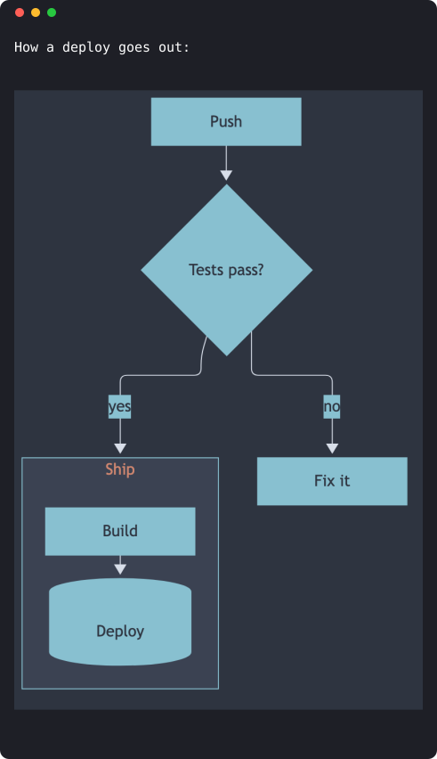
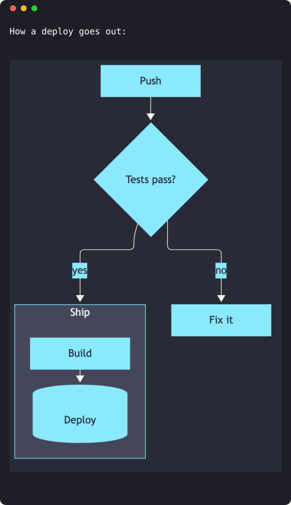
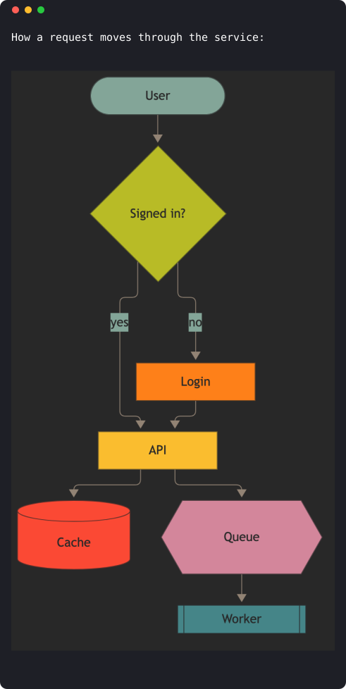
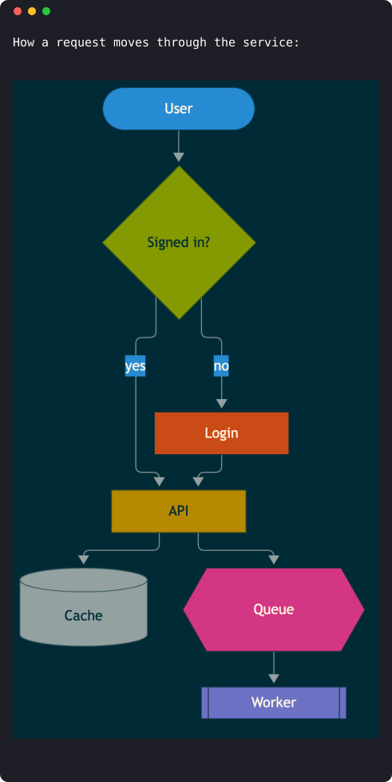

<p align="center"></p>

# mermaid-tty

**Yet, just another Mermaid renderer for your terminal**

[](https://github.com/D0n9X1n/mermaid-tty/actions/workflows/ci.yml)
[](https://github.com/D0n9X1n/mermaid-tty/releases)
[](LICENSE)
[](https://github.com/D0n9X1n/mermaid-tty/stargazers)
[](https://docs.anthropic.com/en/docs/claude-code/plugins)
[](https://mermaid.js.org/intro/)
[](https://github.com/D0n9X1n/mermaid-tty/blob/main/package.json)
[](https://github.com/D0n9X1n/mermaid-tty/blob/main/.github/workflows/ci.yml)

Claude replies with a `mermaid` block; your terminal shows the diagram. mermaid-tty is a Claude Code plugin that draws every closed Mermaid fence as a colored diagram sized to your window, or as Mermaid's own picture where the terminal can show one.


## Previews

**From a block of source to a diagram**, drawn in box-drawing text that fits your terminal's width:

| Without mermaid-tty | With mermaid-tty |
|---|---|
|  |  |

**Mermaid's own picture**, in kitty, Ghostty and SonicTerm: every node in its own palette color, on your theme's background:


| nord | dracula |
|---|---|
|  |  |
| **gruvbox** | **solarized** |
|  |  |

**Thirteen diagram types**, each laid out for the terminal:


| | |
|---|---|
|  |  |
|  |  |
|  |  |

**Six themes**: follow your Claude Code theme, pick a curated palette, or go `mono`:

| default | nord | dracula |
|---|---|---|
|  |  |  |
| **gruvbox** | **solarized** | **mono** |
|  |  |  |

## Features

- **13 diagram types:** `flowchart`, `sequence`, `state`, `class`, `er`, `mindmap`, `gantt`, `pie`, `gitGraph`, `timeline`, `journey`, `xychart` and `quadrant`.
- **Faithful or nothing.** Each diagram is drawn whole and checked before it's shown. If it can't be drawn as Mermaid means it, mermaid-tty falls back to the source, never a guess.
- **Fits your terminal.** No row is wider than your window's columns: gaps tighten, labels wrap, and wide graphs turn vertical.
- **Exact CJK widths.** Chinese, Japanese and Korean labels take two columns each, so every line meets.
- **Pictures where they work.** In kitty, Ghostty and SonicTerm, and inside tmux through a launcher, Mermaid's own picture replaces the text, drawn in your theme.
- **Six themes.** `default` follows your Claude Code theme; `nord`, `dracula`, `gruvbox` and `solarized` use their official colors; `mono` draws without color.
- **The source stays yours.** The transcript keeps the Mermaid text, `/copy` copies it exactly, and one command shows it again.
- **Nothing else to install, nothing left behind.** Pure TypeScript on macOS, Linux and Windows: no build step, no runtime dependencies, and no picture files once a session closes.
- **Made for the CLI.** It works in Claude Code's terminal; the desktop app and SDK keep their own drawing.

## Quick start

```sh
claude plugin marketplace add D0n9X1n/mermaid-tty
claude plugin install mermaid-tty@mermaid-tty --config theme=default
```

Start a new Claude Code session (2.1.287 or later) and ask for a diagram. For pictures in kitty, Ghostty or SonicTerm, also install [mermaid-cli](https://github.com/mermaid-js/mermaid-cli): `npm i -g @mermaid-js/mermaid-cli`.

| Command | What it does |
|---|---|
| `/mermaid-tty diagram` | Draws diagrams, as pictures where the terminal shows them (the default) |
| `/mermaid-tty text` | Draws diagrams as text, even where pictures work |
| `/mermaid-tty source` | Shows the Mermaid source, including replies already on screen |
| `/mermaid-tty images auto\|on\|off` | Pictures where detected, always, or never; kept across sessions |
| `/copy` | Copies a reply with its exact Mermaid source |

Pick a theme any time:

```sh
echo '{"theme":"nord"}' | claude plugin configure mermaid-tty@mermaid-tty --values-stdin
```

## Learn more

Everything else is in the wiki, in [English](https://github.com/D0n9X1n/mermaid-tty/wiki) and [简体中文](https://github.com/D0n9X1n/mermaid-tty/wiki/Home-zh-CN): every diagram's supported syntax, why a diagram falls back, terminals and fonts, pictures inside tmux, themes and their colors, how it works, and how to develop and release it.

[MIT](LICENSE) licensed.
