<p align="center">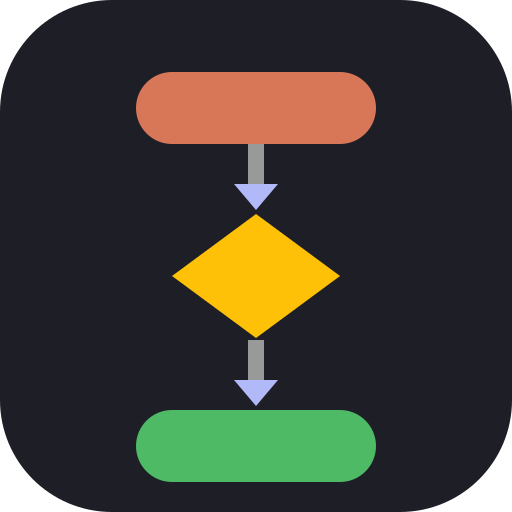</p>

# mermaid-tty

**Yet, just another Mermaid renderer for your terminal**

[](https://github.com/D0n9X1n/mermaid-tty/actions/workflows/ci.yml)
[](https://github.com/D0n9X1n/mermaid-tty/releases)
[](LICENSE)
[](https://github.com/D0n9X1n/mermaid-tty/stargazers)
[](https://docs.anthropic.com/en/docs/claude-code/plugins)
[](https://mermaid.js.org/intro/)
[](https://github.com/D0n9X1n/mermaid-tty/blob/main/package.json)
[](https://github.com/D0n9X1n/mermaid-tty/blob/main/package.json)
[](https://github.com/D0n9X1n/mermaid-tty/blob/main/.github/workflows/ci.yml)
[](https://github.com/D0n9X1n/mermaid-tty)
[](https://github.com/D0n9X1n/mermaid-tty/commits/main)
[](https://github.com/D0n9X1n/mermaid-tty/issues)

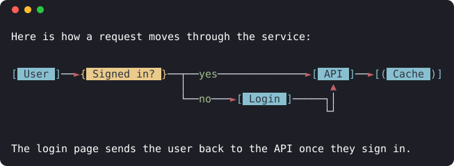

A Claude Code plugin (mod) that redraws closed `mermaid` fences in Claude's replies as colored, flat, box-drawing diagrams sized to your terminal, with exact CJK widths. The transcript keeps the Mermaid source. If a diagram can't be drawn faithfully, you get the source—not an approximation.

## Highlights

- **Faithful or nothing.** A diagram is drawn whole and checked before it's shown. If it can't be drawn as Mermaid means it, you get the source, never a guess.
- **13 diagram types**, from flowcharts and sequence diagrams to gantt, gitGraph, xychart and quadrant charts.
- **Fits your terminal.** No row is wider than your window: gaps tighten, labels wrap, and wide graphs turn vertical.
- **Exact CJK widths.** Wide characters take two columns, so Chinese, Japanese and Korean labels line up.
- **Themes.** Follows your Claude Code theme, or pick nord, dracula, gruvbox, solarized or mono.
- **Real images where they work.** In kitty, Ghostty and SonicTerm, Mermaid's own picture replaces the text drawing.
- **Nothing to install but the plugin.** Pure TypeScript, no build step, no runtime dependencies.
- **The transcript keeps the source.** `/copy` copies the exact Mermaid text, and one command switches back to source.

## Install

```sh
claude plugin marketplace add D0n9X1n/mermaid-tty
claude plugin install mermaid-tty@mermaid-tty --config theme=default
```

Needs Claude Code 2.1.287 or later, on macOS, Linux or Windows. Start a new Claude Code session after installing. No build step or runtime dependencies.

To update or remove it later:

```sh
claude plugin update mermaid-tty@mermaid-tty
claude plugin uninstall mermaid-tty@mermaid-tty
```

## Commands

| Command | What it does |
|---|---|
| `/mermaid-tty` | Reports the current mode |
| `/mermaid-tty diagram` | Draws diagrams, as pictures where the terminal can show them (the default) |
| `/mermaid-tty text` | Draws diagrams as text, even where pictures work |
| `/mermaid-tty source` | Shows the Mermaid source, including replies already on screen |
| `/copy` | Copies a reply with its exact Mermaid source, in any mode |

## Before and after

| Before | After |
|---|---|
| 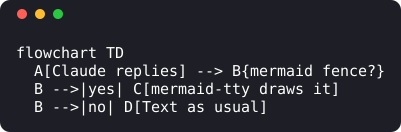 | 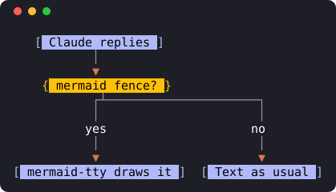 |

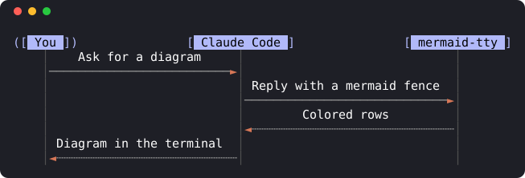

| | |
|---|---|
| 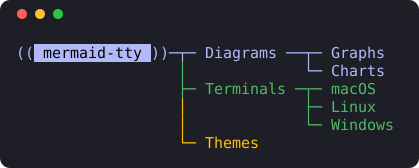 | 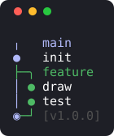 |
| 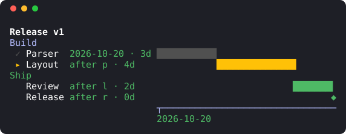 | 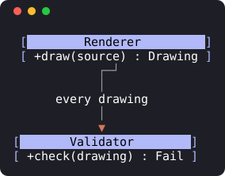 |
| 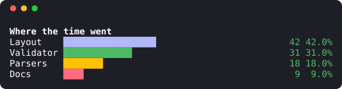 | |

## Images in kitty, Ghostty and SonicTerm

In a terminal that shows pixels, mermaid-tty swaps the text drawing for Mermaid's own picture once [mermaid-cli](https://github.com/mermaid-js/mermaid-cli) renders it in the background. The reply from the top of this page, in Ghostty:

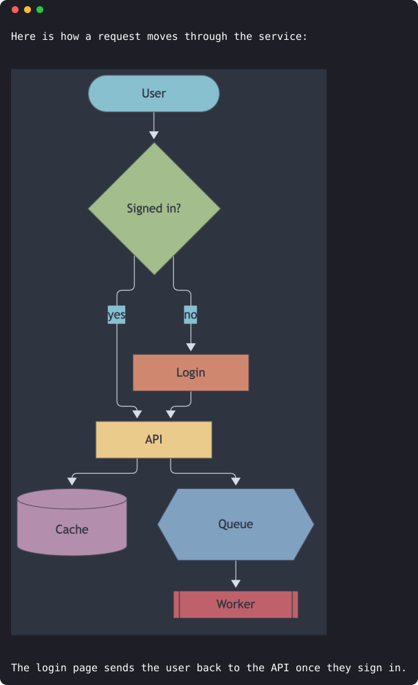

See the FAQ below for what it needs and how to turn it off.

## Supported diagrams

mermaid-tty draws these 13 types, within each type's supported syntax:

| Type | Header keywords |
|---|---|
| `flowchart` | `flowchart`, `graph` |
| `sequence` | `sequenceDiagram` |
| `state` | `stateDiagram`, `stateDiagram-v2` |
| `class` | `classDiagram`, `classDiagram-v2` |
| `er` | `erDiagram` |
| `mindmap` | `mindmap` |
| `gantt` | `gantt` |
| `pie` | `pie` |
| `gitGraph` | `gitGraph` |
| `timeline` | `timeline` |
| `journey` | `journey` |
| `xychart` | `xychart-beta`, `xychart` |
| `quadrant` | `quadrantChart` |

Other types or unsupported statements leave the original fence unchanged for Claude Code to display. mermaid-tty never draws only part of a diagram.

## Themes

Diagrams follow your Claude Code theme by default. Pick a curated palette, or `mono` for no color.

| default | nord |
|---|---|
| 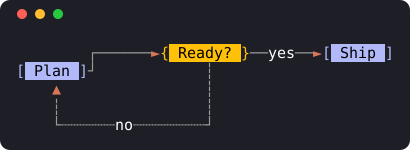 | 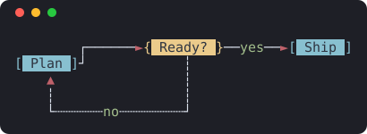 |
| **dracula** | **gruvbox** |
| 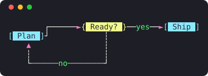 | 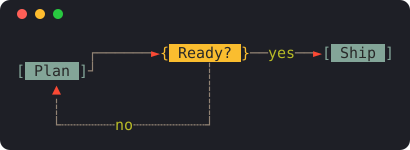 |
| **solarized** | **mono** |
| 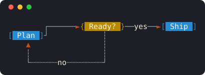 | 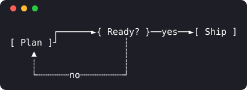 |

## How it works

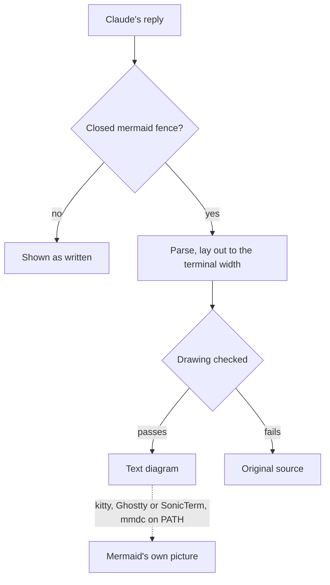

mermaid-tty only changes how a reply is shown. The reply, the transcript and `/copy` keep the Mermaid source. The [wiki](https://github.com/D0n9X1n/mermaid-tty/wiki) walks through each stage in its Architecture page.

## Configuration

| Option | Values | Default |
|---|---|---|
| `theme` | `default`, `nord`, `dracula`, `gruvbox`, `solarized`, `mono` | `default`: follow the Claude Code theme |

```sh
echo '{"theme":"nord"}' | claude plugin configure mermaid-tty@mermaid-tty --values-stdin
```

## FAQ

**Why do I sometimes see the Mermaid source?** mermaid-tty falls back to the original fence when it can't parse a diagram, doesn't support its syntax or type, or can't draw it faithfully within the available width. Unclosed fences stay as text. `claude --debug` logs fallback reasons.

**Which Mermaid features always show the source?** A few can't be drawn as Mermaid shows them in a terminal, so they fall back by design: `fa:` icons render as SVG or through Font Awesome CSS, `$$…$$` math needs typesetting, and `htmlLabels: false` follows different text rules. Whitespace that pie and gitGraph reject, such as an unquoted no-break space, fails in Mermaid too.

**How wide are diagrams?** No drawn row exceeds the terminal's columns. Depending on the type, mermaid-tty tightens gaps, wraps labels, turns horizontal graphs vertical, or moves text into a keyed legend. If nothing fits, it shows the source.

**Do CJK labels line up?** Yes. Wide characters count as 2 columns and combining marks as 0. Characters with unreliable terminal widths fall back rather than break alignment.

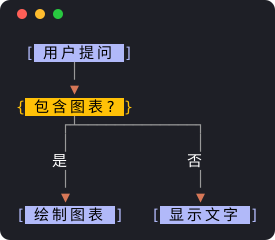

**How do I see the Mermaid source?** Run `/mermaid-tty source` to show diagrams as source, including replies already on screen. `/mermaid-tty diagram` draws them again; bare `/mermaid-tty` reports the current mode. `/copy` copies the exact Mermaid source in either mode.

**Can diagrams show as images?** Yes, in kitty, Ghostty and SonicTerm, if [mermaid-cli](https://github.com/mermaid-js/mermaid-cli) 11 or 12 is installed (`npm i -g @mermaid-js/mermaid-cli`, which puts `mmdc` on PATH). For a diagram mermaid-tty can parse, it draws the text version first, renders Mermaid's own picture in the background with Chromium cut off from the network, then swaps it in. Anywhere else, inside tmux, screen or Zellij, with the `mono` theme, or if `mmdc` is missing or fails, you keep the text drawing. Run `/mermaid-tty text` to keep text even where images work; `/mermaid-tty diagram` turns images back on.

**Can images show inside tmux or RMUX?** Yes, through `bin/claude-tmux.py`, a launcher that ships with the plugin. Inside a multiplexer Claude Code sends its kitty image commands unwrapped, and tmux and RMUX drop them. The launcher runs `claude` in a pty and rewraps those commands as tmux passthrough, which the multiplexer forwards. It needs Python 3.9 or later and passthrough turned on:

```tmux
# ~/.tmux.conf, or ~/.rmux.conf for RMUX
set -g allow-passthrough on
# RMUX only: tell it which terminal each client attaches from
set -ga update-environment TERM_PROGRAM
```

Then start Claude Code through it, for example with an alias:

```sh
alias claude='python3 ~/.claude/plugins/marketplaces/mermaid-tty/bin/claude-tmux.py'
```

It wraps only inside tmux or RMUX, with passthrough on, in an interactive terminal, when the terminal underneath is kitty, Ghostty or SonicTerm. tmux 3.3 and later report that from the attached client; RMUX keeps no such report, so there the launcher reads the session's `TERM_PROGRAM`, and only when `update-environment` refreshes it on every attach. Anywhere else it runs `claude` unchanged. With several clients attached, or after reattaching from another terminal, start Claude Code again: the launcher decides when it starts. Without the launcher, mermaid-tty keeps the text drawing inside tmux, screen and Zellij. Claude Code tracks wrapping the commands itself in [anthropics/claude-code#100146](https://github.com/anthropics/claude-code/issues/100146).

**Which platforms and terminals work?** macOS, Linux and Windows, in any terminal Claude Code supports: Windows Terminal; macOS Terminal, iTerm2 and Ghostty; and Linux terminals. Truecolor terminals show the palettes exactly; 256-color terminals use their available colors. Use a monospaced font with box-drawing and geometric-shape glyphs, plus a CJK font for CJK labels. Keep ambiguous-width characters set to one column so lines meet.

## Development

Use Node 24 or later and Claude Code. No build step is needed. From the repository root:

```sh
bash scripts/check.sh                   # must-pass suite; CI uses Git Bash on Windows
npm ci --prefix scripts/e2e             # the end-to-end job's pinned tooling
node scripts/e2e/run.ts                 # real Claude Code against a mock API, all six themes
node scripts/render-gallery.ts gallery  # the visual-review gallery, as SVG
node scripts/check-ci-coverage.ts       # every acceptance check has a CI step
```

CI runs checks and end-to-end tests on Linux, macOS and Windows. It runs the Node and docs tests separately from `check.sh`:

```sh
node --test
npm ci --prefix scripts/docs
node --test 'scripts/tests/*.docs-spec.ts'
node scripts/check-docs.ts
```

More in the [English](https://github.com/D0n9X1n/mermaid-tty/wiki) and [简体中文](https://github.com/D0n9X1n/mermaid-tty/wiki/Home-zh-CN) wiki.

## License

[MIT](LICENSE)
