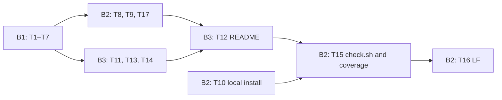

# mermaid-tty v1 B: docs, wiki, CI and release — Implementation Plan

**Goal:** A polished README, a bilingual wiki published the way SonicTerm's is, CI that runs every automatic acceptance check on Linux, macOS and Windows, and a verified `v1.0.0` release.

**Architecture:** Pure rule functions (`scripts/lib/doc-rules.ts`, `scripts/lib/ci-rules.ts`, `scripts/check-wiki.ts`) hold every B acceptance clause and are unit-tested with a fixture and one mutation per clause; thin Node runners apply them to the real files from `scripts/check.sh`. README images are SVGs drawn from `core/` output, one `<text>` per glyph at `x = col × CELL`. The workflows wire in A's harnesses (e2e, gallery, tangle, palettes, review hashes) and SonicTerm's wiki publisher, mirrored with one added `shell: bash`.

**Tech stack:** Node 24 type stripping (erasable TS, `node:test`, no dependencies), bash (Git Bash on Windows), GitHub Actions pinned by SHA, Claude Code 2.1.308 from npm, and `rsvg-convert` 2.63.4 plus `sips` on the dev Mac.

**Inputs:** the specs at `6c204f4` (spec B requirements 1–6; acceptance B1–B7, A8 platforms, A9, VR), the coordinator's notes of 2026-10-28 (three OSes, `►`/`◄` from core only, CI tests everything, `shell: bash`, E2E CI needs, the source view, a scheduled A9 run on each new Claude Code version) and the PM's decisions on plan B.

**Sub-plans:** [B1 infra](2026-10-28-mermaid-tty-v1-B1-infra.md) (T1–T7), [B2 CI and release](2026-10-28-mermaid-tty-v1-B2-ci-release.md) (T8–T10, T15–T17) and [B3 content](2026-10-28-mermaid-tty-v1-B3-content.md) (T11–T14) each hold their tasks with the code, under 500 lines apiece; see [Sub-plans](#sub-plans). The code ran on 2026-10-28 in a scratch tree against stub `core/` modules: 53 unit tests, `test-wiki-publish.sh`, `check-docs.ts`, `check-ci-coverage.ts` (48 IDs), `check-release.ts` and an offline local-marketplace install pass, and Ruby's YAML parser loads all four workflows.

**Commits:** one per task on `feat/v1`; each message ends with `Co-Authored-By: Claude Opus 5.5 (1M context) <noreply@anthropic.com>`.

## Design check

### Bottom-up: what exists

| Component | Job | Key files | Depends on | Evidence |
|---|---|---|---|---|
| SonicTerm wiki publisher | Mirror `wiki/*.md` into the `.wiki` clone; commit only on change | `scripts/publish-wiki.sh` | git | `publish-wiki.sh:26-50` |
| SonicTerm publish workflow | Run it on push to `main` and on dispatch, with a job-scoped write | `.github/workflows/publish-wiki.yml` | `GITHUB_TOKEN` | `:3-6` triggers, `:22-23` grant, `:27-41` clone, mirror, push if changed |
| SonicTerm publisher test | Throwaway repos: mirror, no-op, rename; workflow greps; checker mutations | `scripts/test-wiki-publish.sh` | publisher, checker | `:19-60`, `:62-99`, `:101-259` |
| SonicTerm wiki checker | Pairs, nesting, heading depths, links, Home links, crate list | `scripts/check-wiki.py` | git, cargo | `:65-83`, `:112-143`, `:211-254` |
| SonicTerm CI wiring | Wiki test on Ubuntu, and on Windows under Git Bash | `.github/workflows/ci.yml` | — | `:86-88`, `:727-729` |
| SonicTerm pin rule | `uses:` is a 40-hex SHA plus `# vX` | `scripts/check-workflow-supply-chain.py` | — | `:46-49`, `:493-511` |
| SonicTerm README hero | Centered logo, title, bold tagline, badges | `README.md` | — | `README.md:1-21` |
| mermaid-tty repo | Placeholder README, LICENSE, specs; the wiki repo already exists | — | — | `git ls-remote …mermaid-tty.wiki.git` → `master 9a0803f` |
| Claude Code 2.1.308 | `plugin validate`/`test` run offline with an empty HOME; `test` runs every `*.test.ts(x)` and rejects `node:` imports; `marketplace add ./` and `install` work offline in a fresh `CLAUDE_CONFIG_DIR`; the icon is a square PNG, 512–2048 px, under 2 MB | the binary | — | probes, 2026-10-28 |
| npm cmd-shim (npm 11.20) | Writes sh, `.cmd` and `.ps1` shims, so `claude` resolves in Git Bash | `cmd-shim/lib/index.js` | — | `:121-146`, `:234-243`; inferred until the first Windows run |
| A's and C's interfaces (planned) | Renderer, themes, width, glyphs, `check.sh`, e2e, gallery, review hashes, registry | `core/*`, `scripts/*` | — | design spec; acceptance A8–A10, VR; see D3 |

### Top-down

Requirements → responsibilities → components → tasks are in [Traceability](#traceability); every component in the map serves at least one row there.

### Reconcile

- **Normal path:** a PR edits a wiki pair → the `check` job (three OSes) runs `check.sh` → `check-wiki.ts` and `test-wiki-publish.sh` pass → merge → `publish-wiki.yml` mirrors `wiki/` → on `v1.0.0`, the `release-wiki` step diffs the published wiki against `wiki/`.
- **Failure path:** a zh-CN list item stays English → `check-wiki: wiki/Usage-zh-CN.md:12: untranslated, no CJK: …` → `check.sh` exits 1 under `set -euo pipefail` → `check` is red on all three OSes and the PR can't merge.

### Decisions

- **D1 Test names:** B's Node tests are `scripts/tests/*_test.ts`: `claude plugin test` runs every `*.test.ts(x)` and rejects `node:` imports (probed), and `node --test` still finds `*_test.ts`.
- **D2 SVG palette:** the default theme-key mapping resolves through Claude Code 2.1.308's built-in dark theme (the `rgb()` table whose `text` is `rgb(255,255,255)`, read from the binary), on canvas `#1e1f26`. Curated themes keep their own hex values.
- **D3 Assumed interfaces (confirm against plan A; C's `ENABLED` ids against plan C):** `renderMermaid(src, {columns, theme?})` → `{text, role}[][] | null`; `themes.ts` exports `DEFAULT` and `PALETTES` as `role → {fg, bg?, bold?}`, each a theme key or hex; `width(s)`; `check.sh` opens with `#!/usr/bin/env bash` then `set -euo pipefail`; `node scripts/e2e/run.ts [--installed CONFIG_DIR] [--claude-version V]` (A9.stored reads the transcript JSONL and stubs the clipboard) with `scripts/e2e/package-lock.json`; `node scripts/render-gallery.ts OUT_DIR`; `node scripts/check-review-hashes.ts`; `.gitattributes` keeps text LF; C's `ENABLED` ids. A mismatch touches only `render-image.ts`, the workflows or `ci/coverage.json`.
- **D4 Glyphs:** SVGs draw exactly the glyphs core emits: `misplaced()` compares every `<text>` with core's spans, and the window dots are SVG circles. `readmeErrors` rejects box-drawing or geometric glyphs typed into the README (U+2500–U+25FF). A's gallery reuses `styledRows`/`toSvg`. Review PNGs come from `rsvg-convert -z 2` on the Mac (probed with CJK and box drawing; `qlmanage` can't set a size, and Playwright is too heavy).
- **D5 Icon size:** `check-docs.ts` reads the PNG header on every OS; `make-icon.sh` also confirms it with `sips` on the Mac.
- **D6 Windows:** every step that runs a `.sh` file sets `shell: bash`; `check.sh` never masks a failure, so a failing native `claude plugin validate` or `test` fails the job. Runners use `node:path`/`fileURLToPath` and read with `\r\n` → `\n`; `test-local-install.sh` hands `claude.exe` a `cygpath -w` path.
- **D7 Triggers (accepted by the PM):** `ci.yml` runs on `pull_request` and on pushes to `main`, with Claude Code pinned at 2.1.308; feature-branch pushes are covered by their PR. `claude-code-versions.yml` runs every 4 hours and on dispatch: it lists the stable versions published to npm after the newest one in `tested.txt` on the `claude-code-tested` branch (oldest first, at most 20 per run; the latest alone when there is no record), runs A9 on each with `--claude-version` on three OSes, and records them only when every job passed. A failure is retried on the next run, and GitHub's failed-run notice is the alert. Only the `record` job, which pushes `claude-code-tested`, has a job-scoped `contents: write`; the workflow token is read-only, and `versionsErrors` checks both.
- **D8 Release:** the PM pushes the tag. `release.yml` checks tag = `plugin.json` version, publishes from `docs/release-notes/vX.Y.Z.md`, re-reads the published notes, diffs the wiki, installs from the GitHub marketplace into a fresh config, and runs A9 on that copy (ubuntu, tmux, `C.UTF-8`).
- **D9 Coverage:** check IDs are parsed with the acceptance file's rule and pinned by a test on the real file (48 IDs at 6c204f4); every check step has an `id:`; the judgment IDs (`VR.reviewers`, `VR.passes`, `B1.beauty-review`, `B2.translation-review`) map to `review-hashes`; `A6.in-claude-code`, `A9`, `A9.harness` and `A9.stored` map to `e2e`.
- **D10 E2E tooling:** tmux comes from apt or brew; Windows installs node-pty and @xterm/headless with `npm ci --prefix scripts/e2e` in that job only; no secrets.
- **D11 Not ported from SonicTerm:** the Home-link and crate rules (GitHub's sidebar lists the pages; there are no crates) and the `CLAUDE.md` greps.
- **D12 Source view:** ctrl+o does not show the source. The README FAQ and wiki Usage document `/mermaid-tty source`, `/mermaid-tty diagram`, bare `/mermaid-tty` and `/copy`; `readmeErrors` and `check-wiki.ts` require those commands and reject any claim that ctrl+o shows, reveals or displays the source. A9's run without truecolor asserts `38;5;n` on diagram rows (6c204f4), so CI tests the FAQ's 256-color claim.

## Test Strategy

Every check below is a CI step. The only human gates are the judgments, and CI pins each verdict by the SHA-256 of every reviewed file.

| Kind | What it proves | Command | CI step `id:` |
|---|---|---|---|
| Unit (`node:test`, 53 tests) | Markdown scanning; glyph cells and SVG; every B rule, each with a passing fixture and one mutation per clause; the 48 check IDs derived from the real acceptance file; the next Claude Code versions to test; every role resolves under every theme | `node --test 'scripts/tests/*_test.ts'` | `check` |
| Throwaway repos | Publisher: mirror, no-op, stale-page removal, rename. Checker: a valid fixture wiki passes, and 16 mutations each fail with their diagnostic | `bash scripts/test-wiki-publish.sh` | `check` |
| Real files | README, images (fresh render, glyph cells), the four workflows, the `check.sh` header, the icon header; the real wiki; the coverage map | `node scripts/check-docs.ts`, `node scripts/check-wiki.ts`, `node scripts/check-ci-coverage.ts` | `check` |
| Local install | `marketplace.json` and `plugin.json` install from `./` into a throwaway config | `bash scripts/test-local-install.sh` | `check` |
| End to end (A's harness) | Real Claude Code, a mock API, a PTY at 100 columns, every theme, no color under mono, `38;5;n` without truecolor, the stored transcript source and `/copy` | `node scripts/e2e/run.ts` | `e2e` on 3 OSes |
| Visual (A's) | Gallery SVG artifact; tangle rules; palette contrast and distinctness | `node scripts/render-gallery.ts gallery` | `gallery`, `gallery-upload`, `check` |
| Release | Tag = version; the notes before and after publishing; the wiki matches `wiki/`; marketplace install; A9 on the installed copy | `release.yml` on `v*` | `release-*` |
| New Claude Code versions | A9 on each version published since the last tested one, on three OSes | `claude-code-versions.yml`, every 4 hours | `untested`, `a9-version`, `record` |
| Judgment | Beauty, translation and visual verdicts, with the SHA-256 of each reviewed file | `node scripts/check-review-hashes.ts` (A's) | `review-hashes` |

## Component Map

| Component | Job | Interface | Reuses or extends | Likely change | Test seam |
|---|---|---|---|---|---|
| `scripts/lib/markdown.ts` | Fence-aware Markdown scanning | `blocks`, `headings`, `links`, `prose`, `section`, `CJK` | ports `check-wiki.py:65-109` | a new Markdown construct | `markdown_test.ts` |
| `scripts/check-wiki.ts` | B2 rules on `wiki/` | exit 0, or 1 with `check-wiki: file:line: rule` | ports `check-wiki.py`; adds the opener, per-unit language, Usage OSes and source view, Development commands, and no ctrl+o claim | a new wiki rule | 16 mutations in `test-wiki-publish.sh` |
| `scripts/publish-wiki.sh` + `publish-wiki.yml` | Mirror `wiki/` to the GitHub wiki | `SOURCE WIKI_REPO SHA`; output `changed=` | SonicTerm, verbatim, plus `shell: bash` | none expected | throwaway repos; `publishWikiErrors` |
| `scripts/test-wiki-publish.sh` | Publisher and checker tests | exit status | SonicTerm's `:1-60` | one `rejects` line per new rule | itself |
| `scripts/lib/svg.ts` | Styled rows → SVG, one `<text>` per glyph | `glyphCells`, `toSvg`, `misplaced`, `CELL` | — | cell metrics | `svg_test.ts` |
| `scripts/lib/doc-rules.ts` | README, publish-wiki and icon rules, and the shared workflow helpers | `readmeErrors`, `publishWikiErrors`, `iconErrors`, `supportedTypes`, `INSTALL`, `LOCAL`, `CTRL_O`, `common`, `need` | SonicTerm's pin rule | a spec clause | `doc-rules_test.ts` |
| `scripts/lib/ci-rules.ts` | CI, release and coverage rules | `ciErrors`, `releaseErrors`, `checkShErrors`, `tagErrors`, `notesErrors`, `checkIds`, `stepIds`, `coverageErrors` | `common`/`need` | a spec clause | `ci-rules_test.ts` |
| `scripts/lib/images.ts` | README image manifest | `IMAGES`, `THEMES` | — | adding an image | the closed loop in `check-docs.ts` |
| `scripts/lib/render-image.ts` | Core rows → styled rows → SVG; the reference palette | `styledRows`, `renderImage`, `roleStyle`, `ROOT` | A's `render`, `themes`, `width` | A's theme shape | `render-image_test.ts`; freshness |
| `scripts/render-svg.ts` | Write the README SVGs | `--readme` | — | none | freshness in `check-docs.ts` |
| `scripts/check-docs.ts` | Apply the B1/B3/B4/B6 rules to real files | exit status; `check-docs:` lines | — | none (rules change in the rule modules) | the `check` step |
| `scripts/check-release.ts` | Release tag and notes | `tag vX.Y.Z`; `notes FILE`; `notes -` | — | none | `tagErrors`/`notesErrors` tests; `release.yml` |
| `scripts/test-local-install.sh` | B5 install on every PR | exit status | — | CLI flags | itself, in `check` |
| `scripts/check-ci-coverage.ts` + `ci/coverage.json` | B7 | exit status; check ID → step `id:`(s) | — | new acceptance labels | `checkIds`/`coverageErrors` tests |
| `scripts/lib/cc-versions.ts`, `scripts/cc-versions.ts`, `claude-code-versions.yml` | Run A9 on each new Claude Code version | `untested(published, tested, limit)`, `versionsErrors`; the CLI prints a JSON array | `common`/`need` from `doc-rules.ts` | the cadence or the cap | `cc-versions_test.ts`; `check-docs.ts` |
| `scripts/make-icon.sh` + `assets/icon.svg` | B6 icon | writes `.claude-plugin/icon.png` | — | the logo | `iconErrors` in `check-docs.ts` |
| `ci.yml`, `release.yml` | Run every automatic check | step `id:`s | SonicTerm's CI layout | new A jobs | `ciErrors`, `releaseErrors`, coverage |
| README, wiki, release notes | Documentation | text | SonicTerm's hero and wiki pairs | content | `check-docs.ts`, `check-wiki.ts`, verdicts |

**Fitness:** each component has one job. Dependencies run one way: runners → rules → `markdown.ts`/`svg.ts`, and `render-image.ts` → `core/`; `core/` never imports `scripts/`. Every component is tested through its interface. Nothing duplicates existing code: A's gallery reuses `toSvg`, and B ships no gallery script.

## Design comparison

| Choice | Alternative | Why this |
|---|---|---|
| Port the wiki checker to TypeScript | Copy SonicTerm's Python checker | One toolchain (Node 24 is on every runner), and it shares `markdown.ts` with the README rules |
| Pure rules with thin runners | Assertions inside each runner | Each clause gets a fixture and a mutation, and the runners stay trivial |
| Two rule modules, `doc-rules.ts` and `ci-rules.ts` | One module, or one per artifact | Each sub-plan owns its rules; `ci-rules.ts` reuses the pin, shell and `id:` helpers from `doc-rules.ts` |
| SVG with one `<text>` per glyph | Screenshots; glyphs as paths | Reproducible and byte-checked, and CJK alignment doesn't depend on the viewer's font |
| A synthetic fixture wiki for mutations | SonicTerm's copy of the real wiki | It passes before the real pages exist, and prose edits don't break it |
| `release.yml` publishes from a committed notes file | Notes typed into the web UI | Written by hand, reviewed in the PR, and checked before and after publishing |
| Record tested versions on a `claude-code-tested` branch | Actions cache or artifacts | It never expires, it is easy to inspect, and the job-scoped `contents: write` token can push it |

## File Structure

- **Create, rules and runners:** `scripts/lib/{markdown,svg,doc-rules,ci-rules,images,render-image,cc-versions}.ts`; `scripts/tests/{markdown,svg,doc-rules,ci-rules,render-image,cc-versions}_test.ts`; `scripts/{check-wiki,check-docs,check-release,check-ci-coverage,render-svg,cc-versions}.ts`; `scripts/{test-wiki-publish,publish-wiki,make-icon,test-local-install}.sh`.
- **Create, CI:** `.github/workflows/{ci,release,publish-wiki,claude-code-versions}.yml`; `ci/coverage.json`.
- **Create, content:** `assets/icon.svg`; `.claude-plugin/icon.png`; `assets/readme/src/{hero,sequence,cjk,theme}.mmd` and the 10 `assets/readme/*.svg`; `wiki/{Home,Usage,Configuration-and-Themes,Architecture,Development-and-Release}{,-zh-CN}.md`; `docs/release-notes/v1.0.0.md`; `docs/reviews/*` (R3).
- **Modify:** `README.md` (T12); `scripts/check.sh` (T15, append only); `.gitattributes` (T16, only if a check fails).

## Sub-plans

Each sub-plan holds its tasks with their code and stands alone. Task numbers are unchanged, so references across sub-plans still hold.

| Sub-plan | Tasks | Code | Needs | Unblocks |
|---|---|---|---|---|
| [B1 infra](2026-10-28-mermaid-tty-v1-B1-infra.md) | T1–T7: Markdown scanner, SVG serializer, README/publish/icon rules, wiki publisher, wiki checker, check-docs runner, icon | C1–C10, P1, P2 | nothing | B2's T8, T17; B3's T11, T12, T13 |
| [B2 CI and release](2026-10-28-mermaid-tty-v1-B2-ci-release.md) | T8–T10, T17, T15, T16: CI and release rules and workflows, release checks, local install, version job, `check.sh` and coverage, LF | C11, C12, P3–P7, P13, V1–V4 | B1's T3, T6; T15 also needs B3 | B3's T12 |
| [B3 content](2026-10-28-mermaid-tty-v1-B3-content.md) | T11–T14: README images, README, English and Chinese wiki | P8–P12 | B1's T2, T5, T6, T7; T12 also needs B2's T8, T17 | B2's T15 |

Tasks in one group touch disjoint files and can run in parallel once the earlier groups are done.

| Group | G1 | G2 | G3 | G4 | G5 | G6 | G7 | G8 | G9 |
|---|---|---|---|---|---|---|---|---|---|
| Tasks | T1, T2, T4, T10 | T3 | T5, T6 | T7, T8, T13 | T9, T14, T17 | T11 | T12 | T15 | T16 |

## Traceability

| Spec B / acceptance | Requirement | Components | Tasks | Release or review |
|---|---|---|---|---|
| 1 / B1 | Hero, install block, content, images; beauty | `readmeErrors`, `check-docs.ts`, `svg.ts`, `images.ts`, `render-image.ts`, README | T1, T2, T3, T6, T11, T12 | R3 beauty |
| 1 / B1 FAQ (coordinator) | Windows Terminal; macOS Terminal, iTerm2, Ghostty; Linux; 256-color; fonts; `/mermaid-tty source`, `/mermaid-tty diagram`, `/copy`; no ctrl+o claim | `readmeErrors` FAQ rules, `CTRL_O` | T3, T12 | A9's 256-color run (D12) |
| 2 / B2 | Five pairs; heading levels; twin opener; CJK rules; per paragraph; translation | `check-wiki.ts`, `markdown.ts`, `wiki/` | T1, T5, T13, T14 | R3 translation |
| 2 (coordinator) | Usage covers Windows, macOS and Linux, and the source view; no page claims ctrl+o shows the source | `check-wiki.ts` | T5, T13, T14 | — |
| 3 / B3 | Workflow and script mirror SonicTerm; throwaway-repo tests; triggers, grant, pins | `publish-wiki.sh`/`.yml`, `test-wiki-publish.sh`, `publishWikiErrors` | T3, T4, T5 | R5; `release-wiki` in R6 |
| 4 / B4 | Push and PR; 3-OS matrix; Node 24; Claude Code from npm; SHA pins; `shell: bash`; `set -euo pipefail`; e2e job; a scheduled A9 run on each new Claude Code version; `release.yml` on `v*` | `ci.yml`, `release.yml`, `claude-code-versions.yml`, `ciErrors`, `releaseErrors`, `checkShErrors`, `versionsErrors` | T3, T8, T15, T17 | R2, R5 |
| 4 / B7 | Everything automatic in CI; the coverage map | `check-ci-coverage.ts`, `ci/coverage.json`, `checkIds`, `stepIds`, `coverageErrors` | T8, T15 | — |
| 5 / B5 | Tag; notes with both install commands; installed copy renders; local install on every PR | `check-release.ts`, the notes, `release.yml`, `test-local-install.sh` | T3, T8, T9, T10, T15 | R6, R7 |
| 6 / B6 | Icon: 512 px, under 2 MB, from the SVG | `assets/icon.svg`, `make-icon.sh`, `iconErrors` | T3, T6, T7 | — |
| A8 platforms, B's part | CI on three OSes; LF | `ci.yml`, `.gitattributes` | T8, T16 | R2 |
| A9 and VR wiring | e2e job on 3 OSes; gallery artifact; review hashes | `ci.yml` steps `e2e`, `gallery`, `review-hashes` | T8, T15 | R2, R3 |

**Gaps:** none in B. Still open: D3, the assumed interfaces, to confirm against plans A and C.

## Release runbook (the PM runs this)

**Before you start:** A, B and C are merged into `feat/v1`; `bash scripts/check.sh` passes on the Mac; `plugin.json` says `1.0.0`. In zsh, type `command claude …`: the owner's `claude` function puts flags before `plugin`, and `claude plugin test` refuses that (probed).

- **R1 PR:** `git push -u origin feat/v1`, then `gh pr create --base main --head feat/v1 --title "mermaid-tty v1.0.0" --body-file -`, with the release notes as the body, ending with the Claude Code attribution line.
- **R2 CI:** `gh pr checks --watch`: `check` and `e2e` on ubuntu, macos and windows, plus `gallery`, all succeed. Then `gh run download "$(gh run list --workflow ci.yml --branch feat/v1 -L 1 --json databaseId -q '.[0].databaseId')" -n gallery -D /tmp/gallery`, and `rsvg-convert -z 2 F.svg -o F.png` for each SVG.
- **R3 Reviews:** the PM reads the rendered README on the PR branch (B1 beauty); the PM and a cross-family reviewer compare the five wiki pairs (B2 translation); the visual reviewers check the gallery PNGs (VR). Record each verdict in `docs/reviews/v1.0.0-{readme-beauty,wiki-translation,visual}.md`, in A's review-hash format, listing every reviewed file with its `shasum -a 256` (`README.md` and `assets/readme/*.svg`; `wiki/*.md`; the goldens). Commit, push, and repeat R2. A later edit to a reviewed file fails `review-hashes` until it is reviewed again.
- **R4 Merge:** `gh pr merge --squash --delete-branch`, then `git switch main && git pull --ff-only`.
- **R5 Wiki:** `gh run watch "$(gh run list --workflow publish-wiki.yml -L 1 --json databaseId -q '.[0].databaseId')"` succeeds, and `git clone https://github.com/D0n9X1n/mermaid-tty.wiki.git /tmp/w && diff -r --exclude=.git wiki /tmp/w` prints nothing. If the clone fails because the wiki repo doesn't exist, report the one-click bootstrap to the owner (save any first page in the Wiki tab), then `gh workflow run publish-wiki.yml` and repeat R5. The wiki repo exists today (`master 9a0803f`). Then run `gh workflow run claude-code-versions.yml` and watch it: the first run tests the latest Claude Code and creates the `claude-code-tested` branch.
- **R6 Tag and release:** tag main's HEAD, because the marketplace installs the default branch. Run `node scripts/check-release.ts tag v1.0.0`, then `git tag -a v1.0.0 -m "mermaid-tty v1.0.0" && git push origin v1.0.0`, and `gh run watch` the Release run: it publishes from `docs/release-notes/v1.0.0.md`, re-reads the notes, diffs the wiki, installs from the GitHub marketplace into a fresh config, and runs A9 on that copy. `gh release view v1.0.0` shows both install commands.
- **R7 Scratch session (Mac):** run `export CLAUDE_CONFIG_DIR="$(mktemp -d)"`, `command claude plugin marketplace add D0n9X1n/mermaid-tty` and `command claude plugin install mermaid-tty@mermaid-tty`. Start `command claude` in tmux, log in, and ask for a flowchart with a CJK label; `tmux capture-pane -e -p` shows box drawing with `38;2;` SGR; `/mermaid-tty source` shows the Mermaid source, `/mermaid-tty diagram` draws it again, and `/copy` copies the source. Report to the owner.
- **R8 Clean up:** confirm that `gh pr view --json state,mergedAt` says `MERGED` (squash merges aren't ancestors, so check the PR, not the history). Then `git fetch --prune`; `git branch -D feat/v1`, only if it still exists; `git worktree prune`; check `git status` and `git worktree list`; remove `/tmp/gallery` and `/tmp/w`.

## Second-designer reconciliation

Against the blind second design (GPT-6), 2026-10-28.

| Topic | Agree or differ | Chosen, and why |
|---|---|---|
| render-svg: core rows, width and palettes → deterministic SVG | Agree | `render-image.ts` and `render-svg.ts --readme`; `check-docs.ts` requires a fresh render, byte for byte |
| One shared rasterizer for the icon and the review gallery | Differ | `rsvg-convert` on the dev Mac for both, with no npm tooling: the PNGs are review artifacts, and CI gates the SVGs and the icon's PNG header instead |
| check-docs: repository → diagnostics and exit | Agree | Pure rules in `doc-rules.ts` and `ci-rules.ts`, applied by a thin runner |
| publish-wiki: SOURCE WIKI_REPO SHA → changed | Agree | SonicTerm's script, verbatim |
| README and wiki: gallery and five language pairs | Agree | B3 |
| CI: A's runner plus B's checks, on Ubuntu | Differ | `check` and `e2e` on three OSes, the gallery, `release.yml`, the version job and the coverage map: the amended B4, B5 and B7 require them |
| Glyph x = column × cell width, offset by the parent group's translation; CJK, combining marks, whitespace, escaping | Agree | `svg_test.ts` covers each; whitespace draws no `<text>` |
| Goldens × {60, 80} × {Latin, CJK} | Agree | A's gallery job owns them; B provides the serializer |
| README support table equals `ENABLED` | Differ | C's registry test owns the equality; B checks only that the table parses and isn't empty, so one test owns the rule |
| Reuse A's palettes | Agree | Curated themes come from `core/themes.ts`; the default mapping resolves through Claude Code's dark theme (D2) |
| Icon generated from a core fixture | Differ | A hand-drawn SVG: terminal glyphs read poorly at icon sizes and would tie the icon to fonts |
| Locked resvg-js with pinned fonts | Differ | Not now: no CI gate compares PNG bytes. Adopt it if a byte-exact PNG gate is added |
| IHDR 512×512, under 2 MB, and `sips` | Agree | `iconErrors` on every OS; `make-icon.sh` uses `sips` on the Mac |
| Mutation-test Markdown and YAML semantics, not grep | Partly differ | Markdown goes through a fence-aware scanner; YAML through exact-text and regex rules, one mutation per clause, so there's no parser dependency (Ruby's parser checks syntax) |
| Chinese Home opens with `[英文](Home)` | Differ | `[English](Home)`, as SonicTerm does: a language switch is written in its target language so the readers who need it can read it; the checker exempts the opener |
| Throwaway-Git publisher tests without Cargo or guidance; a clean clone | Agree | Mirroring, a no-op run, stale and renamed pages, and Git metadata kept |
| Node 24, Claude Code 2.1.308 from npm, SHA pins, publish-only write, triggers, concurrency, conditional push | Agree | Plus Windows and macOS runners (spec B 4) |
| Hero, badges, install block, before/after, themes, configuration, FAQ; approvals bound to content hashes | Agree | `readmeErrors`; each verdict records a SHA-256 per reviewed file |
| v1.0.0: handwritten notes with both commands; isolated install evidence; the wiki needs a first saved page | Agree | `release.yml` checks the notes, installs into a fresh config and runs A9; the wiki repo already exists |
