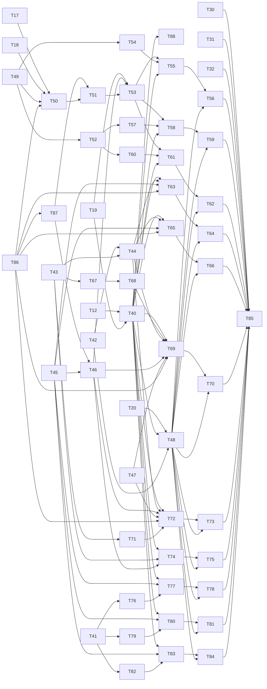

# mermaid-tty v1, sub-project C: Tier 1 diagram types — implementation plan

**Goal:** draw the 11 Tier 1 types (state, class, ER, mindmap, gantt, pie, gitGraph, timeline, journey, xychart, quadrant) at A's quality bar: flat rows, exact widths, validated, fail-closed. Each type passes the visual gate, and every Tier 2 keyword falls back until its type is recorded as passed.
**Architecture:** each type is a `DiagramModule` in `core/diagrams/<type>/{parse,layout}.ts`, registered through `core/diagrams/all.ts`. State, class and ER build a `Graph`. They extend A's model with member columns, marks, side notes, class/ER ends and end labels, and draw through `core/graph/ladder.ts`, A's layered layout, its router and its drawer. The other types draw parts on their own canvases, and `core/charts/sheet.ts` stacks the parts. Exact decimals, eighth-cell bars, legends and axes live in `core/charts/`.
**Tech stack:** as A: Node ≥ 24, erasable TypeScript with `.ts` imports, `node:test`, no dependencies, no build.
**Plan files (each ≤ 500 lines):**
- this index: design, checks, traceability, the Tier 2 gate, risks;
- `…-C1-shared.md`: T40–T48 (gate, source config, glyphs, chart helpers, the C test harness);
- `…-C1b-contracts.md`: T86–T88 (validator contracts for keys, end labels, bars and members, on A's end-mark and frame contracts; the hash-checked Tier 2 gate), added by fix cycle 1;
- `…-C2-graph-core.md`: T49–T53 (graph extensions, member rows, the graph ladder);
- `…-C3-graph-types.md`: T54–T62 (state, class, ER);
- `…-C4-charts.md`: T63–T70 (pie, journey, gantt);
- `…-C5-charts-xy.md`: T71–T75 (xychart, quadrant);
- `…-C6-other.md`: T76–T85 (mindmap, gitGraph, timeline, the visual gate).

**Inputs:**
- spec C (`docs/specs/2026-10-27-mermaid-tty-v1-diagram-types.md`);
- the matrix: its common rules (lines 5–68), its 11 Tier 1 sections and its Coverage table;
- plan A: §6 and §7, and its task style (A2–A4);
- the code at `edd4783` (`plan-c-fix`): A's T2–T20, T23–T25, T27 and T32 are merged; T26 and T28–T31 are not. The validator rule `crossing-ambiguous` is in flight; C's checks run after it;
- fix cycle 1: the cross-family audit of this plan (parts 1, 2a and 2b) and the PM's calls on it; A's shared contracts landing now (per-end marks, frame integrity, `label-blank-line`).

**Numbering:** C continues A's task numbers, since A ends at T39. So `T18` always means A's draw task. B's tasks are written "B's T7".

## 1. Design check
### 1a. Bottom-up: what A provides
| Component | What C uses | Evidence |
|---|---|---|
| `core/registry.ts` | `KEYWORDS` already maps all 23 types' keywords; `ENABLED`; `register`; `lookup` fails `disabled:<type>` or `unregistered:<type>` | `registry.ts:14–60` |
| `core/fit.ts` | `fitLadder` rejects a columns mismatch; `Step` "C widens this union" | `fit.ts:9–25` |
| `core/canvas.ts` | `text`, `cap`, `fill`, `line`, `frame`; exclusive cells; conflict log | `canvas.ts:44–119` |
| `core/validate.ts` | counts label instances per `owners[0]`; edges; conflicts; widths; label adjacency | `validate.ts:24–142` |
| `core/themes.ts` | 9 roles, including `title` and `value`; `series` s1–s8 in all 6 themes | `themes.ts:5–56` |
| `core/caps.ts` | `CAPS`, including `bang`, `cloud` and `plain` (mindmap) and `round` (state) | `caps.ts:7–30` |
| `core/text.ts`, `core/width.ts` | `labelLines`, `wrap` → `Piece[]`, `width`, `unsupported` | `text.ts:9–43` |
| `core/source.ts` | the header, the frontmatter title, comment skipping; no config keys yet | `source.ts:12–40` |
| `core/glyphs.ts` | `GLYPHS` = ASCII, U+2500–U+257F and `►◄▲▼◇●◉` | `glyphs.ts:15–17` |
| `core/graph/*` | `layoutGraph` (sealed blocks, `Placed.bands`), `gaps()`, `nodeSize`, `labelSize`; `NodeRow.id` | `layered.ts:36–84`, `sizes.ts:24–27` |
| Merged since the first draft | `routeGraph` (T17), `drawGraph` (T18), `explain`/`toRows`/`createRenderer` (T19), the golden harness and glyph scan (T20); still planned: coverage (T26), the gallery (T30), the tangle check (T31) | plan A §6 |
| Existing scripts | `check-review-hashes.ts` (scopes from `docs/reviews/required.json`); B's `scripts/lib/svg.ts` (`toSvg`, `misplaced`); `check.ts` (`@nt` runs every `*_test.ts`) | `check.ts:27–60` |

**Reuse:** every row above. **Replace:** nothing. **Extend:** `registry.ts`, `fit.ts` (`Step`), `source.ts` (`config`), `glyphs.ts` and `graph/{model,sizes,layered,route,draw}.ts`. C also moves flowchart's ladder loop into `graph/ladder.ts` (T53), so no second copy of it exists.

### 1b. Top-down: spec C → responsibilities → components
| Spec C | Responsibilities | Components (tasks) |
|---|---|---|
| Tiers; Registry | `ENABLED` = A's two types + Tier 1 + `TIER2_PASSED`; every alias resolves; Tier 2 and unknown keywords fall back; the support table matches | `registry.ts`, `diagrams/all.ts` (T40, T85) |
| Rule 1 Contract | a parser consumes every statement or fails; output is never partial | `diagrams/<type>/parse.ts`; reject fixtures |
| Rule 2 Flat rows | one row per label line; member rows; only containers draw border rows | `graph/{model,sizes,draw,members}.ts`, each layout; `borderRows` (T48) |
| Rule 3 Width | every width from `width()`; each ladder ends in fallback | each module's `steps` and `layout`; `fitLadder` |
| Rule 4 Validate | each source item once, in place or in a legend; no overwrite | `validate` (A); legend owners (T46) |
| Rule 5 Numbers | finite domains; `round(8·v/M·W)` eighths; zero draws nothing; values and percentages print | `decimal.ts`, `scale.ts`, `bars.ts` (T43, T44) |
| Rule 6 Collisions | keys `1…` and `a…`, all or none; the legend; fall back when no placement exists | `legend.ts` (T46); the `keyed` steps |
| Rule 7 Order | source order; pie sorts by value | each layout |
| Rule 8 Styling | parsed and ignored where the type's grammar defines it; ordinary text elsewhere | each parser |
| Rule 9 Series and caps | s1–s8 in source order; one caps table | `themes.ts`, `caps.ts` (A); each layout |
| Architecture | the graph family on A's layout and router; the chart family on shared helpers | `graph/ladder.ts` (T53); `charts/*` (T43–T47) |
| Test strategy; visual gate | fixtures at 60/80/120; rejections; integration; registry; gallery and review scopes | T48, the fixture tasks, T85 |

### 1c. Reconcile: one normal path, one failure path
- **Normal:** at 80 columns under nord, a reply holds a pie fence with `pie title Pets adopted by volunteers` and three slices.
  - `readSource` reads it, and `lookup('pie …')` returns the module that T63 put in `core/diagrams/pie/layout.ts` and `all.ts` registers.
  - `parsePie` reads three slices, each value a `Dec`. `fitLadder` tries `natural` with `W = min(60, 80 − 4 − 3 − 5 − 3) = 60`.
  - The layout sorts the slices by value and draws the `heading` part and the slice rows; `stack` joins them.
  - `validate` passes, since each label, value and percentage is one owner, drawn once. `toRows` colors the bars `s1`…`s3` in source order and the values in the `value` role. The first slice row is `Dogs ` + 47 × `█` + `▋`, padded to 60, then ` 386 79.4%` (T63's test).
- **Failure:** the same fence with `"Rats" : 0`.
  - `parsePie` fails `domain:4` (rule 5), and `explain` returns that Fail. The renderer caches it.
  - The hook logs `mermaid-tty fallback: domain:4` at debug level and merges the fence back into the prose (A's D4).
  - A `radar-beta` fence fails earlier, at `lookup`, with `disabled:radar`.

## 2. Test strategy
Spec C has no check IDs: its per-type checks are the matrix's fixtures. So each C test title starts with the acceptance ID it serves, as A's do. `check.ts` then runs C's tests in the `@nt` rows, and `lib/assert-count` fails any of them that asserts nothing.

| C test | Title prefix | Why that ID |
|---|---|---|
| parse units: each accepted form gives its model; matrix coverage rows per type | `A5:` | rule 1, render only when every statement is in the subset, is the fail-closed contract |
| unsupported or malformed forms fail with their reason; reject fixtures; disabled Tier 2 keywords | `A5.errors:` | "parse errors and unsupported types return null" |
| helper number tests; layout units with exact rows, eighths, cells, ticks and dates; ok fixtures at 60/80/120 against goldens | `A4:` | widths and placement; spec C puts "assert the expected numbers" under its 60/80/120 rule |
| first fitting step; fit −1, 0 and +1; fallback below the minimum (`%% expect` lines) | `A4.fit-ladder:` | the ladder |
| one row per label line; member rows; no border-only rows (`borderRows`) | `A3:` | flat nodes |
| legend counting; mutated keyed owners | `A5.mutation-tests:` | validator mutations |
| spans carry role and series colors | `A7:` | colors |
| C's glyphs are allowed; the golden glyph scan | `A8.platforms:` | the glyph allow-list |
| gallery entries; tangle over C's goldens; review scopes; the support table | `VR.gallery:`, `VR.tangled:`, `VR.reviewers:`, `B1:` | the visual gate; B's README check |
| validator contracts: keys, end labels, bars, members (T86, T87); the Tier 2 gate (T88) | `A5.mutation-tests:`, `A5.errors:` | each contract is a fail-closed check, tested by mutating a drawing; the gate decides which types stay disabled |

- **Kinds:**
  - unit tests in `tests/core/*_test.ts`;
  - golden tests in `tests/golden/`: one generic harness, `c-golden_test.ts`, plus a `<type>_test.ts` per type for its numbers, spans and coverage;
  - script tests in `tests/scripts/`.
- **Fixture expectations** live in the fixture itself, as whole-line comments, which `readSource` skips (common rule 2). So parallel tasks never edit one shared table. The forms are `%% expect <cols> <step> [widest <n>]` and `%% expect <cols> fallback`. The harness checks each line, and a boundary fixture carries three, for fit −1, 0 and +1.
- **Golden format:** A's (§4), plus one role code, `V`/`v` for `value`. Gantt's `crit`, `done` and `active` are role aliases (§5), so they need no code.
- **No new check rows:** every prefix above already has a row in `check.ts`, or in B's rows for `B1`.

## 3. Component map
Each row passes the fitness check: it has one job, its dependencies point one way, its interface is smaller than what it hides, a likely change stays local, and a test reaches it through its interface.

| Component | Job | Interface | Reuses or extends | Likely change | Test seam |
|---|---|---|---|---|---|
| `core/registry.ts` | Tiers, the Tier 2 gate, the support table | `TIER1`, `TIER2`, `TIER2_PASSED`, `ENABLED`, `supportTable` | A's registry | a Tier 2 type passes | `registry-tiers_test` |
| `core/diagrams/all.ts`, `stub.ts` | Lists the Tier 1 modules; a stub fails closed until its type lands | `TIER1_MODULES`, `stub(type)` | `register` | a type lands | `registry-tiers_test` |
| `core/source.ts` | Reads the honored frontmatter config keys, a strict YAML subset | `Source.config` | A's reader | a newly honored key | `source-config_test` |
| `core/glyphs.ts` | Adds the glyphs C's sections name | `GLYPHS` | rule 12 | a new section glyph | `glyphs-c_test`, the golden scan |
| `core/charts/decimal.ts` | Exact decimal arithmetic, rounding half up | `Dec`, `parseDec`, the operations, `toExact`, `toFixed` | BigInt | — | `decimal_test` |
| `core/charts/{scale,bars}.ts` | Eighths, cells, rows, percentages; eighth-block runs | `eighths`, `cellOf`, `rowAt`, `percent`, `hbar`, `vbar` | decimal | — | `bars_test` |
| `core/charts/sheet.ts` | Title and header rows; stacks drawn parts | `heading`, `stack` | canvas, text | — | `sheet_test` |
| `core/charts/legend.ts` | Keys and legend rows | `fieldKey`, `pointKey`, `legendRows`, `withLegend` | sheet | the wrap policy | `legend_test` |
| `core/validate.ts` | C's contracts: end labels, bars, member rows, keys | `Expect` fields `endLabels`, `bars`, `members`, `keys`, `keyable` | A's checks, which run first | a new contract | `validate-c_test`, `validate-keys_test` |
| `core/canvas.ts` | The `key` cell kind | `Canvas.key` | A's canvas | key placement | `validate-keys_test` |
| `core/charts/axis.ts` | A tick rule and its labels | `axisRows` | canvas | — | `axis_test` |
| `core/graph/{model,sizes}.ts` | Marks, member columns, notes, class and ER ends, end labels, frameless clusters | the model types; `nodeSize(n, wrapAt, across?)` | A's model | a new mark | `graph-c-model_test` |
| `core/graph/{route,draw}.ts` | Routes and draws marks, columns, the new ends and end labels | `routeGraph`, `drawGraph` | T17, T18 | a new end | `graph-c-draw_test` |
| `core/graph/{notes,layered}.ts` | Places side notes; frameless regions and their dividers | `withNotes`; `layoutGraph` | the layered layout | note placement | `graph-notes_test` |
| `core/graph/members.ts` | Builds class and ER member rows | `classRows`, `erRows` | text, width | member text | `members_test` |
| `core/graph/ladder.ts` | Runs the graph family's ladder steps | `graphSteps`, `drawAt` | flowchart's loop (moved), sheet, legend | spacing | `ladder_test`, the flowchart goldens |
| `core/diagrams/<type>/parse.ts` (×11) | Turns the grammar subset into a model | `parse<Type>(src)` | source, text, decimal | grammar | `<type>-parse_test` |
| `core/diagrams/<type>/layout.ts` (×11) | The type's ladder steps and drawing | `<name>: DiagramModule` | graph or charts | layout tuning | `<type>-layout_test`, goldens |
| `core/diagrams/gantt/time.ts` | Naive dates, formats, durations, tick steps | `parseDateFormat`, `parseDate`, `parseAxisFormat`, `formatAxis`, `parseDuration`, `tickStep` | — | a new token | `gantt-time_test` |
| `tests/golden/c-lib.ts`, `c-golden_test.ts` | Walks the fixtures; checks expect lines, border rows, coverage, spans | `expectLines`, `borderRows`, `coverageOf`, `spanOf`, `hrun`, `vrun` | golden-lib (T20) | a new check | its own tests |
| `scripts/check-tier2.ts` | The hash-checked Tier 2 gate | `tier2Files`, `tier2Problems`, `repoRecords` | `check-review-hashes.ts` | a new Tier 2 type | `check-tier2_test` |
| `scripts/support-table.ts` | Writes and checks `docs/generated/support-table.md` | `--write`, `--check` | `supportTable` | the table's format | `gallery-c_test` |
| `scripts/{render-gallery,check-tangle}.ts` | Gallery and tangle over every type | their CLIs | T30, T31 | — | `gallery-c_test` |

**Dependencies point one way:**
- `decimal ← scale, bars`; `canvas, text, validate ← sheet ← legend, axis`;
- `graph/model ← sizes, members, notes ← layered ← route ← draw ← ladder`, and `ladder` also takes `sheet` and `legend`;
- `diagrams/<type>` → `graph/*` or `charts/*`, never the other way; `all.ts` → each `layout.ts`; `render.ts` → `all.ts`.

Nothing duplicates existing code. The one loop that would have been duplicated, flowchart's ladder, moves into `ladder.ts` (T53).

## 4. Exported interfaces (fixed here; the sub-plans implement them)
```ts
// core/registry.ts (T40)
export const TIER1: readonly DiagramType[]        // state class er mindmap gantt pie gitGraph timeline journey xychart quadrant
export const TIER2: readonly DiagramType[]        // requirement c4 block architecture kanban packet sankey treemap radar zenuml
export const TIER2_PASSED: readonly DiagramType[] // [] in v1; a type joins only with a vr-C-<type> pass record (§9)
export const ENABLED: ReadonlySet<DiagramType>    // flowchart, sequence, TIER1, TIER2_PASSED
export function supportTable(): string            // docs/generated/support-table.md (T85), which B's README includes: one row per ENABLED type, its keywords
// core/diagrams/stub.ts, core/diagrams/all.ts (T40); render.ts registers TIER1_MODULES
export function stub(type: DiagramType): DiagramModule                   // parse fails 'unimplemented:<type>'
export const TIER1_MODULES: readonly DiagramModule<any>[]                 // each type's layout.ts export; a type task replaces its stub
// core/fit.ts (T40)
export type Step = 'natural' | 'tight' | 'wrap' | 'lrToTd' | 'keyed' | 'keyedWrap' | 'horizontal' | 'oneActor' | 'compact' | 'outline'
// core/source.ts (T41)
export type Scalar = string | number | boolean | null
export type Source = { header: string; title: string | null; config: Readonly<Record<string, Scalar>>
  lines: readonly { n: number; text: string }[] }  // config: frontmatter `config:` scalars as dotted keys, typed as Mermaid's js-yaml JSON_SCHEMA types them (quoted: string; plain: null, bool or safe int; other numeric-looking: fall back) (T41b)
// core/charts/decimal.ts (T43)
export type Dec = { n: bigint; d: bigint }                               // exact: d > 0, reduced
export function parseDec(s: string): Dec | null                          // [+-]?(\d+(\.\d+)?|\.\d+), else null
export function dec(i: number): Dec
export function add(a: Dec, b: Dec): Dec                                 // also sub, mul
export function div(a: Dec, b: Dec): Dec | null                          // null when b is 0
export function cmp(a: Dec, b: Dec): -1 | 0 | 1
export function floor(a: Dec): number                                    // also ceil
export function roundHalfUp(a: Dec): number                              // ⌊a + ½⌋
export function toExact(a: Dec): string | null                           // shortest exact decimal ('99.1', '-0.34'); null if it never ends
export function toFixed(a: Dec, places: number): string                  // half up: 93.75 → '93.8'
// core/charts/scale.ts, core/charts/bars.ts (T44)
export function eighths(v: Dec, m: Dec, w: number): number               // round(8·v/M·W); m > 0
export function cellOf(v: Dec, m: Dec, w: number): number                // ⌊W·v/M⌋, unclamped
export function rowAt(v: Dec, m: Dec, h: number): number                 // max(1, ⌈H·v/M⌉)
export function percent(v: Dec, total: Dec): string                      // toFixed(100·v/Σ, 1) + '%'
export function hbar(e: number): string                                  // ⌊e/8⌋ × '█', then ▏▎▍▌▋▊▉ for e mod 8
export function vbar(e: number, h: number): string[]                     // h cells, top to bottom: blanks, one of ▁▂▃▄▅▆▇, then █s
// core/charts/sheet.ts (T45)
export function heading(text: string, ink: Ink, owner: string, columns: number): Drawing | Fail  // wraps; 'word-too-wide'
export function stack(parts: readonly Drawing[], columns: number): Drawing  // rows in order; expect and conflicts merged
// core/charts/legend.ts (T46)
export type LegendPart = { text: string; ink: Ink; owner: string | null }   // owner null: a drawn separator (' · ')
export type LegendRow = { key: string; keyInk: Ink; item: string; cls: string; parts: readonly LegendPart[] }  // item: the keyed thing's own id
export function fieldKey(i: number): string        // 0 'a', 25 'z', 26 'aa', 701 'zz', 702 'aaa'
export function pointKey(i: number): string        // 0 '1'
export function legendRows(rows: readonly LegendRow[], columns: number): Drawing | Fail      // wraps under the text
export function withLegend(d: Drawing | Fail, rows: readonly LegendRow[], columns: number, keyable?: readonly { item: string; cls: string }[]): Drawing | Fail  // fills expect.keys, keyable
// core/charts/axis.ts (T47)
export type Tick = { cell: number; label: string; align: 'left' | 'right' }
export function axisRows(left: number, w: number, ticks: readonly Tick[], columns: number, owner: string): Drawing
  // a ─ rule with ┬ at each kept tick, then its label; a tick whose label leaves the field or meets the previous one is dropped
// core/diagrams/gantt/time.ts (T67)
export function parseDateFormat(f: string): DateFmt | Fail               // 'format-token', 'format-ymd'
export function parseDate(s: string, f: DateFmt): number | null          // naive UTC ms; null if s does not match
export function parseAxisFormat(f: string, dated: boolean): AxisFmt | Fail
export function formatAxis(ms: number, a: AxisFmt): string
export function parseDuration(s: string): number | null                  // whole ms; null for M, y, junk or a fraction of a ms
export function tickStep(m: number, w: number, l: number): number | null // the smallest STEPS entry with ⌊W·step/M⌋ ≥ L + 1
```
```ts
// core/graph/model.ts and sizes.ts (T49): optional fields only, so A's graphs and goldens are unchanged
export type Mark = 'start' | 'end' | 'choice' | 'bar'                    // ● ◉ ◇, and ━ (┃ across): a glyph node with no label
export type Col = { text: string; role: Role; id: string; width: number; join?: Piece['join']; key?: string }  // one aligned member column; key: drawn in its place
export type NodeRow = { text: string; role: Role; align: 'center' | 'left'; id?: string; key?: true
  fixed?: boolean; indent?: number; join?: Piece['join']; cols?: readonly Col[] }  // fixed: built by members.ts, never re-wrapped
export type Note = { id: string; text: string; side: 'left' | 'right'; key?: string }  // a state note; its text keeps its <br> breaks
export type GNode = { id: string; shape: Shape; role: Role; rows: NodeRow[]; order: number; mark?: Mark; span?: number; note?: Note }
export type End = 'arrow' | 'circle' | 'cross' | 'none' | 'triangle' | 'diamond' | 'odiamond'  // △▽◁▷ by side, ◆, ◇
export type GEdge = { id: string; from: string; to: string; style: 'solid' | 'dotted' | 'thick' | 'invisible'; tail: End; head: End
  label: string | null; minlen: number; order: number; tailLabel?: string; headLabel?: string; endRole?: Role; labelKey?: string }  // cardinality
export type GCluster = { id: string; title: string | null; dir: Dir | null; nodes: string[]; clusters: string[]; frameless?: boolean }
export function nodeSize(n: GNode, wrapAt: number | null, across?: boolean): Size | Fail  // mark 1×1; bar 1×span (span×1 across)
// core/graph/notes.ts (T51)
export function withNotes(g: Graph): Graph         // LR/RL: each note becomes a note node (a keyed note: one key row) and a dotted, headless edge; TB/BT notes: layoutGraph (Placed.notes)
// core/graph/members.ts (T52)
export type Member = { text: string; method: boolean }                   // display text: '+name(p) : int', 'id$'
export type Attr = { type: string; name: string; keys: string; comment: string }
export function classRows(id: string, members: readonly Member[], wrapAt: number | null): NodeRow[] | Fail   // ids `${id}.m<k>`
export function erRows(id: string, attrs: readonly Attr[], wrapAt: number | null): NodeRow[] | Fail  // ids `${id}.a<k>.type` …
// core/graph/ladder.ts (T53)
export type Built = { graph: Graph; legend: readonly LegendRow[]; keyable: readonly { item: string; cls: string }[] }
export type Build = (o: { dir: Dir; wrapAt: number | null; keyed: boolean }) => Built | Fail
export function graphSteps(dir: Dir, keyable: boolean): Step[]          // natural tight wrap, + lrToTd for LR/RL, + keyed
export function drawAt(build: Build, dir: Dir, step: Step, columns: number, title: string | null): Drawing | Fail
// core/diagrams/<type>/{parse,layout}.ts (T54–T84): each parse.ts exports parse<Type>(src: Source): <Model> | Fail and its model types;
// each layout.ts exports its DiagramModule and registers it. Parsers: parseState parseClass parseEr parsePie parseJourney parseGantt parseXy
// parseQuadrant parseMindmap parseGitGraph parseTimeline. Modules: state classDiagram er pie journey gantt xychart quadrant mindmap gitGraph timeline.
// core/validate.ts (T86, T87): optional Expect fields; A's drawings list none, so they check as before
//   Expect.edges[].endLabels?: { node; owner }[] (T86) extends A's per-end marks, ends: { node; glyph }[]; frames: A's Expect.frames
//   bars?: { owner; eighths; axis: 'h' | 'v'; lanes? }[]   members?: { id; parent }[]   keys?: { key; item; cls }[]   keyable?: { item; cls }[]
// core/canvas.ts (T87): Kind gains 'key', Cell gains legend?: true, and key(r, c, s, role, owner: string | readonly string[], legend: boolean): number
// scripts/check-tier2.ts (T88)
export function tier2Files(t: string): string[]                       // each ok fixture, then its golden
export function tier2Problems(t: string, files: readonly string[], records: readonly ReviewRecord[], read?: (p: string) => string | Uint8Array | null): string[]
export function repoRecords(): ReviewRecord[]
// tests/golden/c-lib.ts (T48): test-only helpers
export const GATED_DIRS: readonly string[]  // the 11 Tier 1 fixture folders, then each TIER2_PASSED type (T88)
export const LADDER: Readonly<Record<string, readonly number[]>>  // each ladder fixture's exact expect widths (T48)
export type ExpectLine = { cols: number; step: Step | 'fallback'; widest?: number }
export function expectLines(src: string): ExpectLine[]                  // each '%% expect <cols> <step|fallback> [widest <n>]'
export function fx(id: string): string                                  // a fixture's source, by id
export function borderRows(d: Drawing): string[]   // 'owner@row' where an owner that has text draws caps or fills with no text
export function coverageOf(matrix: string, type: string, fixtures: readonly string[]): string[]  // cited-but-missing, ok-but-uncited
export function spanOf(rows: Rows, re: RegExp): Span | undefined
export function hrun(d: Drawing, row: number, col: number): number      // eighths of the ▏…█ run that starts at col
export function vrun(d: Drawing, col: number, base: number): number     // eighths of the ▁…█ run that ends above row base
```

## 5. Shared rules (normative for the sub-plans)
**Owners and keys** (rules 4 and 6):
- **Text owners:** every text cell's `owners[0]` is one source item's id, and `expect.labels` lists that owner once. The ids are:
  - `title` and `sec<k>`;
  - `<item>` for a name, `<item>.v` for its value, `<item>.p` for its percentage, `<item>.t` for a timing, `<item>.a<k>` for an actor;
  - the member ids that `members.ts` gives.
- **Replaced text** covers notes, relation labels, ER comments, gantt timings and quadrant field texts.
  - At a keyed step, the item draws its key in place as a `key` cell (T87); its text is drawn once, in its legend row.
  - Its legend row draws the key as a legend `key` cell, then the full text, both owned by the item itself.
  - An edge label keeps its owner `${edge}:label`, so its key stays next to its edge.
  - `expect.keys` lists each drawn key and `expect.keyable` every item of a keyable class, so `validate` fails a key missing in place or in the legend, a swapped or stray key, and a half-keyed class (T87).
- **Point keys** (quadrant): the plot draws each key once, as a `key` cell owned by every point it stands for. Each point's legend row draws its key, its name (owner `p<i>`) and its `(x, y)` (owner `p<i>.xy`).
- **Glyph cells:** bars, markers, status glyphs, tags, connectors, marks and axis rules are `cap` cells, in a role or series ink. Their owner is their item; when the item's text is on another row, as for xychart plot marks, it is `<item>:mark`, so `borderRows` passes.
- **Contracts:** C builds on A's per-end marks (`ends`, `end-misplaced`), frames (`expect.frames`, `frame-broken`) and `label-blank-line`; a `<br><br>` in any C text falls back. T86 adds every end label to `endLabels`, every bar to `expect.bars` with its eighths and every member row or column to `expect.members`. Every drawn frame is listed (T48); a frameless region lists none.
- **Computed text** is a text cell whose expected text is the computed string: percentages, tick labels, the cardinalities `0..*`, `«annot»`, `Square<Shape>`, ER keys `PK, FK`.

**Ladders** (normative; after the last step, each falls back):
| Type | Steps |
|---|---|
| state, class, ER | `natural`, `tight`, `wrap`, `lrToTd` (LR and RL only), `keyed` |
| pie | `natural`: `W = min(60, columns − N − V − P − 3)` if ≥ 10. `wrap`: W = 10, labels wrap to `columns − V − P − 13` |
| journey | `natural`; `wrap`: actor lists wrap after commas to `columns − N − S − 16`; `oneActor`: names wrap to `columns − S − a − 16` |
| gantt | `natural`: W ≥ 20 with timings. `keyed`: `W = min(60, columns − N − 5 − K)` if ≥ 20. `keyedWrap`: W = 20, names wrap to `columns − 25 − K` |
| xychart | `natural`: the header's orientation. `horizontal`: only after a vertical header. `wrap`: horizontal, W = 10, categories wrap to `columns − V − 14` |
| quadrant | `natural`: every text in place. `keyed`: q ≥ 8; a text wider than q makes every quadrant and x-axis text a field key |
| mindmap | `natural`, `compact`, `wrap`, `outline` |
| gitGraph | `natural`, `wrap` |
| timeline | LR and a bare header: `natural` (gap 2), `tight` (gap 1), `wrap`, `lrToTd`. TD: `natural`, `wrap` |

**Resolved ambiguities** (choices the spec and the matrix leave open; each is recorded here and pinned by a test):
1. **Config keys** are read from frontmatter `config.<type>.<key>`: `mindmap.colorBy`, `timeline.disableMulticolor`, `gitGraph.mainBranchName`, `gitGraph.mainBranchOrder`. Every other key is ignored. Values are typed scalars (T41b).
2. **Gantt status inks:** the matrix's `crit`, `done` and `active` roles are aliases of `arrow`, `note` and `decision`, so the `Palette` shape, a B dependency, does not change. In mono, the status cells `!`, `✓` and `▸` tell them apart.
3. **Series before the first section** (gantt, journey): those tasks take `s1`, and the sections take `s2`, `s3`, …. With no such tasks, the first section takes `s1`.
4. **gitGraph labels:**
   - A commit with no `id:` prints no id, since Mermaid's is random. It prints `msg`, then its tags.
   - A merge prints its `id:` when it has one.
   - A cherry-pick prints its tags; the default is `cherry-pick:<id>`.
5. **Keys:** there is one key sequence per diagram, in the source order of the keyed items. At `keyed`, class and ER key their notes, comments and relation labels together. Cardinality is never keyed.
6. **Rounding:** half up is `⌊x + ½⌋`, so −2.5 rounds to −2. Only xychart line values may be negative.
7. **Mindmap columns:**
   - `natural` aligns each depth in one column, as wide as the widest pill at that depth plus `─┬─`.
   - `compact` starts each child group right after its own parent.
   - In both, subtrees own disjoint rows.
8. **Timeline LR events:** a column's k-th event sits on event row k, left-aligned in its column. A bare `timeline` is LR.
9. **Quadrant field keys** follow the source order of the statements; an axis gives its left text, then its right. The legend lists the fields, then the points.
10. **State notes:**
    - TB and BT: the note's lines sit beside the state, joined to its pill by `┄` on their first row.
    - LR and RL: `withNotes` makes a note node with a dotted, headless edge, ranked before its state (left) or after it (right). RL mirrors this.
11. **Class ends:** `<|`/`|>` draw `triangle`, `*` `diamond` (◆), `o` `odiamond` (◇), `<`/`>` `arrow`. A `note for` note uses a dotted, headless edge; a floating note is an isolated plain node.
12. **Support table:** `supportTable()` is the source. T85's `scripts/support-table.ts` writes `docs/generated/support-table.md`, and a `B1:` test compares the two. B owns `README.md` and includes the file through B-T12; C never edits the README.
13. **State regions:** each `--` region has its own `[*]`, as in Mermaid. Id uniqueness is per composite body, the matrix's scope.

## 6. Design comparison
| Choice | Chosen | Alternative | Why |
|---|---|---|---|
| Graph types | A's layered layout, router and drawer, extended | A layout per type | Spec C, Architecture |
| Member rows | `members.ts` builds fixed rows | `sizes.ts` wraps them | ER types, names and keys never wrap, and their columns align |
| State notes | TB/BT: beside the state; LR/RL: a note node with a dotted edge | One model for both | Longest-path ranking would put a TB note on another rank |
| Regions | Frameless sealed clusters, chained by invisible edges | A region layout | It reuses sealed-block recursion; state's scope rule means no edge joins two regions |
| Bars and marks; keys | Bars and marks are `cap` cells; keys are a `key` kind (fix cycle 1) | Keys as caps | A key must be found in place and in the legend; a key's golden code is its ink's, like a cap's |
| Gantt status inks | Aliases of `arrow`, `note`, `decision` | Three new roles | `Palette` is a B dependency, and `check-palettes` would grow |
| Numbers | BigInt decimals, rounded half up | Floats | Matrix rule 8: exact decimal arithmetic |
| Fixture expectations | `%% expect` lines in each fixture | A table in the harness | Parallel type tasks never edit one file |
| Registration | Each `<type>/layout.ts` registers itself, as A's modules do; `all.ts` imports the 11 | A loop in `render.ts` | One pattern for every type; disjoint files; a stub fails closed |
| Chart parts | Each part is its own drawing, and `stack` joins them | One canvas per chart | A part's height is known only after wrapping, and each part stays testable alone |
| Review scopes | One `vr-C-<type>` per type; `vr-A` narrowed to A's goldens | One `vr-C` | A golden change reopens only its own type's review |
| Second design | Fix cycle 1's cross-family audit stands in for a blind second design | A blind second design, as A had in §12 | C had none; the audit's findings are folded into §4, §5 and T86–T88 |

## 7. Files, tasks and groups
**Files:**
- **Create:**
  - `core/diagrams/{stub,all}.ts`;
  - `core/diagrams/<type>/{parse,layout}.ts` for the 11 types, plus `gantt/time.ts`;
  - `core/charts/{decimal,scale,bars,sheet,legend,axis}.ts`;
  - `core/graph/{notes,members,ladder}.ts`.
- **Modify:**
  - `core/{registry,fit,source,glyphs,render}.ts`;
  - `core/graph/{model,sizes,layered,route,draw}.ts`;
  - `core/diagrams/flowchart/layout.ts`;
  - `scripts/{render-gallery,check-tangle}.ts`;
  - `tests/golden/golden-lib.ts`;
  - `tests/core/{fit,render,source}_test.ts`;
  - `docs/reviews/required.json` and `docs/generated/support-table.md`;
  - `core/validate.ts` and `core/canvas.ts` (T86, T87), `scripts/check-tier2.ts` (T88) and `scripts/support-table.ts` (T85).
- **Data:** `fixtures/<type>/<type>-{ok,reject}-NN.mmd` and `goldens/<type>/*.golden` for the 11 types.
- **Tests:**
  - `tests/core/<component>_test.ts`;
  - `tests/golden/{c-lib.ts, c-golden_test.ts, <type>_test.ts}`;
  - `tests/scripts/gallery-c_test.ts`.

**Groups:** tasks in one group touch disjoint files, so they can run in parallel. Each task starts once its own Deps are merged. A's T2–T20 are merged; a Deps cell still names the A tasks a task builds on.

| Task | Title | Group | Deps | Plan |
|---|---|---|---|---|
| T40 | Tier gate, `Step`, Tier 1 stubs, registration | G1 | T12, T19 | C1 |
| T41 | Source config keys, a strict YAML subset | G1 | — | C1 |
| T42 | C's glyphs | G1 | — | C1 |
| T43 | Exact decimals | G1 | — | C1 |
| T44 | Scale and bars | G2 | T42, T43 | C1 |
| T45 | Sheet: `heading` and `stack` | G1 | — | C1 |
| T46 | Legend | G3 | T45, T87 | C1 |
| T47 | Axis | G1 | — | C1 |
| T48 | C golden harness | G2 | T20, T40, T42 | C1 |
| T49 | Graph model and sizes | G1 | — | C2 |
| T50 | Route and draw: marks, columns, ends, end labels | G2 | T17, T18, T49, T86 | C2 |
| T51 | Side notes, frameless regions, dividers; keyed text | G3 | T50, T87 | C2 |
| T52 | Member rows | G2 | T49 | C2 |
| T53 | Graph ladder; flowchart moves onto it | G4 | T19, T46, T51 | C2 |
| T54 | State parse | G2 | T49 | C3 |
| T55 | State module | G5 | T40, T53, T54 | C3 |
| T56 | State fixtures and goldens | G6 | T48, T55 | C3 |
| T57 | Class parse | G3 | T52 | C3 |
| T58 | Class module | G5 | T40, T53, T57 | C3 |
| T59 | Class fixtures and goldens | G6 | T48, T58 | C3 |
| T60 | ER parse | G3 | T52 | C3 |
| T61 | ER module | G5 | T40, T53, T60 | C3 |
| T62 | ER fixtures and goldens | G6 | T48, T61 | C3 |
| T63 | Pie parse and module | G3 | T40, T44, T45, T86 | C4 |
| T64 | Pie fixtures and goldens | G4 | T48, T63 | C4 |
| T65 | Journey parse and module | G3 | T40, T44, T45, T86 | C4 |
| T66 | Journey fixtures and goldens | G4 | T48, T65 | C4 |
| T67 | Gantt time | G2 | T43 | C4 |
| T68 | Gantt parse and resolve | G3 | T67 | C4 |
| T69 | Gantt module | G4 | T40, T44, T46, T47, T68, T86 | C4 |
| T70 | Gantt fixtures and goldens | G5 | T48, T69 | C4 |
| T71 | xychart parse | G2 | T43 | C5 |
| T72 | xychart module | G4 | T40, T44, T46, T47, T71, T86 | C5 |
| T73 | xychart fixtures and goldens | G5 | T48, T72 | C5 |
| T74 | Quadrant parse and module | G4 | T40, T43, T46 | C5 |
| T75 | Quadrant fixtures and goldens | G5 | T48, T74 | C5 |
| T76 | Mindmap parse | G2 | T41 | C6 |
| T77 | Mindmap module | G3 | T40, T45, T76 | C6 |
| T78 | Mindmap fixtures and goldens | G4 | T48, T77 | C6 |
| T79 | gitGraph parse | G2 | T41 | C6 |
| T80 | gitGraph module | G3 | T40, T45, T79 | C6 |
| T81 | gitGraph fixtures and goldens | G4 | T48, T80 | C6 |
| T82 | Timeline parse | G2 | T41 | C6 |
| T83 | Timeline module | G3 | T40, T45, T82 | C6 |
| T84 | Timeline fixtures and goldens | G4 | T48, T83 | C6 |
| T85 | Visual gate: gallery, tangle, review scopes, support table, stubs gone | G7 | T30, T31, T32, every fixture task | C6 |
| T86 | Validator contracts I: end labels, bars, members | G1 | A's per-end marks | C1b |
| T87 | Validator contracts II: keys | G2 | T86 | C1b |
| T88 | The Tier 2 gate, hash-checked | G2 | T40 | C1b |


**Critical path:** T86 → T50 → T51 → T53 → T55 → T56 → T85, seven C tasks; T86 → T87 → T46 → T53 is as long and joins it at T53. A's T17–T20 are merged, so only A's gallery, tangle and review-scope tasks (T30–T32) still gate C, at T85.

## 8. Traceability (every spec C rule and every Tier 1 matrix row has a task)
| Spec C | Tasks |
|---|---|
| Tiers; Registry: `ENABLED`, aliases, disabled keywords fall back, the support table | T40, T85, T88 |
| Fix cycle 1 contracts: keys in place and in the legend, all or none; end marks and end labels; bars and zero; member rows | T86, T87, T46, T50, T63, T65, T69, T72, T74 |
| Fix cycle 1: frontmatter config through a strict YAML subset; required coverage rows and ladder expect lines | T41, T48 |
| Rule 1 Contract · Rule 8 Styling ignored | every parse task (T54, T57, T60, T63, T65, T68, T71, T74, T76, T79, T82); every reject fixture |
| Rule 2 Flat rows · Rule 3 Width | T49–T52, T48 (`borderRows`), T45; each module's ladder; `%% expect` lines |
| Rule 4 Validate · Rule 6 Collisions | T46, T48; the keyed steps in T55, T58, T61, T69, T74 |
| Rule 5 Numbers · Rule 7 Order | T43, T44; T63 (pie sorts), T65, T69, T72, T74 |
| Rule 9 Series and caps | T63, T65, T69, T72, T77, T80, T83; caps in T50 and T77 |
| Architecture | T40 (modules), T49–T53 (graph family), T43–T47 (chart family) |
| Test strategy: coverage rows, 60/80/120 numbers, rejections, integration, registry | T48, each fixture task and its `<type>_test.ts`; T40 |
| Visual gate | T85 |
| Decisions: pie as bars; keys and legend; disabled keywords keep the engine's drawing | T63; T46; T40 |

| Matrix common rule | Tasks |
|---|---|
| 1 Fallback · 2 Headers and comments · 5 Keywords | each parse task; T41 for the reader |
| 3 Frontmatter title and honored config | T41, T45; T77 `colorBy`, T80 `mainBranchName`/`Order`, T83 `disableMulticolor` |
| 4 Styling ignored | each parse task |
| 6 Text · 7 Legend · 8 Numbers | T45, T52 · T46 · T43, T44 |
| 9 Roles and series (mono by glyph, key or position) · 10 Counting | each module · T46, T48 |
| 11 Coverage · 12 Glyphs · End caps | T48 `coverageOf` · T42, T50, A's golden scan · T50, T55, T58, T61, T77 |

| Tier 1 type | ok / reject fixtures | Tasks |
|---|---|---|
| state | ok-01…25 / reject-01…06 | T54, T55, T56 |
| class | ok-01…31 / reject-01…07 | T57, T58, T59 |
| ER | ok-01…24 / reject-01…08 | T60, T61, T62 |
| gantt | ok-01…16 / reject-01…17 | T67, T68, T69, T70 |
| pie | ok-01…10 / reject-01…06 | T63, T64 |
| xychart | ok-01…11 / reject-01…13 | T71, T72, T73 |
| quadrant | ok-01…10 / reject-01…09 | T74, T75 |
| journey | ok-01…08 / reject-01…08 | T65, T66 |
| mindmap | ok-01…14 / reject-01…06 | T76, T77, T78 |
| gitGraph | ok-01…11 / reject-01…07 | T79, T80, T81 |
| timeline | ok-01…13 / reject-01…07 | T82, T83, T84 |

Each fixture task lists every fixture of its type. `coverageOf` (T48) fails CI when a Coverage row cites a missing fixture or an ok fixture is cited by no row, so every coverage row maps to a fixture, and through it to a task.

## 9. The Tier 2 gate
- `TIER2` is requirement, c4, block, architecture, kanban, packet, sankey, treemap, radar and zenuml. `TIER2_PASSED` is `[]` in v1, so `ENABLED` is flowchart, sequence and the 11 Tier 1 types.
- Every Tier 2 keyword and alias in `KEYWORDS` makes `lookup` fail `disabled:<type>`. `explain` returns that Fail, and the hook draws the original fence. `requirement` and `flowchart-elk` stay `fallback:<keyword>`.
- **To enable a Tier 2 type later:** its matrix fixtures pass the C harness (T48), and a `vr-C-<type>` record with `verdict: pass` lists every ok fixture of the type and its golden, with matching hashes (T88). Then one commit adds the type to `TIER2_PASSED`, its module to `all.ts` and its scope to `required.json`.
- **T40's tests** check that `ENABLED` is exactly that union and that every keyword of an unpassed Tier 2 type gives `disabled:<type>`. **T88's** check that `TIER2_PASSED` is exactly the Tier 2 types that pass `tier2Problems`: an empty Files table, a missing fixture or golden, a stale hash, a fail verdict or no record keeps a type disabled.
- Implementing any Tier 2 type is out of scope for this plan.

## 10. Risks (each with a concrete trigger)
| # | Risk | Trigger | Response |
|---|---|---|---|
| R1 | The in-flight `crossing-ambiguous` rule rejects a C drawing | A C golden test fails `crossing-ambiguous` once that rule merges | Route with A's rules and T53's retry spacing; never weaken the rule. C's checks run after it and do not edit it |
| R2 | TB side notes widen ranks and tangle the routes | `state-ok-12` or `-13` falls back with `route-conflict`, or fails `check-tangle` | Place the note as a same-rank neighbour, pinned beside its state in `order.ts` |
| R3 | A matrix number disagrees with its formula | A `<type>_test.ts` assertion fails, and the code matches the formula | Report to the PM. The matrix is never edited by the implementer. Pie, gantt, xychart and quadrant numbers were checked by hand for this plan. |
| R4 | The honored config keys sit at other paths in Mermaid's docs | The PM's review of `mindmap-ok-13`, `gitGraph-ok-05` or `timeline-ok-08` | A matrix amendment first; `readSource` keeps every dotted key, so only the layouts' lookups change |
| R5 | Cold p90 grows with BigInt math and the ladder tries | `scripts/bench.ts fixtures` p90 > 50 ms on the Mac, or > 200 ms in CI | A number fast path for safe integers; memoize each ladder's parse; cap the wrapAt tries at 3 |
| R6 | A type fails its visual review | `vr-C-<type>` verdict `fail` | Fix and re-render. A Tier 1 type is dropped only by the PM. |
| R7 | A terminal draws `▏`…`█`, `◆` or `✓` wide | An A9 screen whose row width ≠ `width(row)` | ASCII substitutes under `theme: mono`; a matrix amendment |
| R8 | The generated support table drifts from `supportTable()` | T85's `B1:` test or `node scripts/support-table.ts --check` fails | Run `node scripts/support-table.ts --write`; B-T12 includes the file, so the README follows |
| R9 | A stub ships | T85's no-stub test, or a release tagged before T85 | Never tag before T85, which deletes `stub.ts` |
| R10 | gitGraph without ids looks unlike Mermaid's | The PM's review of `gitGraph-ok-02` | A matrix amendment, if the PM wants generated ids shown |
| R11 | C had no blind second design, as A had in §12 | — | Fix cycle 1's cross-family audit stands in (§6); its findings are folded into T86–T88 and the task revisions |

## 11. Must-pass commands
```bash
scripts/check.sh                                         # the single entry; C adds no CHECKS rows (§2)
node scripts/typecheck.ts                                # core/ against the pinned TypeScript (T40, T53)
node scripts/support-table.ts --check                    # docs/generated/support-table.md is supportTable() (T85)
node scripts/check.ts A4                                 # C's numbers, layouts and 60/80/120 goldens
node scripts/check.ts A4.fit-ladder                      # first fits; fit −1, 0 and +1; fallback
node scripts/check.ts A5                                 # parsers, coverage rows, the Tier 2 gate (matches A5.errors, A5.mutation-tests)
node scripts/check.ts A3                                 # flat rows, member rows, no border-only rows
node scripts/check.ts A7                                 # role and series colors in spans
node scripts/check.ts A8.platforms                       # C's glyphs; the golden glyph scan
node scripts/check-tangle.ts                             # VR.tangled over every type's ok fixtures
node scripts/render-gallery.ts out/gallery --png         # VR.gallery: every type at 80 and 60, the CJK and palette sheets
node scripts/check-review-hashes.ts --require-pass       # VR.reviewers, VR.passes: vr-A and every vr-C-<type>
```
