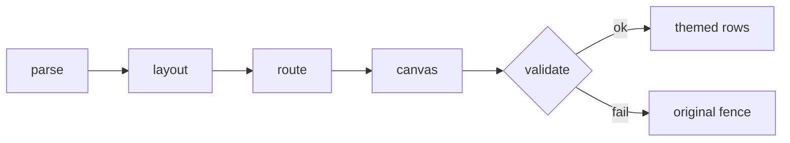

# mermaid-tty v1 design: renderer and Claude Code mod

**Goal:** be the best Mermaid rendering in a CLI. In Claude Code's terminal, each closed ```mermaid fence in a reply is drawn as a colored, flat box-drawing diagram, while the transcript keeps the source.

**Approval:** PM waiver under `/goal` autonomy, 2026-10-27. Docs, wiki, CI and release are sub-project B (`2026-10-27-mermaid-tty-v1-docs-release.md`).

## Scope

- **In:**
  - The Claude Code terminal surface on macOS, Linux and Windows. Mods need 2.1.287 or later; tested on 2.1.308.
  - Flowcharts, including subgraphs, and sequence diagrams. Together they make up all 87 blocks in the corpus from the owner's docs.
- **Out:**
  - Copilot CLI comes after v1; a spike showed plain `session.log` keeps truecolor SGR.
  - Other diagram types are sub-project C. Desktop, VS Code and images keep the engine's own drawing.
  - `classDef` and `style` colors are not applied.

## Requirements (must pass)

1. **Flowchart syntax:**
   - **Header:** `flowchart` or `graph`, with direction TD, TB, BT, LR or RL.
   - **Shapes:** every classic bracket shape (rectangle, round, stadium, subroutine, cylinder, circle, rhombus, hexagon, parallelogram, trapezoid, asymmetric) and `@{shape}`. An unknown shape draws as a rectangle.
   - **Labels:** quoted labels and `<br/>` line breaks.
   - **Edges:** solid, dotted, thick and bidirectional, ending in an arrow, circle, cross or nothing. Labels are written `|x|` or `-- x -->`. Chains and `&` work.
   - **Subgraphs:** nested and titled, each with its own `direction`.
   - **Also parsed:** `%%` comments and `---` frontmatter, whose title is shown. `classDef`, `style`, `class`, `linkStyle` and `click` are parsed and ignored.
2. **Sequence syntax:**
   - **Participants:** `participant` and `actor`, with aliases.
   - **Messages:** solid or dotted; arrow, open, cross or async ends; with labels.
   - **Also:** `+`/`-` activations; notes left of, right of or over; `alt`/`else`, `opt`, `loop`, `par`/`and`, `critical` and `break` frames; `autonumber`.
   - **Full subsets:** the diagram matrix's `flowchart` and `sequence` sections are normative.
3. **Flat nodes:** a node takes exactly one row per label line, with no border-only rows. End caps show the shape, so shape doesn't depend on color.
4. **Width:**
   - One function measures width: East Asian Width `W`/`F` characters count 2 columns; combining marks (Mn/Me) and zero-width characters count 0; everything else counts 1, including box-drawing, arrows and `◇`. Labels containing ZWJ, variation selectors, regional indicators, emoji modifiers or control characters fall back.
   - Every row fits within `e.viewport.columns`. To fit, try natural layout, tighter gaps, wrapped labels, then LR redrawn as TD; otherwise show the source.
5. **Fail closed:**
   - A validator confirms that each node's label appears once (counted per node id, so identical texts are fine), each edge connects its endpoints, no glyph overwrites another, and every row fits.
   - Any validator failure, parse error or unsupported type shows the original fence unchanged. The reason goes only to the debug log.
6. **Source preserved:**
   - Only the drawing changes. ctrl+o shows the source.
   - Unclosed fences are left alone.
   - The engine draws the prose around each diagram through `next()`. The spike confirmed two engine refs in one reply.
7. **Colors:**
   - By default, the roles node, decision, edge, arrow, label, frame and note map to Claude Code theme keys, so diagrams follow the user's theme.
   - The `theme` option picks a curated palette instead: nord, dracula, gruvbox, solarized or mono.
8. **Zero install:**
   - No runtime dependencies and no build step.
   - `claude plugin validate .` passes.
   - p90 corpus render time is at most 50 ms (cold, 80 columns, development Mac).
   - An LRU cache of 64 entries is keyed by text, width and theme.
   - Works the same on macOS, Linux and Windows: no OS-specific code, and CI runs the full suite on all three.

## Architecture



- **Plugin root:** the repo root is the plugin; the marketplace entry uses `source: "./"`.
- **`core/`:** host-agnostic, dependency-free TypeScript in erasable syntax only, so it runs under both Claude Code's loader and Node's type stripping.
  - `width.ts`: the width function.
  - `parse/`: the parsers.
  - `layout/flowchart.ts`: cycle breaking, ranks (edge labels get their own), barycenter sweeps, grid coordinates.
  - `layout/sequence.ts`: sequence layout.
  - `route.ts`: orthogonal tracks; a junction bitmask picks the box-drawing glyph.
  - `canvas.ts`, `validate.ts`, `themes.ts`.
  - `render.ts`: `renderMermaid(source, {columns, theme})` returns rows of spans, or `null`.

- **`hooks/register.tsx`:** a `ui.render` hook on `AssistantMessage`, terminal surface only.
  - It splits the reply at closed mermaid fences and passes the prose to `next()`.
  - It draws each diagram as colored `Text` rows with `wrap: 'truncate-end'`, and caches the result.
- **`.claude-plugin/`:** `plugin.json` (`userConfig.theme`), `marketplace.json`, and an icon.

## Test strategy

- **Acceptance:** every requirement maps to the checks in the normative [`2026-10-27-mermaid-tty-v1-acceptance.md`](2026-10-27-mermaid-tty-v1-acceptance.md): unit, golden, mutation, hook, portability, benchmark and visual-review checks.
- **Corpus gate (local only, never committed):** all 87 of the owner's blocks render and validate at 80 and 120 columns.
- **Runtime proof:** a CJK flowchart rendered in a tmux-driven Claude Code session, with an ANSI capture showing themed truecolor rows, and ctrl+o showing the source.
- **Must-pass suite:** `scripts/check.sh`.

## Decisions (grill, self-answered)

- We own the renderer; no third-party layout code ("you control everything").
- Nodes are flat pills with end caps; the mono theme drops the backgrounds.
- A failed render falls back silently. Version 1.0.0, as the owner asked.
- The owner's docs are used as a corpus only on this machine.

## Prior art

| Practice | Source | Fit (evidence) |
|---|---|---|
| termaid | fasouto/termaid | Correct CJK and subgraphs, but 3-row boxes and a subprocess |
| merman-cli | Latias94/merman | Fails on subgraph routes |
| beautiful-mermaid | lukilabs/beautiful-mermaid | Misaligns CJK (owner's screenshot) |
| Community mods | ngothanhluc, ejklock, BukeLy | Weeks old (research) |
| `cc-plugin-mermaid` | Claude Code binary | Turned off by its flag |

## Risks

- **Tangled dense graphs:** if more than 5 corpus diagrams stay tangled after 3 fix cycles, port termaid's placement and routing, keeping flat nodes.
- **Early-access mods API:** re-test each Claude Code release.
