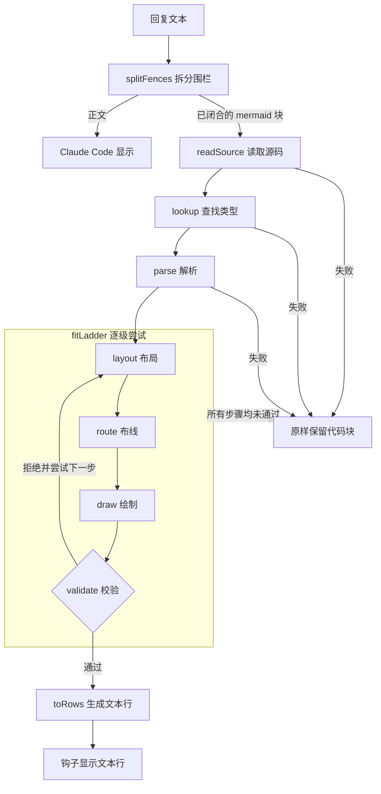

# 架构

[英文版](Architecture)

mermaid-tty 分为两部分。`core/` 是渲染器：不依赖宿主、无依赖的 TypeScript，将 Mermaid 源码转换为带颜色的文本行，或返回回退原因。`hooks/` 是 Claude Code mod：找到回复中的图表，请 `core/` 绘制，其余内容仍交给 Claude Code。

## 流水线

1. **围栏。** `splitFences`（`hooks/fences.ts`）按已闭合的 `mermaid` 代码块拆分回复。各片段重新拼接后与原回复完全相同，正文仍交给 Claude Code。
2. **源码。** `readSource`（`core/source.ts`）统一换行符和 HTML 属性引号，读取 frontmatter 标题和配置的严格子集，检查指令和词法敏感空白，移除空行及 `%%` 注释行。它返回首行、带类型的配置标量，以及保留源码行号的正文行。随后 `explain` 检查标题的文本规则。
3. **查找。** `lookup`（`core/registry.ts`）取首行第一个词，去掉末尾的 `:`，返回对应类型的模块；否则返回 `unknown-type`、`fallback:<keyword>`、`disabled:<type>` 或 `unregistered:<type>`。
4. **解析。** 类型模块将各行解析为模型。任何语句无法完整读取，整个代码块就会失败。
5. **逐级适配。** `fitLadder`（`core/fit.ts`）按顺序执行该类型的步骤。每一步按终端宽度布局并绘图；流程图依次执行布局、布线和绘制。`validate` 检查结果，第一个通过的绘图胜出；全部失败时返回最后一步的原因。
6. **文本行。** `toRows`（`core/render.ts`）按主题配色，将绘图转换为由带样式片段组成的文本行。
7. **钩子。** `ui.render` 将每行显示为 Claude Code 的 `Text`，使用 `wrap="truncate-end"`，放在前后正文之间。

阶段接口返回包含简短原因的 `Fail`。部分解析器内部用 `stop()` 抛出 `Fail`，再在公开接口边界捕获。源码和解析失败会终止当前代码块；布局失败则进入下一适配步骤。`explain`（`core/render.ts`）将越过这些边界的意外异常转换为 `internal-error`。

## 模块

**渲染器 `core/`。** 同时支持 Claude Code 加载器和 Node 类型剥离，无需构建。

| 文件 | 职责 |
|---|---|
| `render.ts` | 入口：`explain`、`renderMermaid`、`toRows`，以及供钩子使用的缓存渲染器 `createRenderer`。 |
| `source.ts` | `readSource`：读取代码块首行、frontmatter 标题和正文行。 |
| `registry.ts` | 首行关键字与类型映射、`ENABLED`、`register` 和 `lookup`。 |
| `fit.ts` | `fitLadder`：逐步尝试，直到 `validate` 接受绘图。 |
| `validate.ts` | 校验器：布局到屏幕之间的保守校验关卡。 |
| `canvas.ts` | 单元格网格：字形、角色、所有者、写入策略及冲突记录。 |
| `glyphs.ts` | `GLYPHS` 字形允许列表，以及按单元格连接方向选择制表符号。 |
| `box-table.ts` | 由 `scripts/gen-box-table.ts` 生成，按连接方向列出 80 个轻重线条制表符号。 |
| `width.ts` | 统一宽度函数 `width` 和字符检查函数 `unsupported`。 |
| `width-table.ts` | 由 `scripts/gen-width-table.ts` 生成的东亚宽字符与全角字符范围。 |
| `text.ts` | `drawable` 执行各字段的实体、HTML、Markdown、图标、公式和换行规则；`labelLines` 拆分支持的换行；`wrap` 将行折为片段。 |
| `caps.ts` | 节点形状的端帽，以及 `@{ shape: … }` 名称。 |
| `themes.ts` | 六种主题中各角色和系列的颜色。 |
| `color.ts` | 供 `scripts/check-palettes.ts` 使用的 WCAG 对比度与 OKLab 距离。 |
| `lru.ts` | 最近最少使用缓存。 |
| `fail.ts` | 统一的回退结果 `Fail`。 |

**图布局 `core/graph/`。** 流程图、状态图、类图和 ER 图共享的逐级适配、分层布局与布线器。

| 文件 | 职责 |
|---|---|
| `model.ts` | 图模型：节点、边和簇，仅包含类型。 |
| `layered.ts` | 将图放在单元格网格上的分层布局，每个簇使用一个边框。 |
| `place.ts` | 单层放置：层级和链、条带间隔、排序，再计算横轴和主轴。 |
| `ranks.ts` | 打破环，并按最长路径确定各单元的层级。 |
| `chains.ts` | 层内元素：对应层级的单元、带标签连线中途的标签节点，以及跨层连线在其他层上的虚拟节点。 |
| `clusters.ts` | 簇树，以及没有连线穿过边界的封闭簇。 |
| `strips.ts` | 簇条带及防止其他元素进入的间隔。 |
| `order.ts` | 层内重心扫描排序，选择交叉最少的结果。 |
| `nest.ts` | 同层排序，保持各条带内元素相邻。 |
| `cross.ts` | 横轴位置：紧凑排列各层，再向中位位置靠拢。 |
| `main-axis.ts` | 主轴位置：各层占用的带状区域及层间间隔。 |
| `sizes.ts` | 节点框尺寸：最宽标签片段、内边距和端帽。 |
| `gaps.ts` | 读取层间间隔，供布线器使用。 |
| `route.ts` | 使用共享预算的加权曼哈顿搜索，生成正交路径。 |
| `draw.ts` | 将放置和布线后的节点、边框、路径与标签画到画布上。 |
| `ladder.ts` | 共享 `natural`、`tight`、`wrap`、有条件的 `lrToTd` 和 `keyed` 步骤，并增大间隔重试布线。 |
| `members.ts` | 带所有者 id 和固定换行的类成员行与 ER 属性列。 |
| `notes.ts` | 侧边注释，或横向图中由虚线连接的独立注释节点。 |

**图表组件 `core/charts/`。** `decimal.ts` 进行精确有理数运算；`scale.ts` 将数值映射到单元格；`bars.ts` 绘制八分之一单元格精度的条形；`axis.ts` 绘制刻度；`sheet.ts` 叠放标题和绘图；`legend.ts` 将短键绑定到完整文本。

**图表类型 `core/diagrams/`。** 每种类型有自己的目录，如 `core/diagrams/flowchart/` 和 `core/diagrams/sequence/`。`parse.ts` 将代码块读成模型，`layout.ts` 定义适配步骤及各步布局。导入 `layout.ts` 时会注册模块。`core/render.ts` 直接导入流程图和时序图，再通过 `core/diagrams/all.ts` 加载其余十一种类型；13 种全部启用。

**钩子 `hooks/`。** Claude Code mod 的接入部分。

| 文件 | 职责 |
|---|---|
| `hooks.json` | 加载 `register.tsx`。 |
| `register.tsx` | 注册 `/mermaid-tty` 命令和 `ui.render` 钩子，将模式保存在 `$.state` 中。 |
| `fences.ts` | `splitFences`：拆分回复正文和已闭合的 `mermaid` 代码块。 |
| `mode.ts` | 决定何时原样传递回复，以及解析命令参数和生成反馈。 |

`types/mermaid-tty.d.ts` 声明插件状态：布尔值 `mermaid-tty.source`。

## 校验与回退

`validate`（`core/validate.ts`）是布局到屏幕之间的保守校验关卡。每个布局通过 `Expect` 声明绘图必须包含什么，按所有者 id 识别，必要时指定精确位置。校验内容包括：

1. **标签只出现一次。** 每个非空标签在空白归一化后必须与其所有者的文本一致，且只出现一次；空标签不绘制文字。不同所有者可使用相同文字（`label-missing`、`label-dup`）。
2. **连线与箭头。** 每条边连接自己的端点。端点标记的字形和位置正确；方向箭头指向节点而非分叉处（`edge-disconnected`、`end-misplaced`、`head-extra`、`head-on-junction`）。
3. **连线不误导。** 不允许悬空线段、有歧义的交叉，或暗示不存在连接的合并主干。线条字形必须匹配记录的连接方向和粗细（`line-dangling`、`crossing-ambiguous`、`line-glyph`、`merge-ambiguous`）。
4. **无覆盖且宽度正确。** 画布不能有冲突，输出的每行都不超出指定列数（`overwrite`、`row-too-wide`）。
5. **标签与边框。** 连线标签必须靠近自身路径；边框保持闭合；同一框内节点之间的边不得越出边框；连线只有在边框恰好包含其一端时才穿过该边框，且只穿过一次。端点标签必须无歧义地指向自己的连线端点（`label-not-adjacent`、`frame-broken`、`edge-outside-frame`、`edge-crosses-frame`、`end-label`）。
6. **图表与成员结构。** 条形的八分之一单元格长度和位置必须正确。类成员及 ER 属性列属于自己的节点框，并位于声明的行列。短键在原位及自身图例文字旁各出现一次；同类可替换项要么全部用短键，要么都不用。
7. **有意义的位置。** 事件顺序、语义字形及位置、坐标轴和类别标签、行标签、侧边注释、生命线和节点框内的文字都必须保持与正确对象绑定。仅仅保留文字还不够。

完整原因分组见[用法](Usage-zh-CN)中的“绘图会产生误导”。包括 `tests/core/validate_mutation_fuzz_test.ts` 在内的变异模糊测试，会在不改变预期声明的前提下修改真实测试样例的绘图，要求校验器拒绝产生误导的变异。这些测试随 `node --test` 在三个操作系统的 CI 中运行。

`fitLadder` 还会拒绝声明列数与实际输入不同的绘图（`columns-mismatch`）。最终得到 `Fail` 时，钩子会将原始代码块原样保留在周围正文中，并写入调试日志 `mermaid-tty fallback: <reason>`；界面上不额外显示错误。

**字形允许列表。** 除源码文字外，绘制字形均来自 `core/glyphs.ts` 的 `GLYPHS`：可打印 ASCII、制表符号区块（U+2500 至 U+257F）、`►◄▲▼◇●◉`、条形字形 `▏▎▍▌▋▊▉█▁▂▃▄▅▆▇` 和图表标记 `✓▸◆·■○△□▷◁▽«»⊗◎↑↓`。其中非 ASCII 字形均无 Unicode `Emoji` 属性，以免被终端显示为宽表情。水平箭头使用 `►` 和 `◄`，而非 `▶` 和 `◀`。测试固定允许列表，并检查渲染器输出。

## 宽度

`width`（`core/width.ts`）是唯一的宽度函数，逐码点累加列数：

- 东亚宽字符或全角字符计 2 列，通过二分查找 `core/width-table.ts` 判断；
- 组合标记（Mn、Me）及零宽字符 U+200B、U+200C、U+2060、U+FEFF 计 0 列；
- 其余字符计 1 列，包括制表符号等东亚宽度不明确的字符。

`scripts/gen-width-table.ts` 从仓库中的 Unicode 16.0.0 文件 `scripts/data/EastAsianWidth-16.0.0.txt` 生成表格；测试固定该数据文件的 SHA-256。

`unsupported` 返回第一个在不同终端上宽度可能不同的码点：零宽连接符、变体选择符、区域指示符、表情修饰符、控制字符，以及受支持零宽字符以外的格式字符。`readSource` 检查 frontmatter 标题，各类型解析器检查自己要显示的文字。独立的 `drawable` 规则还会拒绝 Mermaid 会变换的文字，而不只是宽度不确定的文字。

所有测量都经过 `width`：

- 节点框尺寸取决于最宽标签片段（`core/graph/sizes.ts`）。
- `wrap`（`core/text.ts`）只在空格或相邻的两个宽字符之间断行，不拆分拉丁字母词。
- 画布上的宽字符占两个单元格，第二个为 `cont`，由 `toRows` 跳过。
- 校验器按 `toRows` 的实际输出方式测量每行。

因此，只要终端遵循东亚宽度表，并将宽度不明确的字符显示为一列，通过校验的行就与测量宽度一致。

## 钩子与缓存

`hooks/hooks.json` 加载 `hooks/register.tsx`，后者注册三个钩子：

- **`session.start`** 注册 `/mermaid-tty` 命令。
- **`command.run`** 解析命令参数，将模式存为 `$.state` 中的 `mermaid-tty.source`，并使 `ui.render` 失效，让已显示的回复按新模式重绘。
- **`ui.render`** 处理 `AssistantMessage`。视口未提供宽度、界面不是终端、处于源码模式或消息标记为展开时，回复原样传递。否则，钩子拆分回复，渲染每个 `mermaid` 块，将回退块拼回周围正文。若没有绘出任何图，整个回复原样交给 Claude Code；否则返回由正文与图表行组成的纵向布局，正文仍由 Claude Code 显示。回复以图表开头时，先交给 Claude Code 一个空块，以保留回复前的项目符号。

主题在 `register` 执行时从插件选项中读取一次，因此修改主题后需要重启。

**缓存。** 钩子创建一个带 64 条容量 LRU 缓存的渲染器，以代码块正文、终端列数和主题为键：

- 未命中时渲染并保存文本行或 `Fail`。
- 命中时返回缓存结果，并将条目标记为最近使用。
- 加入第 65 条时，淘汰最近最少使用的条目。
- `Fail` 只在未命中时记录原因，因此在条目仍被缓存期间只记录一次。
- 列数不是正的安全整数时，在进入缓存前返回 `bad-columns`，确保键能精确表示输入。
