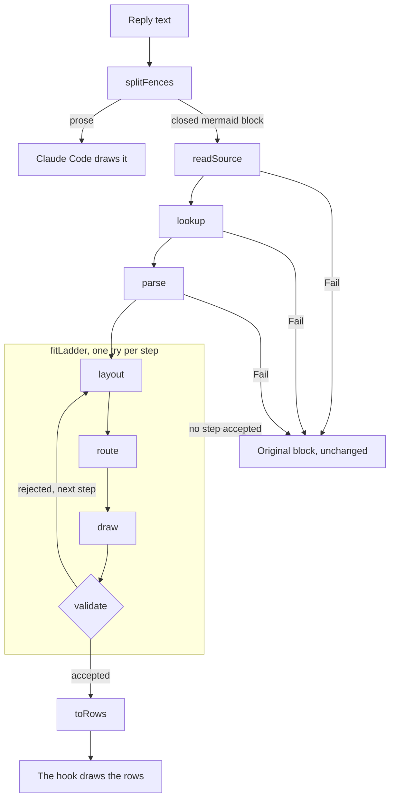

# Architecture

[Chinese (Simplified)](Architecture-zh-CN)

mermaid-tty has two parts. `core/` is the renderer: host-agnostic, dependency-free TypeScript that turns a Mermaid source into colored rows, or into a reason to fall back. `hooks/` is the Claude Code mod: it finds the diagrams in a reply, asks `core/` to draw them, and leaves everything else to Claude Code.

## Pipeline

1. **Fences.** `splitFences` (`hooks/fences.ts`) splits the reply at its closed `mermaid` blocks. The pieces join back to exactly the reply, and the prose goes on to Claude Code.
2. **Source.** `readSource` (`core/source.ts`) normalizes line endings and HTML attribute quotes, reads a strict subset of frontmatter title/config, checks directives and lexer-sensitive whitespace, and drops blank and `%%` comment lines. It returns the header, typed config scalars and remaining lines with source line numbers. `explain` then checks the title's text rules.
3. **Lookup.** `lookup` (`core/registry.ts`) takes the header's first word, less a trailing `:`, and returns that type's module. Otherwise it fails with `unknown-type`, `fallback:<keyword>`, `disabled:<type>` or `unregistered:<type>`.
4. **Parse.** The module's parser reads the lines into its model. A statement it can't read whole fails the block.
5. **Fit ladder.** `fitLadder` (`core/fit.ts`) runs the module's steps in order. Each step lays the model out at the terminal's width and draws it; for a flowchart, that is layout, route and draw. `validate` checks the drawing, and the first drawing it accepts wins. If it accepts none, the last step's reason is the result.
6. **Rows.** `toRows` (`core/render.ts`) turns the drawing into rows of styled spans, in the theme's palette.
7. **Hook.** The `ui.render` hook draws each row as a Claude Code `Text` line, with `wrap="truncate-end"`, between the prose around it.

Stage interfaces return a `Fail`, a short reason. Some parsers use an internal `stop()` that throws a `Fail` and catch it at their public boundary. Source and parse failures stop the block; layout failures advance the ladder. `explain` (`core/render.ts`) turns any unexpected throw escaping those boundaries into `internal-error`.

## Modules

**`core/`.** The renderer. It runs under both Claude Code's loader and Node's type stripping, with no build step.

| File | Role |
|---|---|
| `render.ts` | The entry point: `explain`, `renderMermaid`, `toRows`, and `createRenderer`, the cached renderer the hook uses. |
| `source.ts` | `readSource`: a block's header, frontmatter title and lines. |
| `registry.ts` | Every header keyword and its type, `ENABLED`, `register` and `lookup`. |
| `fit.ts` | `fitLadder`: tries a type's steps until `validate` accepts a drawing. |
| `validate.ts` | The validator: the fail-closed gate between a layout and the screen. |
| `canvas.ts` | The cell grid: each cell's glyph, role and owners, a write policy, and a conflict log. |
| `glyphs.ts` | `GLYPHS`, the glyph allow-list, and the Box Drawing glyph for a cell's arms. |
| `box-table.ts` | Generated by `scripts/gen-box-table.ts`: the 80 light and heavy Box Drawing glyphs, by arms. |
| `width.ts` | `width`, the one width function, and `unsupported`. |
| `width-table.ts` | Generated by `scripts/gen-width-table.ts`: the East Asian Wide and Fullwidth ranges. |
| `text.ts` | `drawable` enforces Mermaid's field-specific entity, HTML, Markdown, icon, math and newline rules; `labelLines` splits supported breaks; `wrap` fills a line into pieces. |
| `caps.ts` | Each node shape's end caps, and the `@{ shape: … }` names. |
| `themes.ts` | The six themes: each role's and series' color. |
| `color.ts` | WCAG contrast and OKLab distance, for `scripts/check-palettes.ts`. |
| `lru.ts` | The least-recently-used cache. |
| `fail.ts` | `Fail`, the one fallback result. |

**`core/graph/`.** The shared graph ladder, layered layout and router used by flowchart, state, class and ER diagrams.

| File | Role |
|---|---|
| `model.ts` | The graph model: nodes, edges and clusters. Types only. |
| `layered.ts` | The layered layout: a graph placed on a cell grid, each cluster a frame. |
| `place.ts` | One level: ranks and chains, strip spacers, order, then the cross and main axes. |
| `ranks.ts` | Cycle breaking, and each unit's longest-path rank. |
| `chains.ts` | A level's items: units on their ranks, a label node mid-way along a labelled edge, and a dummy on every other rank an edge spans. |
| `clusters.ts` | The cluster tree, and which clusters are sealed: no edge crosses their border. |
| `strips.ts` | Cluster strips, and the spacers that keep other items out of them. |
| `order.ts` | Order within ranks: barycenter sweeps; the order with the fewest crossings wins. |
| `nest.ts` | One rank's order, each strip's items kept together. |
| `cross.ts` | The cross axis: each rank packed, then items pulled toward their medians. |
| `main-axis.ts` | The main axis: each rank's band, and the gaps between bands. |
| `sizes.ts` | Box sizes: a node's widest label piece, its pads and its caps. |
| `gaps.ts` | The gaps between rank bands, read back for the router. |
| `route.ts` | The router: orthogonal routes, by a weighted Manhattan search with a shared budget. |
| `draw.ts` | A placed, routed graph drawn on the canvas: nodes, frames, routes and labels. |
| `ladder.ts` | Shared `natural`, `tight`, `wrap`, conditional `lrToTd` and `keyed` steps; retries routing with extra gaps. |
| `members.ts` | Class member rows and ER attribute columns, with owner ids and fixed wrapping. |
| `notes.ts` | Side notes, or separate note nodes with dotted links for horizontal graphs. |

**`core/charts/`.** Shared chart primitives: `decimal.ts` does exact rational arithmetic; `scale.ts` maps values to cells; `bars.ts` draws eighth-cell bars; `axis.ts` draws ticks; `sheet.ts` stacks headings and drawings; `legend.ts` binds short keys to full text.

**`core/diagrams/`.** Each type has a folder, such as `core/diagrams/flowchart/` and `core/diagrams/sequence/`. Its `parse.ts` reads a block into the type's model, and its `layout.ts` holds the type's ladder and lays out each step. Importing `layout.ts` registers the module. `core/render.ts` imports flowchart and sequence directly, then `core/diagrams/all.ts` loads the other eleven types. All 13 are enabled.

**`hooks/`.** The Claude Code mod.

| File | Role |
|---|---|
| `hooks.json` | Loads `register.tsx`. |
| `register.tsx` | Registers the `/mermaid-tty` command and the `ui.render` hook, and keeps the mode in `$.state`. |
| `fences.ts` | `splitFences`: a reply's prose and closed `mermaid` blocks. |
| `mode.ts` | When a reply passes through untouched, and the command's argument and reply. |

`types/mermaid-tty.d.ts` declares the plugin's state: `mermaid-tty.source`, a boolean.

## Validation and fallback

`validate` (`core/validate.ts`) is the fail-closed gate between a layout and the screen. Each layout declares what its drawing must show in `Expect`, by owner id and, where needed, exact position. The gate checks:

1. **Labels once.** Every nonblank label occurs once for its owner, compared after whitespace normalization; blank labels draw no text. Identical text on distinct owners is allowed (`label-missing`, `label-dup`).
2. **Edges and heads.** Every edge connects its own endpoints. Each endpoint mark has the right glyph and position; directional heads point at their node, not a junction (`edge-disconnected`, `end-misplaced`, `head-extra`, `head-on-junction`).
3. **Honest lines.** No dangling arms, ambiguous crossings or merged trunks that imply nonexistent links. Line glyphs match their recorded arms and weight (`line-dangling`, `crossing-ambiguous`, `line-glyph`, `merge-ambiguous`).
4. **No overwrite; correct width.** No canvas conflicts, and every emitted row fits the requested columns (`overwrite`, `row-too-wide`).
5. **Labels and frames.** Edge labels stay adjacent to their route; frames stay closed; an edge between nodes inside a frame stays inside it, and an edge crosses a frame's border only once, and only when the frame holds exactly one of its ends. End labels unambiguously identify their own edge end (`label-not-adjacent`, `frame-broken`, `edge-outside-frame`, `edge-crosses-frame`, `end-label`).
6. **Chart and member structure.** Bars have the expected eighth-cell length and location. Class members and ER attribute columns belong to their own pill and sit in their declared row/column. Keys appear once in place and once beside their own legend text, and keyable classes are keyed all or none.
7. **Meaningful positions.** Event order, semantic glyphs and their positions, axis/category labels, row labels, side notes, lifelines and text inside pills remain bound to their intended items. Merely preserving the words is not enough.

The complete reason groups are in [Usage](Usage), under "The drawing would mislead". Mutation fuzz tests, including `tests/core/validate_mutation_fuzz_test.ts`, alter real fixture drawings without changing their expectations and require rejection of misleading mutations. They run with `node --test` in CI on all three OSes.

`fitLadder` also rejects a drawing that declares other columns than it was given (`columns-mismatch`). On any `Fail`, the hook keeps the original block, unchanged, as part of the prose around it, and logs `mermaid-tty fallback: <reason>` at debug level. Nothing else changes on screen.

**Glyph allow-list.** Outside source text, drawn glyphs come from `GLYPHS` in `core/glyphs.ts`: printable ASCII, the Box Drawing block (U+2500 to U+257F), `►◄▲▼◇●◉`, bar glyphs `▏▎▍▌▋▊▉█▁▂▃▄▅▆▇`, and chart marks `✓▸◆·■○△□▷◁▽«»⊗◎↑↓`. No non-ASCII glyph in this set has the Unicode `Emoji` property, since terminals may draw those as wide emoji. Horizontal arrowheads are `►` and `◄`, never `▶` or `◀`. Tests pin the allow-list and check renderer output.

## Width

`width` (`core/width.ts`) is the one width function. It sums the columns of each code point:

- 2 for an East Asian Wide or Fullwidth code point, found by binary search in `core/width-table.ts`;
- 0 for a combining mark (Mn, Me) or a zero-width character: U+200B, U+200C, U+2060 or U+FEFF;
- 1 for everything else, East Asian Ambiguous code points such as the box-drawing glyphs included.

`scripts/gen-width-table.ts` generates the table from the committed Unicode 16.0.0 file `scripts/data/EastAsianWidth-16.0.0.txt`, and a test pins that file's SHA-256.

`unsupported` returns the first code point that terminals draw at differing widths: the zero-width joiner, variation selectors, regional indicators, emoji modifiers, control characters and the other format characters, except the supported zero-width ones. `readSource` checks the frontmatter title, and each type's parser checks its drawn text. The separate `drawable` rules reject text Mermaid would transform, not merely text with uncertain width.

Everything that measures goes through `width`:

- Box sizes come from a label's widest piece (`core/graph/sizes.ts`).
- `wrap` (`core/text.ts`) splits a line only at spaces or between two wide characters, so a Latin word is never split.
- On the canvas, a wide character takes two cells. The second is a `cont` cell, which `toRows` skips.
- The validator's row check measures each row exactly as `toRows` emits it.

So a row the validator accepts is as wide on screen as it measured, in a terminal that follows the East Asian Width table and draws ambiguous-width characters one column wide.

## Hook and cache

`hooks/hooks.json` loads `hooks/register.tsx`, which registers three hooks:

- **`session.start`** registers the `/mermaid-tty` command.
- **`command.run`** parses the command's argument, keeps the mode in `$.state` as `mermaid-tty.source`, and invalidates `ui.render`, so the replies on screen are drawn again in the new mode.
- **`ui.render`**, on `AssistantMessage`, draws a reply. The reply passes through untouched when the viewport has no width, on any surface but the terminal, in source mode, or when the message is marked expanded. Otherwise the hook splits the reply, renders each `mermaid` block, and joins each block that falls back to the prose around it. If nothing was drawn, the reply goes to Claude Code untouched. Otherwise the hook returns a column of prose, which Claude Code draws, and diagram rows. When a reply opens on a diagram, the hook first sends Claude Code an empty block, which draws the reply's bullet.

The theme comes from the plugin's options, read once when `register` runs. That is why a theme change needs a restart.

**The cache.** The hook builds one renderer, with an LRU cache of 64 entries, keyed by the block's body, the terminal's columns and the theme:

- A miss renders the block and stores its rows, or its `Fail`.
- A hit returns the stored result, and makes it the most recently used.
- Adding a 65th entry evicts the least recently used one.
- A `Fail` logs its reason only on the miss, so a block that falls back logs once while it stays cached.
- Columns that are not a positive safe integer fail `bad-columns` before the cache, so every key is exact.
