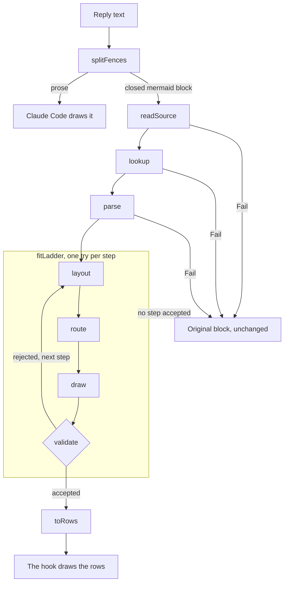

# Architecture

[Chinese (Simplified)](Architecture-zh-CN)

mermaid-tty has two parts. `core/` is the renderer: host-agnostic, dependency-free TypeScript that turns a Mermaid source into colored rows, or into a reason to fall back. `hooks/` is the Claude Code mod: it finds the diagrams in a reply, asks `core/` to draw them, and leaves everything else to Claude Code.

## Pipeline

1. **Fences.** `splitFences` (`hooks/fences.ts`) splits the reply at its closed `mermaid` blocks. The pieces join back to exactly the reply, and the prose goes on to Claude Code.
2. **Source.** `readSource` (`core/source.ts`) normalizes line endings and HTML attribute quotes, reads a strict subset of frontmatter title/config, checks directives and lexer-sensitive whitespace, and drops blank and `%%` comment lines. It returns the header, typed config scalars and remaining lines with source line numbers. `explain` then checks the title's text rules.
3. **Lookup.** `lookup` (`core/registry.ts`) takes the header's first word, less a trailing `:`, and returns that type's module. Otherwise it fails with `unknown-type`, `fallback:<keyword>`, `disabled:<type>` or `unregistered:<type>`.
4. **Parse.** The module's parser reads the lines into its model. A statement it can't read whole fails the block.
5. **Fit ladder.** `fitLadder` (`core/fit.ts`) runs the module's steps in order. Each step lays the model out at the terminal's width and draws it; for a flowchart, that is layout, route and draw. `validate` checks the drawing, and the first drawing it accepts wins. `validate` measures row widths first, so a step too wide for the terminal is rejected before the costlier checks. If it accepts none, the result is the first reason that is not about width (`too-wide`, `row-too-wide` or `word-too-wide`), so the debug log names what kept a drawing that fitted off the screen; when width is all that failed, it is the last step's reason. The steps run in two rounds: first the diagram's own, then its fallbacks (`fallbacks`), the steps that draw it another way. For a graph type (flowchart, state, class, ER) written `LR` or `RL`, those are `lrToTd` and `keyed`, which turn `LR` top to bottom and `RL` bottom to top. `lrToTd` tries natural spacing, then tight, then wrapped. On the rescue its tries share one budget, so their order decides which graphs draw; it tries that order, then, on the budget it started with again, the tight spacing first, wrapped as the terminal needs. Neither order can then spend the budget the other needs. In each round every step runs plainly. Only after every plain step has failed does a graph type run that round's steps again through its `rescue` layout, in the same order and under the same checks, and the first drawing it draws is taken. Each rescue pass shares `RESCUE_WORK` (50,000) path-search expansions across its steps, wraps, gaps and searches, and stops once they are spent. If a pass draws nothing, a second pass runs the same way on its own `RESCUE_WORK`, with rip-up on: the search router routes again with each edge it got stuck on first. So a diagram draws its own way whenever any step or rescue can, and turns only when none can. A diagram no rescue can draw falls back after at most two passes per round: 100,000 expansions, or 300,000 for a graph with fallbacks, whose `lrToTd` rescue runs its two orders on 50,000 each. A rescue that draws nothing leaves the steps' reason. Because a round's rescue runs after its plain steps, a drawing those steps find never changes.
6. **Rows.** `toRows` (`core/render.ts`) turns the drawing into rows of styled spans, in the theme's palette.
7. **Hook.** The `ui.render` hook draws each row as a Claude Code `Text` line, with `wrap="truncate-end"`, between the prose around it.

Stage interfaces return a `Fail`, a short reason. Some parsers use an internal `stop()` that throws a `Fail` and catch it at their public boundary. Source and parse failures stop the block; layout failures advance the ladder. `explain` (`core/render.ts`) turns any unexpected throw escaping those boundaries into `internal-error`.

## Modules

**`core/`.** The renderer. It runs under both Claude Code's loader and Node's type stripping, with no build step.

| File | Role |
|---|---|
| `render.ts` | The entry point: `explain`, `renderMermaid`, `toRows`, and `createRenderer`, the cached renderer the hook uses. |
| `source.ts` | `readSource`: a block's header, frontmatter title and lines. |
| `registry.ts` | Every header keyword and its type, `ENABLED`, `register` and `lookup`. |
| `fit.ts` | `fitLadder`: tries a type's steps until `validate` accepts a drawing, then, if none did, its `rescue` layout for each step. |
| `validate.ts` | The validator: the fail-closed gate between a layout and the screen. |
| `canvas.ts` | The cell grid: each cell's glyph, role and owners, a write policy, and a conflict log. |
| `glyphs.ts` | `GLYPHS`, the glyph allow-list, and the Box Drawing glyph for a cell's arms. |
| `box-table.ts` | Generated by `scripts/gen-box-table.ts`: the 80 light and heavy Box Drawing glyphs, by arms. |
| `width.ts` | `width`, the one width function, and `unsupported`. |
| `width-table.ts` | Generated by `scripts/gen-width-table.ts`: the East Asian Wide and Fullwidth ranges. |
| `text.ts` | `drawable` enforces Mermaid's field-specific entity, HTML, Markdown, icon, math and newline rules; `labelLines` splits supported breaks; `wrap` fills a line into pieces. |
| `caps.ts` | Each node shape's end caps, and the `@{ shape: … }` names. |
| `themes.ts` | The six themes: each role's and series' color. |
| `color.ts` | WCAG contrast and OKLab distance, for `scripts/check-palettes.ts`. |
| `lru.ts` | The least-recently-used cache. |
| `fail.ts` | `Fail`, the one fallback result. |

**`core/graph/`.** The shared graph ladder, layered layout and router used by flowchart, state, class and ER diagrams.

| File | Role |
|---|---|
| `model.ts` | The graph model: nodes, edges and clusters. Types only. |
| `layered.ts` | The layered layout: a graph placed on a cell grid, each cluster a frame. It moves each back edge's bends and label into its lane, the label near the edge's source unless a frame stands between them, and moves a label or bend toward its edge's ends only where it neither crowds another box nor jumps over a frame. |
| `place.ts` | One level: ranks and chains, strip spacers, order, then the cross and main axes. |
| `ranks.ts` | Cycle breaking, and each unit's longest-path rank. |
| `chains.ts` | A level's items: units on their ranks, a label node mid-way along a labelled edge, and a dummy on every other rank an edge spans. |
| `clusters.ts` | The cluster tree, and which clusters are sealed: no edge crosses their border. |
| `strips.ts` | Cluster strips, and the spacers that keep other items out of them. |
| `order.ts` | Order within ranks: barycenter sweeps; the order with the fewest crossings wins. |
| `nest.ts` | One rank's order, each strip's items kept together. |
| `sides.ts` | `keepSides`: a strip's frame is a wall on the ranks it spans, so each edge's labels, bends and movable ends outside it stay on one side: the side its outer end comes from when the strip holds an end, else the side most of a group of edges sharing nodes is on. An end of a back edge drawn in a lane keeps to the lane's side. Only items at the strip's own level move, so no other subgraph loses one of its own. |
| `cross.ts` | The cross axis: each rank packed, then items pulled toward their medians. |
| `main-axis.ts` | The main axis: each rank's band and its gaps. A strip's first border gets two cells outside it for a turn and arrow stem when a fan-out enters and bypasses the strip, when a label or bend right before it leads into it, or when an edge from the rank before it passes over it or leaves from over it; its incoming channel stays inside. A self-loop on a strip's last rank gets room before its border. |
| `sizes.ts` | Box sizes: a node's widest label piece, its pads and its caps. |
| `gaps.ts` | The gaps between rank bands, read back for the router. |
| `route.ts` | The router's entry point: which back edges take outside lanes, and which router draws the rest, the channel router first, then the search router. If outside lanes fail for back edges sharing an endpoint, or on a rescue for a lane a node beside its end blocks, bounded general search tries other attachment slots while keeping labels and waypoints. A bottom-to-top or right-to-left layout none of them routes is routed turned over (`mirror.ts`). |
| `channels.ts` | The channel router, tried first: each edge runs down the gaps between rank bands and turns across in a track of its gap. Any conflict sends the whole graph to the search router. |
| `search.ts` | The search router: each edge in turn, by a weighted Manhattan search (`find-path.ts`) with a shared budget, through its label and bends. It keeps one cell clear round every other box, the row before each arrowhead's face for its stem, a frame that holds neither end shut, and a frame that holds one end crossed once: each leg of the route keeps to its side of it. In a rescue, every path search also draws on the rescue pass's shared work, and the first edge that runs the budget out gets one refill and tries its source slots again. Each slot gets an even share of what is left, and that share bounds every path search the slot runs, so a slot that reaches no target cannot starve the rest. One search spends at most twice the budget. On the second rescue pass it routes again, up to four times, with the edge it got stuck on first. |
| `lanes.ts` | The outside-lane router: a back edge with a label or a bend, drawn in its lane past everything at its level, against the routes already placed. |
| `mirror.ts` | A bottom-to-top or right-to-left layout turned into top-to-bottom or left-to-right, and its routes turned back. |
| `route-base.ts` | What the routers share: routes, walls, fences, label ink and the frame-crossing check. |
| `compact.ts` | A drawing without its slack: each run of rows that only carry `│`, and of columns that only carry `─`, shortened. |
| `find-path.ts` | The grid path search the routers share: a weighted Manhattan search over cells and directions. |
| `draw.ts` | A placed, routed graph drawn on the canvas: nodes, frames, routes and labels. |
| `ladder.ts` | Shared `natural`, `tight`, `wrap`, conditional `lrToTd` and `keyed` steps, each a list of tries of a spacing and a wrap width; retries routing with extra gaps. `lrToTd`, the fallback for a left-to-right graph, tries what a top-down graph tries: natural, tight, then wrapped. `drawAt` with rescue routes every try with the router's rescue on; it is the graph types' `rescue` layout. |
| `members.ts` | Class member rows and ER attribute columns, with owner ids and fixed wrapping. |
| `notes.ts` | Side notes, or separate note nodes with dotted links for horizontal graphs. |

**`core/charts/`.** Shared chart primitives: `decimal.ts` does exact rational arithmetic; `scale.ts` maps values to cells; `bars.ts` draws eighth-cell bars; `axis.ts` draws ticks; `sheet.ts` stacks headings and drawings; `legend.ts` binds short keys to full text.

**`core/diagrams/`.** Each type has a folder, such as `core/diagrams/flowchart/` and `core/diagrams/sequence/`. Its `parse.ts` reads a block into the type's model, and its `layout.ts` holds the type's ladder and lays out each step. Importing `layout.ts` registers the module. `core/render.ts` imports flowchart and sequence directly, then `core/diagrams/all.ts` loads the other eleven types. All 13 are enabled.

**`hooks/`.** The Claude Code mod.

| File | Role |
|---|---|
| `hooks.json` | Loads `register.tsx`. |
| `register.tsx` | Registers the `/mermaid-tty` command, the `/btw` takeover and the `ui.render` hooks, and keeps the mode in `$.state`. |
| `fences.ts` | `splitFences`: a reply's prose and closed `mermaid` blocks. |
| `mode.ts` | When a reply passes through untouched, and the command's argument and reply. |
| `btw.ts` | When mermaid-tty answers `/btw` (`takesBtw`), the side-question prompt the fork gets (`forkPrompt`), the stored answer's shape, a transcript row's id (`rowId`), and the cue shown while it answers: the row's text (`BTW_STATUS`), the marker's path (`markerPath`), and when the marker is used (`usesMarker`, `isWindows`). |
| `btw-history.ts` | The side question's own request when there is nothing to fork: its system prompt (`SIDE_SYSTEM`), the conversation as JSON in `<conversation_history>` with the question after it (`historyPrompt`, newest turns kept up to `HISTORY_CHARS`, each tool call clipped to `TOOL_CHARS`), and the note on an answer cut at `ANSWER_TOKENS` (`answerText`). With no conversation, its own system prompt (`QUESTION_SYSTEM`) and the question alone (`questionPrompt`). |

`types/mermaid-tty.d.ts` declares the plugin's state: `mermaid-tty.source`, `true`, `'text'` or unset, and `mermaid-tty.images`, `'auto'`, `'on'` or `'off'`, among others, such as `mermaid-tty.btw`, the latest `/btw` question and answer shown in the pane, and `mermaid-tty.btwRow`, a family with one value per transcript row: the question and answer it draws, or `null` for a row that wasn't placed.

## Validation and fallback

`validate` (`core/validate.ts`) is the fail-closed gate between a layout and the screen. Each layout declares what its drawing must show in `Expect`, by owner id and, where needed, exact position. The gate checks:

1. **Labels once.** Every nonblank label occurs once for its owner, compared after whitespace normalization; blank labels draw no text. Identical text on distinct owners is allowed (`label-missing`, `label-dup`).
2. **Edges and heads.** Every edge connects its own endpoints. Each endpoint mark has the right glyph and position; directional heads point at their node, not a junction (`edge-disconnected`, `end-misplaced`, `head-extra`, `head-on-junction`).
3. **Honest lines.** No dangling arms, ambiguous crossings or merged trunks that imply nonexistent links. Line glyphs match their recorded arms and weight, and every line cell of an edge draws in that edge's own line style (solid, thick or dotted; an invisible edge draws none) (`line-dangling`, `crossing-ambiguous`, `line-glyph`, `merge-ambiguous`).
4. **No overwrite; correct width.** No canvas conflicts, and every emitted row fits the requested columns (`overwrite`, `row-too-wide`).
5. **Labels and frames.** Edge labels stay adjacent to their route; frames stay closed; each frame holds its own nodes, every cell of each strictly inside it; an edge between nodes inside a frame stays inside it, and an edge crosses a frame's border only once, and only when the frame holds exactly one of its ends. End labels unambiguously identify their own edge end (`label-not-adjacent`, `frame-broken`, `node-outside-frame`, `edge-outside-frame`, `edge-crosses-frame`, `end-label`).
6. **Chart and member structure.** Bars have the expected eighth-cell length and location. Class members and ER attribute columns belong to their own pill and sit in their declared row/column. Keys appear once in place and once beside their own legend text, and keyable classes are keyed all or none.
7. **Meaningful positions.** Event order, semantic glyphs and their positions, axis/category labels, row labels, side notes, lifelines and text inside pills remain bound to their intended items. Merely preserving the words is not enough.

The complete reason groups are in [Usage](Usage), under "The drawing would mislead". Mutation fuzz tests, including `tests/core/validate_mutation_fuzz_test.ts`, alter real fixture drawings without changing their expectations and require rejection of misleading mutations. They run with `node --test` in CI on all three OSes.

`fitLadder` also rejects a drawing that declares other columns than it was given (`columns-mismatch`). On any `Fail`, the hook keeps the original block, unchanged, as part of the prose around it, and logs `mermaid-tty fallback: <reason>` at debug level. Nothing else changes on screen.

**Glyph allow-list.** Outside source text, drawn glyphs come from `GLYPHS` in `core/glyphs.ts`: printable ASCII, the Box Drawing block (U+2500 to U+257F), `►◄▲▼◇●◉`, bar glyphs `▏▎▍▌▋▊▉█▁▂▃▄▅▆▇`, and chart marks `✓▸◆·■○△□▷◁▽«»⊗◎↑↓`. No non-ASCII glyph in this set has the Unicode `Emoji` property, since terminals may draw those as wide emoji. Horizontal arrowheads are `►` and `◄`, never `▶` or `◀`. Tests pin the allow-list and check renderer output.

## Width

`width` (`core/width.ts`) is the one width function. It sums the columns of each code point:

- 2 for an East Asian Wide or Fullwidth code point, found by binary search in `core/width-table.ts`;
- 0 for a combining mark (Mn, Me) or a zero-width character: U+200B, U+200C, U+2060 or U+FEFF;
- 1 for everything else, East Asian Ambiguous code points such as the box-drawing glyphs included.

`scripts/gen-width-table.ts` generates the table from the committed Unicode 16.0.0 file `scripts/data/EastAsianWidth-16.0.0.txt`, and a test pins that file's SHA-256.

`unsupported` returns the first code point that terminals draw at differing widths: the zero-width joiner, variation selectors, regional indicators, emoji modifiers, control characters and the other format characters, except the supported zero-width ones. `readSource` checks the frontmatter title, and each type's parser checks its drawn text. The separate `drawable` rules reject text Mermaid would transform, not merely text with uncertain width.

Everything that measures goes through `width`:

- Box sizes come from a label's widest piece (`core/graph/sizes.ts`).
- `wrap` (`core/text.ts`) splits a line only at spaces or between two wide characters, so a Latin word is never split.
- On the canvas, a wide character takes two cells. The second is a `cont` cell, which `toRows` skips.
- The validator's row check measures each row exactly as `toRows` emits it.

So a row the validator accepts is as wide on screen as it measured, in a terminal that follows the East Asian Width table and draws ambiguous-width characters one column wide.

## Hook and cache

`hooks/hooks.json` loads `hooks/register.tsx`, which registers these hooks:

- **`session.start`** registers the `/mermaid-tty` command and copies the picture setting from `$.store` into `$.state` as `mermaid-tty.images`, `auto` when unset, unknown or unreadable. It also sets `mermaid-tty.theme` to the configured theme and `mermaid-tty.direction` to the configured direction, so each load starts from the saved options. When a load within a session finds another direction already set, as after a `/config` change, it appends a note for the model with `$.session.append`. It starts with no `/btw` cue: it clears the status row and, when `$.fs.exists` finds this session's marker, empties it, whatever `MERMAID_TTY_BTW_STATUS` says.
- **`session.end`** takes the `/btw` cue down where it was shown, so a `/clear`, which ends the conversation and goes on under a new session id with no `session.start`, leaves no cue behind. In a terminal session it then removes the picture temp dirs.
- **`command.run`** parses the command's argument, keeps the mode in `$.state` as `mermaid-tty.source`, and invalidates `ui.render`, so the replies on screen are drawn again in the new mode. `images auto|on|off` writes the setting to `$.state` and `$.store`, so it holds for later sessions too, and invalidates `ui.render` the same way; a failing store still sets it for the session and says so. `theme <name>` writes `mermaid-tty.theme`, invalidates `ui.render`, and saves the name through `$.config.set` on the plugin's own `theme` row; a refused or failed save still sets it for the session and says so. `direction <LR|TB|off>` does the same with `mermaid-tty.direction` and the `direction` row, and appends a user row telling the model, since the thread's system prompt stays as sent. Asking again for a theme or direction whose save was refused retries the save, and for a direction whose note was refused, the note.
- **`command.run`** on `btw` answers a side question in a terminal session outside source mode. It awaits `$.model.fork` with the question after a short side-question preamble (`hooks/btw.ts`), which runs over the session's own transcript with every tool denied. A fork that comes back `nothing-to-fork`, as in a session just resumed or one whose first turn hasn't finished, holds no request of the main thread to share, so the hook asks `$.model.complete` instead, on `$.session.model()`, with `SIDE_SYSTEM` and `historyPrompt` over `$.session.messages()`, which hold the conversation since the last compaction, and `next.signal`, so Esc cuts it. A conversation with nothing to send, no text and no tool call, asks with `QUESTION_SYSTEM` and `questionPrompt`, the question alone. A `/btw` sent before Claude Code has loaded the plugin's hooks, in the first moment after a session starts, never reaches this hook: Claude Code answers it. With an answer, it keeps it as `mermaid-tty.btwRow` under a new row id (`rowId`: `btw-<$.clock.now()>-<number>`, so a reload, which numbers its `/btw` from 1 again, never reuses an id) and places a display-only transcript row with `$.ui.place`. Each answer is a value of its own: a hook's `$.state` reads are as of its dispatch, so a `/btw` queued behind another can't see that one's writes, and none reads or rewrites another's. The row is drawn at the transcript's full width; a pane docked beside a fullscreen transcript gets at most 45% of the terminal. A row placed, or not placed but given a request id, stands: the hook closes a `btw` pane an earlier answer fell back to and answers `{}`, so no output row or context reaches the conversation. A place that throws, as on Claude Code before 2.1.314, which has no `$.ui.place`, or one that places nothing, sets that row's value to `null` and falls back to the pane, as does an answer the engine refuses or doesn't set: it stores `{ question, text }` as `mermaid-tty.btw` and opens the `btw` pane with `$.ui.open` (focused, closed by Esc). A module counter drops an answer that arrives after a newer `/btw`; one overtaken while its row is placed keeps that row. Anything else hands the command to Claude Code with `next(e)`: no question, source mode, no terminal, a fork or completion that throws or comes back with no answer, and neither a row nor a pane placed; a pane not placed is closed again. A cancelled fork or completion answers `{}`. While the newest `/btw` it took is being answered, it shows a cue: `$.ui.status(BTW_STATUS)`, or, with `MERMAID_TTY_BTW_STATUS=file` and not on Windows, `1` written with `$.fs.write` to `markerPath($HOME, session id)`, falling back to the row when the write fails. The cue's state lives in the module (`Cues`): the number of the `/btw` it stands for, where it is shown, and its writes, which `syncCue` runs one at a time, each showing or hiding the cue until it matches the newest `/btw`. A `/btw` that hands the command on takes the cue down first, and one that leaves takes it down only while it is still the one the cue stands for. A marker is emptied rather than deleted, as the engine has no file removal. The row is best effort. mermaid-tty sends its row calls in the order the cue needs and waits on none of them, so a call a hook never lets through holds no `/btw` up. `$.ui.status` returns before the hooks beneath it run and says nothing of when they apply a call, so a hook of another plugin's that holds one may apply it after a later one, and the row can then be up or down out of turn. Every way a `/btw` ends and every `session.end` clears the row once more while no `/btw` is answered. With no such hook, the row follows the cue, as the end-to-end tests show on a real screen. The marker has no such limit: each write is awaited before the next, so a status line reads it in order. `session.end` takes the cue down and removes the picture temp dirs side by side, so a slow marker write never eats into the time the pictures get.
- **`ui.render`**, on `Placed`, draws a `/btw` row of mermaid-tty's in a round dim border: the question, dimmed, then the answer planned as a reply is (`safePlan`) at the transcript's width less the border and padding (`ROW_FRAME`), its drawn fences as rows or pictures and its prose as `Markdown`. When nothing draws, the plan fails, the mode is source, the surface isn't the terminal or no width was measured, the whole answer is one `Markdown`. Another plugin's row, or one whose answer is no longer kept, calls `next(e)`.
- **`ui.render`**, on `Pane` with request id `btw`, draws the pane's stored answer on the terminal the same way, at the pane's body width. On another surface, or with no answer stored, it calls `next(e)`.
- **`prompt.compose`** adds the section `mermaid-tty:flowchart-direction` after the engine's sections, on the session side of the cache boundary, asking Claude to open the flowcharts it writes with `flowchart LR` or `flowchart TB`. It adds nothing when the direction is `off` or the session draws in no terminal, and sends the engine's sections unchanged if it fails.
- **`ui.render`**, on `AssistantMessage`, draws a reply. The reply passes through untouched when the viewport has no width, on any surface but the terminal, in source mode, or when the message is marked expanded. Otherwise the hook splits the reply, renders each `mermaid` block, and joins each block that falls back to the prose around it. If nothing was drawn, the reply goes to Claude Code untouched. Otherwise the hook returns a column of prose, which Claude Code draws, and diagram rows. When a reply opens on a diagram, the hook first sends Claude Code an empty block, which draws the reply's bullet.

The theme a drawing uses is `mermaid-tty.theme`, read while drawing, so a change redraws at once. When it is unset, the drawing uses the plugin's `theme` option, and `nord` when that is unset or unknown.

**The cache.** The hook builds one renderer, with an LRU cache of 64 entries, keyed by the block's body, the terminal's columns and the theme:

- A miss renders the block and stores its rows, or its `Fail`.
- A hit returns the stored result, and makes it the most recently used.
- Adding a 65th entry evicts the least recently used one.
- A `Fail` logs its reason only on the miss, so a block that falls back logs once while it stays cached.
- Columns that are not a positive safe integer fail `bad-columns` before the cache, so every key is exact.
