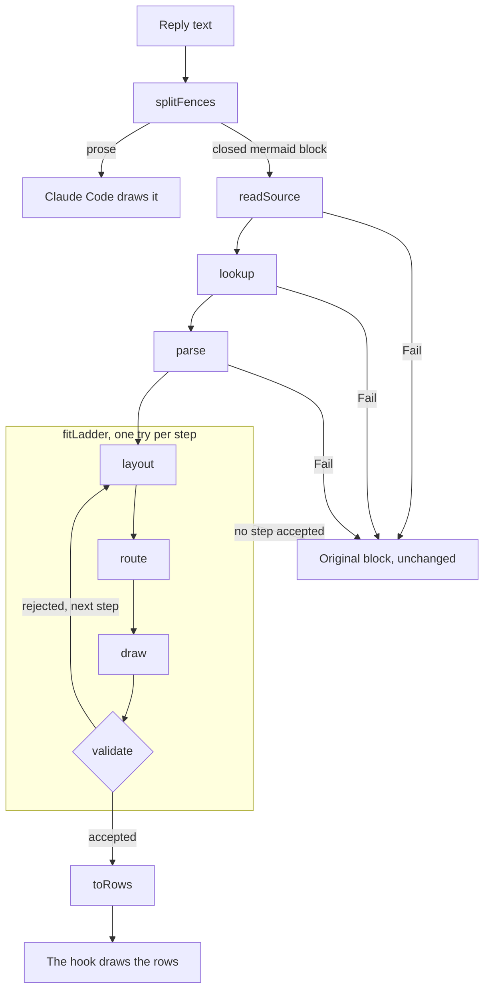

# Architecture

[Chinese (Simplified)](Architecture-zh-CN)

mermaid-tty has two parts. `core/` is the renderer: host-agnostic, dependency-free TypeScript that turns a Mermaid source into colored rows, or into a reason to fall back. `hooks/` is the Claude Code mod: it finds the diagrams in a reply, asks `core/` to draw them, and leaves everything else to Claude Code.

## Pipeline

1. **Fences.** `splitFences` (`hooks/fences.ts`) splits the reply at its closed `mermaid` blocks. The pieces join back to exactly the reply, and the prose goes on to Claude Code.
2. **Source.** `readSource` (`core/source.ts`) normalizes line endings, reads the frontmatter title, and drops blank and `%%` comment lines. It returns the header and the remaining lines, with their line numbers.
3. **Lookup.** `lookup` (`core/registry.ts`) takes the header's first word, less a trailing `:`, and returns that type's module. Otherwise it fails with `unknown-type`, `fallback:<keyword>`, `disabled:<type>` or `unregistered:<type>`.
4. **Parse.** The module's parser reads the lines into its model. A statement it can't read whole fails the block.
5. **Fit ladder.** `fitLadder` (`core/fit.ts`) runs the module's steps in order. Each step lays the model out at the terminal's width and draws it; for a flowchart, that is layout, route and draw. `validate` checks the drawing, and the first drawing it accepts wins. If it accepts none, the last step's reason is the result.
6. **Rows.** `toRows` (`core/render.ts`) turns the drawing into rows of styled spans, in the theme's palette.
7. **Hook.** The `ui.render` hook draws each row as a Claude Code `Text` line, with `wrap="truncate-end"`, between the prose around it.

Every stage returns a `Fail`, a short reason, instead of throwing, and the first `Fail` wins. `explain` (`core/render.ts`) runs the stages, and turns any throw below it, which would be a bug, into `internal-error`.

## Modules

**`core/`.** The renderer. It runs under both Claude Code's loader and Node's type stripping, with no build step.

| File | Role |
|---|---|
| `render.ts` | The entry point: `explain`, `renderMermaid`, `toRows`, and `createRenderer`, the cached renderer the hook uses. |
| `source.ts` | `readSource`: a block's header, frontmatter title and lines. |
| `registry.ts` | Every header keyword and its type, `ENABLED`, `register` and `lookup`. |
| `fit.ts` | `fitLadder`: tries a type's steps until `validate` accepts a drawing. |
| `validate.ts` | The validator: the fail-closed gate between a layout and the screen. |
| `canvas.ts` | The cell grid: each cell's glyph, role and owners, a write policy, and a conflict log. |
| `glyphs.ts` | `GLYPHS`, the glyph allow-list, and the Box Drawing glyph for a cell's arms. |
| `box-table.ts` | Generated by `scripts/gen-box-table.ts`: the 80 light and heavy Box Drawing glyphs, by arms. |
| `width.ts` | `width`, the one width function, and `unsupported`. |
| `width-table.ts` | Generated by `scripts/gen-width-table.ts`: the East Asian Wide and Fullwidth ranges. |
| `text.ts` | `labelLines` splits a label at ` `; `wrap` fills a line into pieces. |
| `caps.ts` | Each node shape's end caps, and the `@{ shape: … }` names. |
| `themes.ts` | The six themes: each role's and series' color. |
| `color.ts` | WCAG contrast and OKLab distance, for `scripts/check-palettes.ts`. |
| `lru.ts` | The least-recently-used cache. |
| `fail.ts` | `Fail`, the one fallback result. |

**`core/graph/`.** The layered layout and router that flowcharts draw with.

| File | Role |
|---|---|
| `model.ts` | The graph model: nodes, edges and clusters. Types only. |
| `layered.ts` | The layered layout: a graph placed on a cell grid, each cluster a frame. |
| `place.ts` | One level: ranks and chains, strip spacers, order, then the cross and main axes. |
| `ranks.ts` | Cycle breaking, and each unit's longest-path rank. |
| `chains.ts` | A level's items: units on their ranks, a label node mid-way along a labelled edge, and a dummy on every other rank an edge spans. |
| `clusters.ts` | The cluster tree, and which clusters are sealed: no edge crosses their border. |
| `strips.ts` | Cluster strips, and the spacers that keep other items out of them. |
| `order.ts` | Order within ranks: barycenter sweeps; the order with the fewest crossings wins. |
| `nest.ts` | One rank's order, each strip's items kept together. |
| `cross.ts` | The cross axis: each rank packed, then items pulled toward their medians. |
| `main-axis.ts` | The main axis: each rank's band, and the gaps between bands. |
| `sizes.ts` | Box sizes: a node's widest label piece, its pads and its caps. |
| `gaps.ts` | The gaps between rank bands, read back for the router. |
| `route.ts` | The router: orthogonal routes, by a weighted Manhattan search with a shared budget. |
| `draw.ts` | A placed, routed graph drawn on the canvas: nodes, frames, routes and labels. |

**`core/diagrams/`.** Each type has a folder, such as `core/diagrams/flowchart/` and `core/diagrams/sequence/`. Its `parse.ts` reads a block into the type's model, and its `layout.ts` holds the type's ladder and lays out each step. Importing `layout.ts` registers the type's module in the registry, and `core/render.ts` imports each one.

**`hooks/`.** The Claude Code mod.

| File | Role |
|---|---|
| `hooks.json` | Loads `register.tsx`. |
| `register.tsx` | Registers the `/mermaid-tty` command and the `ui.render` hook, and keeps the mode in `$.state`. |
| `fences.ts` | `splitFences`: a reply's prose and closed `mermaid` blocks. |
| `mode.ts` | When a reply passes through untouched, and the command's argument and reply. |

`types/mermaid-tty.d.ts` declares the plugin's state: `mermaid-tty.source`, a boolean.

## Validation and fallback

`validate` (`core/validate.ts`) is the fail-closed gate between a layout and the screen. Each layout lists what its drawing must show: every label instance, by owner id; every edge, with its ends and heads; and every edge label. `validate` returns the first invariant the drawing breaks, in this order:

1. **Labels once.** Each label is drawn exactly once, as its text, for its owner id (`label-missing`, `label-dup`). Distinct nodes with identical text pass, because labels are counted by owner id.
2. **Edges connected.** A walk over an edge's line, arrow and label cells, from a cell next to its start node, reaches a cell next to its end node (`edge-disconnected`).
3. **No extra heads.** Each head is its own arrow cell of the edge, next to an end node, and a directional head points at that node. An arrow cell that no head claims is an extra head (`head-extra`). A head whose cell behind it is a junction of three or more arms has an ambiguous direction (`head-on-junction`).
4. **No dangling lines.** Every line cell of an edge has at least two arms, and each arm meets a line of the same edge, the edge's arrow or label, or one of its end nodes (`line-dangling`).
5. **No overwrite.** The canvas logged no conflict: no write hit a drawn cell beyond the merges and crossings the canvas allows, and none fell outside the grid (`overwrite`).
6. **Row widths.** No row, measured exactly as `toRows` emits it, is wider than the terminal (`row-too-wide`).
7. **Label adjacency.** Each edge label has a cell within one cell, diagonals included, of a line or arrow cell of its own edge (`label-not-adjacent`).

`fitLadder` also rejects a drawing that declares other columns than it was given (`columns-mismatch`). On any `Fail`, the hook keeps the original block, unchanged, as part of the prose around it, and logs `mermaid-tty fallback: <reason>` at debug level. Nothing else changes on screen.

**Glyph allow-list.** Outside source text, every glyph the renderer draws comes from `GLYPHS` in `core/glyphs.ts`: printable ASCII, the whole Box Drawing block (U+2500 to U+257F), and `►`, `◄`, `▲`, `▼`, `◇`, `●` and `◉`. No non-ASCII glyph in it has the Unicode `Emoji` property, since some terminals draw those as wide emoji. So heads are `►` and `◄`, never `▶` or `◀`. Tests pin the set, 230 glyphs, and check that the canvas never draws outside it.

## Width

`width` (`core/width.ts`) is the one width function. It sums the columns of each code point:

- 2 for an East Asian Wide or Fullwidth code point, found by binary search in `core/width-table.ts`;
- 0 for a combining mark (Mn, Me) or a zero-width character: U+200B, U+200C, U+2060 or U+FEFF;
- 1 for everything else, East Asian Ambiguous code points such as the box-drawing glyphs included.

`scripts/gen-width-table.ts` generates the table from the committed Unicode 16.0.0 file `scripts/data/EastAsianWidth-16.0.0.txt`, and a test pins that file's SHA-256.

`unsupported` returns the first code point that terminals draw at differing widths: the zero-width joiner, variation selectors, regional indicators, emoji modifiers, control characters and the other format characters. `readSource` checks the frontmatter title with it, and the flowchart and sequence parsers check their labels, so such text fails before layout.

Everything that measures goes through `width`:

- Box sizes come from a label's widest piece (`core/graph/sizes.ts`).
- `wrap` (`core/text.ts`) splits a line only at spaces or between two wide characters, so a Latin word is never split.
- On the canvas, a wide character takes two cells. The second is a `cont` cell, which `toRows` skips.
- The validator's row check measures each row exactly as `toRows` emits it.

So a row the validator accepts is as wide on screen as it measured, in a terminal that follows the East Asian Width table and draws ambiguous-width characters one column wide.

## Hook and cache

`hooks/hooks.json` loads `hooks/register.tsx`, which registers three hooks:

- **`session.start`** registers the `/mermaid-tty` command.
- **`command.run`** parses the command's argument, keeps the mode in `$.state` as `mermaid-tty.source`, and invalidates `ui.render`, so the replies on screen are drawn again in the new mode.
- **`ui.render`**, on `AssistantMessage`, draws a reply. The reply passes through untouched when the viewport has no width, on any surface but the terminal, in source mode, or when the message is marked expanded. Otherwise the hook splits the reply, renders each `mermaid` block, and joins each block that falls back to the prose around it. If nothing was drawn, the reply goes to Claude Code untouched. Otherwise the hook returns a column of prose, which Claude Code draws, and diagram rows. When a reply opens on a diagram, the hook first sends Claude Code an empty block, which draws the reply's bullet.

The theme comes from the plugin's options, read once when `register` runs. That is why a theme change needs a restart.

**The cache.** The hook builds one renderer, with an LRU cache of 64 entries, keyed by the block's body, the terminal's columns and the theme:

- A miss renders the block and stores its rows, or its `Fail`.
- A hit returns the stored result, and makes it the most recently used.
- Adding a 65th entry evicts the least recently used one.
- A `Fail` logs its reason only on the miss, so a block that falls back logs once while it stays cached.
- Columns that are not a positive safe integer fail `bad-columns` before the cache, so every key is exact.
