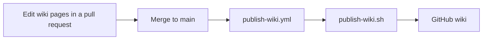

# Development and Release

[Chinese (Simplified)](Development-and-Release-zh-CN)

How the repository is laid out, what to run before a pull request, what CI runs, how the README images and the icon are made, how this wiki is published, and how a release is cut.

## Repository

The repository root is the plugin root: the marketplace entry in `.claude-plugin/marketplace.json` uses `source: "./"`.

| Path | What it holds |
|---|---|
| `.claude-plugin/` | `plugin.json`, with the `theme` option; `marketplace.json`; and `icon.png`. |
| `core/` | The renderer: host-agnostic, dependency-free TypeScript. See [Architecture](Architecture). |
| `hooks/` | The Claude Code mod: `hooks.json`, `register.tsx` and its helpers. |
| `types/` | The plugin's state type. |
| `tests/` | Node tests, named `*_test.ts`, and mods kit tests, named `*.test.tsx`, which `claude plugin test .` runs. |
| `fixtures/` | Mermaid sources for tests and scripts. |
| `scripts/` | Checks, generators, the end-to-end harness and the docs tooling. |
| `assets/` | `icon.svg` and the README images. |
| `docs/` | Specs, plans, decisions and review verdicts. |
| `wiki/` | This wiki. |
| `.github/workflows/` | CI, the wiki publisher and the release workflow. |

There is no build step and no runtime dependency. The root `package.json` has no dependencies, and Claude Code and Node 24 or later run the TypeScript as it is. Only the docs tooling (`scripts/docs/`) and the end-to-end harness (`scripts/e2e/`) install packages, each from its own lockfile.

`scripts/check-portable.ts` keeps `core/` and `hooks/` runnable in the engine's module sandbox, which has no Node and no DOM. Imports must be relative `.ts` or `.tsx` paths, apart from type-only `claude-code` imports. The code may not use `process`, `Buffer`, `document`, `window`, `require`, `eval`, `new Function` or dynamic `import()`. The check also fails if `package.json` has a `dependencies` key.

To try a checkout without installing it, load it for one session from the repository root:

```sh
claude --plugin-dir .
```

If you added the checkout as a local marketplace, with `claude plugin marketplace add ./`, Claude Code reads the plugin from the folder. Edits take effect at the next session start, or after `/reload-plugins`.

## Local checks

Before a pull request, run:

```sh
bash scripts/check.sh
npm ci --prefix scripts/e2e
node scripts/e2e/run.ts
node scripts/render-gallery.ts
node scripts/check-ci-coverage.ts
```

- `bash scripts/check.sh` is the must-pass suite, under `set -euo pipefail`. It runs `claude plugin validate .`, then `claude plugin test .` (the mods kit tests), then `node scripts/check.ts all`: every Node test under `tests/`, then the portability, benchmark, fresh-clone, corpus, gallery, tangle, review-verdict and palette checks.
- `npm ci --prefix scripts/e2e` installs the end-to-end harness's pinned packages. `node scripts/e2e/run.ts` runs the harness: real Claude Code, in a pseudo-terminal, against a mock Messages API, with no account or secret.
- `node scripts/render-gallery.ts` renders the gallery, every golden, as SVG for visual review.
- `node scripts/check-ci-coverage.ts` fails if an acceptance check has no CI step.

For a faster loop:

| Command | What it does |
|---|---|
| `node --test` | The Node tests alone. No install needed. |
| `node scripts/check.ts <ID>` | One acceptance check's steps, such as `A4` or `A8.portability`. |
| `node scripts/explain.ts FILE COLS` | How the fit ladder draws `FILE`'s diagram at `COLS` columns: the step it took and the rows, or the reason it falls back. |
| `node scripts/smoke.ts` | Draws a flowchart fixture at 80 columns under `nord`. |
| `npm ci --prefix scripts/docs` | Installs the pinned Markdown and YAML parsers that the docs checks use. |
| `node scripts/check-docs.ts` | Checks the README and its images, the wiki workflow, and the icon. |
| `node scripts/check-wiki.ts` | Checks this wiki's pages. See Wiki below. |

## CI

`.github/workflows/ci.yml` runs on every pull request and every push to `main`, on `ubuntu-latest`, `macos-latest` and `windows-latest`. Each runner sets up Node 24 and installs a pinned Claude Code from npm.

- **check**, on all three OSes: `scripts/check.sh`, the docs checks, the wiki publisher's tests, and a local-marketplace install: `claude plugin marketplace add ./`, then `claude plugin install mermaid-tty@mermaid-tty`, after which the plugin must show in `claude plugin list`.
- **e2e**, on all three OSes: the end-to-end harness, once with the default mapping, once per curated theme, and once with truecolor unavailable, where the diagram rows must carry 256-color codes.
- **Gallery:** the gallery is rendered as SVG and uploaded as a build artifact, for visual review.
- **Scheduled run:** a scheduled job runs the end-to-end harness against each newly published Claude Code version, so a change to the mods API is caught early.

Every step that runs a `.sh` script uses `shell: bash`, which is Git Bash on Windows, and every script runs under `set -euo pipefail`. So any failing command fails the job, the native Windows `claude plugin validate .` and `claude plugin test .` included. Actions are pinned by commit SHA.

`.github/workflows/release.yml` runs the release checks on a `v*` tag. See Release below.

## Images and icon

Every README image is an SVG that `scripts/render-svg.ts` renders from `core/`: real renderer output, never a screenshot. After a change that affects them, regenerate them:

```sh
node scripts/render-svg.ts --readme
```

`scripts/lib/images.ts` is the manifest: each image's Mermaid source, width and theme. It lists a before-and-after pair, a sequence diagram, a CJK diagram, and one image per theme. In each SVG, every glyph is its own `<text>` at `x = column × cell width`, so CJK alignment doesn't depend on the viewer's fonts. `scripts/check-docs.ts` fails when the README doesn't show a manifest image, shows an image that doesn't exist, or when `assets/readme/` holds an SVG the manifest doesn't list.

The plugin icon, `.claude-plugin/icon.png`, is made from `assets/icon.svg`:

```sh
bash scripts/make-icon.sh
```

The script runs on a Mac: it needs `rsvg-convert`, from `librsvg`, and `sips`. It checks that the PNG is 512×512 and under 2 MB, and `scripts/check-docs.ts` checks both again from the PNG's header.

## Wiki

`wiki/` in this repository is the only source of the GitHub wiki. Edit the pages here, in a pull request. Edits made on the GitHub wiki itself are overwritten by the next publish.



`.github/workflows/publish-wiki.yml` runs on every push to `main`, and on `workflow_dispatch`. It clones the wiki's repository and runs `scripts/publish-wiki.sh wiki wiki-repo "$GITHUB_SHA"`, which deletes the wiki's top-level Markdown pages, copies in `wiki/*.md`, and commits only when something changed. The workflow pushes only when there is a commit. Its token is read-only; only the publish job can write.

`scripts/test-wiki-publish.sh` tests the publisher in throwaway Git repositories: a first publish, an unchanged publish, a rename, and a stale page's removal. It also runs the checker on a valid fixture wiki and on broken copies of it.

`node scripts/check-wiki.ts` checks these rules:

- Each of Home, Usage, Configuration-and-Themes, Architecture and Development-and-Release exists in English, `<Page>.md`, and in Simplified Chinese, `<Page>-zh-CN.md`. The two pages of a pair have the same heading levels, in the same order.
- Each page opens with `# Title`, a blank line, then one link to its twin: `[Chinese (Simplified)](<Page>-zh-CN)` on an English page, `[英文版](<Page>)` on a Chinese one. It is the only cross-language link.
- English pages have no CJK outside code. On Chinese pages, every heading, paragraph and table row that has letters has CJK.
- No HTML and no images: draw diagrams with `mermaid` code blocks. Links go to page names, such as `[Usage](Usage)`, or to the allowlisted hosts `github.com`, `mermaid.js.org` and `docs.anthropic.com`, over `https://`.
- Usage covers Windows, macOS, Linux, `/mermaid-tty source`, `/mermaid-tty diagram` and `/copy`, and this page shows every local check command.

## Release

1. Check that CI is green on `main` on all three OSes, that `version` in `.claude-plugin/plugin.json` is the version you are releasing, and that `bash scripts/check.sh` passes. Its review step needs a passing verdict for every path in `docs/reviews/required.json`, and every reviewed file must still match its recorded SHA-256.
2. Write the release notes by hand. They must contain both install commands:

   ```sh
   claude plugin marketplace add D0n9X1n/mermaid-tty
   claude plugin install mermaid-tty@mermaid-tty
   ```

3. Publish a GitHub Release with those notes, on a new tag: `v` and the version, such as `v1.0.0`.
4. The tag runs `.github/workflows/release.yml`. It checks that the tag matches the version in `plugin.json` and that the notes contain both install commands. Then it installs the plugin from the GitHub marketplace into a fresh config, and runs the end-to-end harness on the installed copy.
5. Check that the `publish-wiki` run on `main` succeeded, and that the wiki shows the pages. GitHub creates a wiki's repository only when its first page is saved in the web UI. If the run couldn't clone the wiki, save one page there, then re-run the workflow.

Don't make the tag with `claude plugin tag`: it makes a tag such as `mermaid-tty--v1.0.0`, which doesn't start with `v`, so `release.yml` doesn't run.
