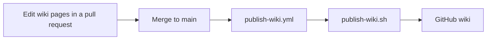

# Development and Release

[Chinese (Simplified)](Development-and-Release-zh-CN)

How the repository is laid out, what to run before a pull request, what CI runs, how the README images and the icon are made, how this wiki is published, and how a release is cut.

## Repository

The repository root is the plugin root: the marketplace entry in `.claude-plugin/marketplace.json` uses `source: "./"`.

| Path | What it holds |
|---|---|
| `.claude-plugin/` | `plugin.json`, with the `theme` option; `marketplace.json`; and `icon.png`. |
| `core/` | The renderer: host-agnostic, dependency-free TypeScript. See [Architecture](Architecture). |
| `hooks/` | The Claude Code mod: `hooks.json`, `register.tsx` and its helpers. |
| `types/` | The plugin's state type. |
| `tests/` | Node tests, named `*_test.ts`, and mods kit tests, named `*.test.tsx`, which `claude plugin test .` runs. |
| `fixtures/` | Mermaid sources for tests and scripts. |
| `scripts/` | Checks, generators, the end-to-end harness and the docs tooling. |
| `assets/` | `icon.svg` and the README images. |
| `ci/` | `coverage.json`, which maps each check ID to its CI step, and `reviews/`, the recorded verdicts of the golden reviews. |
| `CLAUDE.md` | Working rules for coding agents: workflow, release, documentation, code style and tests. |
| `wiki/` | This wiki: the only documentation. There is no `docs/` folder, and `check-docs` fails if one appears. |
| `.github/workflows/` | CI, the wiki publisher and the release workflow. |

There is no build step and no runtime dependency. The root `package.json` has no dependencies, and Claude Code and Node 24 or later run the TypeScript as it is. Only the docs tooling (`scripts/docs/`) and the end-to-end harness (`scripts/e2e/`) install packages, each from its own lockfile.

`scripts/check-portable.ts` keeps `core/` and `hooks/` runnable in the engine's module sandbox, which has no Node and no DOM. Imports must be relative `.ts` or `.tsx` paths, apart from type-only `claude-code` imports. The scanner rejects `process`, `Buffer`, `document`, `window`, `globalThis`, `Reflect`, `require`, `eval`, `Function`, `constructor`, dynamic `import()` and Unicode escapes outside literals/comments. The check also fails if `package.json` has a `dependencies` key.

To try a checkout without installing it, load it for one session from the repository root:

```sh
claude --plugin-dir .
```

If you added the checkout as a local marketplace, with `claude plugin marketplace add ./`, Claude Code reads the plugin from the folder. Edits take effect at the next session start, or after `/reload-plugins`.

## Local checks

Before a pull request, run:

```sh
bash scripts/check.sh
npm ci --prefix scripts/e2e
node scripts/e2e/run.ts
node scripts/render-gallery.ts
node scripts/check-ci-coverage.ts
```

- `bash scripts/check.sh` is the must-pass suite, under `set -euo pipefail`. It runs `claude plugin validate .`, then `claude plugin test .` (the mods kit tests), then `node scripts/check.ts all`: every `tests/**/*_test.ts`, then the portability, benchmark, fresh-clone, corpus, gallery, tangle, review-verdict and palette checks. It does not discover `scripts/tests/` or docs specs; CI runs those separately.
- `npm ci --prefix scripts/e2e` installs the end-to-end harness's pinned packages. `node scripts/e2e/run.ts` runs the harness: real Claude Code, in a pseudo-terminal, against a mock Messages API, with no account or secret.
- `node scripts/render-gallery.ts` renders every non-reject fixture of every diagram type (each `fixtures/` folder except `corpus`) at 60 and 80 columns under `nord`, plus a CJK sheet per type and a six-theme sheet, as SVG for visual review.
- `node scripts/check-ci-coverage.ts` fails if an acceptance check has no CI step.

For a faster loop:

| Command | What it does |
|---|---|
| `node --test` | All automatically discovered Node tests, including `scripts/tests/*_test.ts`; no install needed. Docs specs use a separate command. |
| `node scripts/typecheck.ts` | Checks `core/` with pinned TypeScript; includes hooks when the generated Claude Code types are present. Uses the npx cache, not a build step. |
| `node scripts/check-review-hashes.ts` | Verifies recorded review hashes; add `--require-pass` to require passing coverage of `ci/reviews/required.json`. |
| `node --test 'scripts/tests/*.docs-spec.ts'` | Docs-tooling tests, after installing `scripts/docs` dependencies. |
| `node scripts/check.ts <ID>` | One acceptance check's steps, such as `A4` or `A8.portability`. |
| `node scripts/explain.ts FILE COLS` | How the fit ladder draws `FILE`'s diagram at `COLS` columns: the step it took and the rows, or the reason it falls back. |
| `node scripts/smoke.ts` | Draws a flowchart fixture at 80 columns under `nord`. |
| `npm ci --prefix scripts/docs` | Installs the pinned Markdown and YAML parsers that the docs checks use. |
| `node scripts/check-docs.ts` | Checks the README and its images, the wiki workflow, and the icon. |
| `node scripts/check-wiki.ts` | Checks this wiki's pages. See Wiki below. |

## Code style

Write for the next human reader. The style follows copilot-relay's rules and the major TypeScript guides (Google, Airbnb, StandardJS): one house style, formatted by a tool, never argued by hand.

```sh
npm ci --prefix scripts/style
node scripts/style/run.ts --write
node scripts/style/run.ts
```

- `npm ci --prefix scripts/style` installs Prettier 3.6.2, pinned in its own lockfile; nothing at the root depends on it.
- `node scripts/style/run.ts --write` formats: Prettier, then `scripts/style/layout.ts` for what Prettier leaves alone (a blank line after multi-line blocks, comments wrapped at 120 columns), then Prettier again.
- `node scripts/style/run.ts` checks: `prettier --check`, `scripts/style/check-style.ts` and the checker's tests. CI runs it on Linux, macOS and Windows.

Prettier (`.prettierrc.json`) uses single quotes, no semicolons, two-space indent, 120 columns and trailing commas. `.prettierignore` leaves out the generated tables, goldens, fixtures and everything that isn't TypeScript.

`check-style.ts` parses each file with the TypeScript parser Prettier bundles and enforces what Prettier can't:

| Rule | Closest ESLint rule |
|---|---|
| Every `if`, `else`, `for`, `while` and `do` body is a braced block; only `else if` is exempt | `curly: all` |
| `===` and `!==`; `== null` only to match both `null` and `undefined` | `eqeqeq` with null ignored |
| No ternary inside a ternary | `no-nested-ternary` |
| One variable per `const` or `let`; loop headers excepted | `one-var: never` |
| A blank line after each multi-line block statement | `padding-line-between-statements` |
| At most one blank line in a row, in comments too | `no-multiple-empty-lines` |
| No line over 120 columns, unless a string, template, regex or URL crosses it | `max-len` |
| No file over 1000 lines | `max-lines` |
| No issue or PR number in a comment or test name, and no issue or PR link in any string | project rule |

For the Python release scripts, `scripts/style/check_py.py` reads each file with Python's tokenizer and enforces one statement per line, no compound one-line statements, and the same line, file and citation limits. The release-notes tests hold real issue numbers as data and are exempt from the citation rule.

Reviewed, not enforced: comments say why (the Mermaid behavior mirrored, the terminal fact relied on, the invariant kept), never restate the next line; code states how it works today, never its history; names say what a value is; guard clauses over deep nesting; tests separate arrange, act and assert. Formatting-only commits stay apart from logic changes, so a reviewer can confirm they behave the same.

## CI

`.github/workflows/ci.yml` runs on every push and pull request. The `check` and `e2e` jobs use `ubuntu-latest`, `macos-latest` and `windows-latest`, with Node 24 and Claude Code 2.1.308 installed from npm.

- **check**, on all three OSes: the code style gate (`node scripts/style/run.ts`), bare `node --test`, typecheck, docs-tooling tests, wiki-publisher tests, the local-marketplace install test, `scripts/check.sh`, review hashes and docs checks. The install test adds the local marketplace and installs `mermaid-tty@mermaid-tty` into a fresh config, then verifies its version. On Linux, it also runs the release-notes tests (Python, against real Git histories and a fake `gh`).
- **e2e**, on all three OSes: the real-Claude-Code harness with `--scenario all`, covering source view, stored text, themes including `mono`, and 256-color output. Windows uses ConPTY; macOS and Linux use tmux.
- **gallery**, on Ubuntu only: renders the SVG gallery and uploads it as a build artifact for visual review.
- **claude-code-versions**, every four hours: runs the A9 end-to-end harness against each newly published Claude Code version, so a release that breaks the plugin shows up within hours.

Every step that runs a `.sh` script uses `shell: bash`, which is Git Bash on Windows, and every script runs under `set -euo pipefail`. So any failing command fails the job, the native Windows `claude plugin validate .` and `claude plugin test .` included. Actions are pinned by commit SHA.

`.github/workflows/release.yml` runs the release checks on a `v*` tag. See Release below.

## Release notes

`scripts/release-notes.py` writes a release's notes from the issues and pull requests it ships, so the repo keeps no changelog. Its provenance code, `scripts/release-issues.py` and its tests, comes from SonicTerm by way of copilot-relay (MIT, `scripts/LICENSE-SonicTerm`).

- **Range:** from the previous `v*` tag, found with `git describe --match 'v*'` on the tag's parent, to the tag. It needs full history: a shallow clone fails.
- **Resolved issues:** an issue counts when a commit in range or a merged PR whose merge commit is in range closed it, by `Fixes #N` in a commit or by the PR's closing references. An issue closed by hand during the range is listed apart as unverified.
- **Pull requests:** each merged PR whose merge commit is in range, except release PRs titled `mermaid-tty v<version>`.
- **Reverts:** a canonical `This reverts commit <sha>` cancels its target; reverting the revert restores it. A PR with a reverted commit is left out, with the issues it closed.
- **Failures:** any Git or GitHub error, a tag that doesn't match `plugin.json`, or a missing predecessor prints nothing and exits 1, so the release stops rather than publishing partial notes.

## Images and icon

The README diagrams are SVGs that `scripts/render-svg.ts` renders from `core/`, never screenshots. The "before" image shows the raw Mermaid source instead. After a change that affects them, regenerate them:

```sh
node scripts/render-svg.ts --readme
```

`scripts/lib/images.ts` is the manifest: each image's Mermaid source, width and theme. It lists a before-and-after pair, a sequence diagram, a CJK diagram, and one image per theme. In each SVG, every glyph is its own `<text>` at `x = column × cell width`, so CJK alignment doesn't depend on the viewer's fonts. `scripts/check-docs.ts` fails when the README doesn't show a manifest image, shows an image that doesn't exist, or when `assets/readme/` holds an SVG the manifest doesn't list.

One image, `picture.svg`, shows image mode: the hero reply with its fence as Mermaid's own picture. Its PNG, `assets/readme/src/preview.png`, comes from mermaid-cli with the plugin's own flags, so remake it with `mmdc` 11 or 12 on PATH before regenerating:

```sh
node scripts/render-picture.ts
```

The plugin icon, `.claude-plugin/icon.png`, is made from `assets/icon.svg`:

```sh
bash scripts/make-icon.sh
```

The script runs on a Mac: it needs `rsvg-convert`, from `librsvg`, and `sips`. It checks that the PNG is 512×512 and under 2 MB, and `scripts/check-docs.ts` checks both again from the PNG's header.

## Wiki

`wiki/` in this repository is the only source of the GitHub wiki. Edit the pages here, in a pull request. Edits made on the GitHub wiki itself are overwritten by the next publish.



`.github/workflows/publish-wiki.yml` runs on every push to `main`, and on `workflow_dispatch`. It clones the wiki's repository and runs `scripts/publish-wiki.sh wiki wiki-repo "$GITHUB_SHA"`, which deletes the wiki's top-level Markdown pages, copies in `wiki/*.md`, and commits only when something changed. The workflow pushes only when there is a commit. Its token is read-only; only the publish job can write.

`scripts/test-wiki-publish.sh` tests the publisher in throwaway Git repositories: a first publish, an unchanged publish, a rename, and a stale page's removal. It also runs the checker on a valid fixture wiki and on broken copies of it.

`node scripts/check-wiki.ts` checks these rules:

- Each of Home, Usage, Configuration-and-Themes, Architecture and Development-and-Release exists in English, `<Page>.md`, and in Simplified Chinese, `<Page>-zh-CN.md`. The two pages of a pair have the same heading levels, in the same order.
- Each page opens with `# Title`, a blank line, then one link to its twin: `[Chinese (Simplified)](<Page>-zh-CN)` on an English page, `[英文版](<Page>)` on a Chinese one. It is the only cross-language link.
- English pages have no CJK outside code. On Chinese pages, every heading, paragraph and table row that has letters has CJK.
- No HTML and no images: draw diagrams with `mermaid` code blocks. Links go to page names, such as `[Usage](Usage)`, or to the allowlisted hosts `github.com`, `mermaid.js.org` and `docs.anthropic.com`, over `https://`.
- Usage covers Windows, macOS, Linux, `/mermaid-tty source`, `/mermaid-tty diagram` and `/copy`, and this page shows every local check command.

## Release

1. Check that CI is green on `main` on all three OSes, that `version` in `.claude-plugin/plugin.json` is the version you are releasing, and that `bash scripts/check.sh` passes. Its review step needs a passing verdict for every path in `ci/reviews/required.json`, and every reviewed file must still match its recorded SHA-256. Re-review changed files; translation review is not replaced by the wiki checker.
2. Don't write release notes: the tag workflow generates them. Every change goes through a PR whose title reads well in a list and whose commit body says `Fixes #N` for each issue it resolves. The release PR, titled `mermaid-tty v<version>`, only bumps the version and is left out of the notes. Preview the notes for a tag with `python3 scripts/release-notes.py v<version>` (set `PREVIOUS_TAG` to compare with another tag).

3. **Publish the wiki first.** Wait for `publish-wiki` to succeed on the exact `main` commit to be tagged, and check the published pages. GitHub creates a wiki's repository only after its first page is saved in the web UI. If cloning fails, save one page there, then re-run the workflow.
4. Push a tag equal to `v` plus the plugin version, such as `v1.0.0`, on that commit. Do not create the GitHub Release manually: the tag workflow creates it.
5. `.github/workflows/release.yml` checks the tag, generates the notes and checks them, requires a successful wiki-publish run for that SHA, and compares the published wiki with `wiki/`. Only then does it create the GitHub Release and check the published notes.
6. The workflow installs from the GitHub marketplace into a fresh config, checks the listed version, and runs A9 with `--installed`, `--claude-version 2.1.308` and `--scenario all` against that installed copy. A published release alone does not mean this final verification passed.

Don't make the tag with `claude plugin tag`: it makes a tag such as `mermaid-tty--v1.0.0`, which doesn't start with `v`, so `release.yml` doesn't run.
