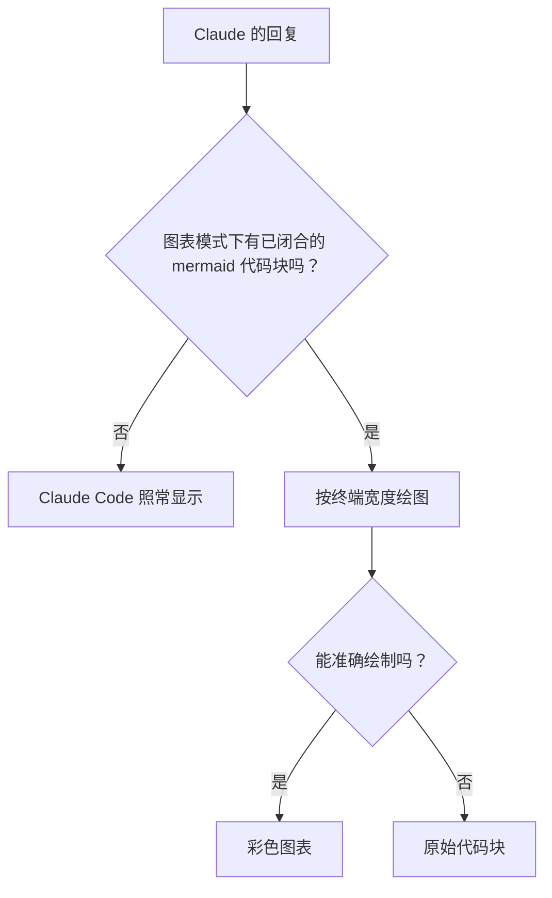

# mermaid-tty 百科

[英文版](Home)

mermaid-tty 是一个 Claude Code mod（插件），能将 Claude 回复中已闭合的 `mermaid` 代码块直接重绘为终端里的扁平彩色线框图。

- **无需额外安装。** 安装插件后，Claude Code 直接加载仓库中的 TypeScript：没有运行时依赖，也没有构建步骤。
- **精确宽度。** 所有标签和行都使用同一个宽度函数测量，确保 CJK 标签对齐，且每一行都不超出终端宽度。
- **保留源码。** 只改变显示方式，存储的回复仍保留完整的 Mermaid 源码。`/copy` 复制源码，`/mermaid-tty source` 显示源码。
- **无法保证准确就回退。** 每幅图都经过校验；无法准确绘制时，原样显示代码块。

目前可绘制 13 种 Mermaid 图表：流程图（flowchart，也可写作 `graph`）、时序图、状态图、类图、实体关系图（ER）、思维导图、甘特图、饼图、Git 提交图（gitGraph）、时间线、用户旅程图、XY 图和象限图。其他类型保留源码。

mermaid-tty 仅在 Claude Code 的终端界面中绘图，支持 Windows、macOS 和 Linux；其他界面保持原有显示方式。在终端中，每条回复按以下流程处理：



## 页面

| 页面 | 内容 |
|---|---|
| [用法](Usage-zh-CN) | 安装、平台与终端、绘图、源码视图、回退、宽度与 CJK，以及卸载。 |
| [配置与主题](Configuration-and-Themes-zh-CN) | `theme` 选项、六种配色，以及主题着色的角色。 |
| [架构](Architecture-zh-CN) | 渲染流水线、模块、校验器、宽度函数，以及钩子和缓存。 |
| [开发与发布](Development-and-Release-zh-CN) | 仓库结构、本地检查、持续集成、README 图片与图标、百科及发布步骤。 |

每个页面都可以独立阅读。使用插件时，先看下方的快速开始，再看[用法](Usage-zh-CN)和[配置与主题](Configuration-and-Themes-zh-CN)。参与开发时，先看[架构](Architecture-zh-CN)，再看[开发与发布](Development-and-Release-zh-CN)。

## 快速开始

1. 确认 Claude Code 版本不低于 2.1.287：

   ```sh
   claude --version
   ```

2. 添加插件市场并安装插件：

   ```sh
   claude plugin marketplace add D0n9X1n/mermaid-tty
   claude plugin install mermaid-tty@mermaid-tty --config theme=default
   ```

3. 启动新的 Claude Code 会话。插件会在会话开始时注册 `/mermaid-tty` 命令。
4. 请 Claude 生成一张图。回复中的 `mermaid` 代码块闭合后，会在原位显示为图表。例如：

   ```mermaid
   flowchart LR
     A[请求] --> B{已缓存？}
     B -->|是| C[从缓存返回]
     B -->|否| D[渲染] --> C
   ```

   它会绘制成适合当前终端宽度的彩色图表。
5. 随时切换视图：
   - `/mermaid-tty source` 将所有图表显示为 Mermaid 源码。
   - `/mermaid-tty diagram` 恢复图表显示。
   - 单独运行 `/mermaid-tty` 可查看当前模式。
   - `/copy` 复制 Mermaid 源码，而不是绘制结果。
6. 也可以选择配色。`theme` 支持 `default`、`nord`、`dracula`、`gruvbox`、`solarized` 和 `mono`：

   ```sh
   echo '{"theme":"nord"}' | claude plugin configure mermaid-tty@mermaid-tty --values-stdin
   ```

   重启 Claude Code 后生效。详见[配置与主题](Configuration-and-Themes-zh-CN)。

更新时，运行 `claude plugin update mermaid-tty@mermaid-tty` 并重启 Claude Code。移除插件的方法见[用法](Usage-zh-CN)中的“卸载”。

如果图表显示为源码，这是 mermaid-tty 主动回退：它无法准确绘制该图。使用 `claude --debug` 启动 Claude Code，在调试日志中查看原因，并参阅[用法](Usage-zh-CN)中的“回退”。
