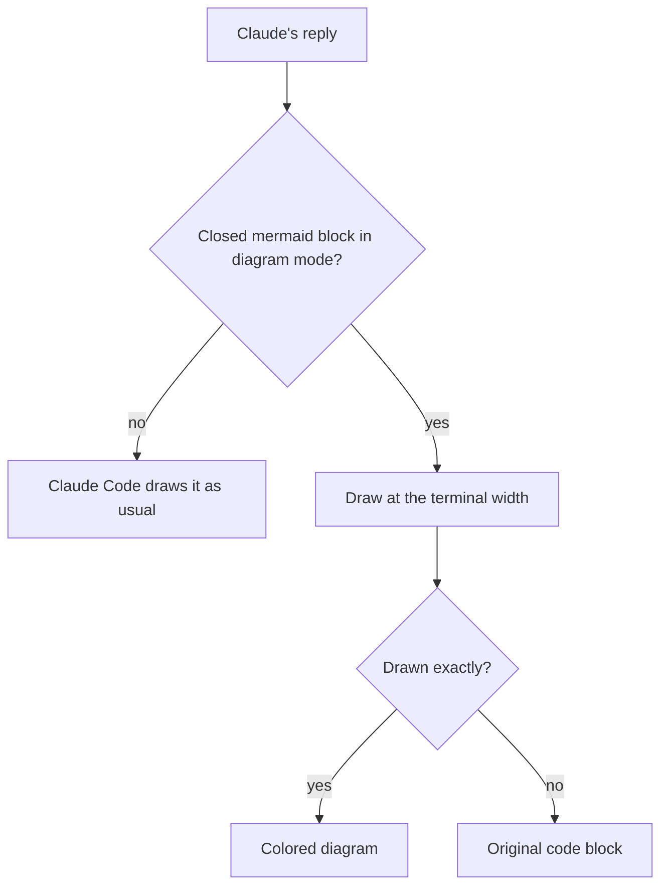

# mermaid-tty Wiki

[Chinese (Simplified)](Home-zh-CN)

mermaid-tty is a Claude Code mod (plugin) that redraws closed `mermaid` code blocks in Claude's replies as flat, colored box-drawing diagrams, right in the terminal.

- **No extra install step.** Install the plugin, and Claude Code loads the checked-in TypeScript as it is: no runtime dependencies and no build step.
- **Exact width.** One width function measures every label and row, so CJK labels line up and every row fits the terminal.
- **Source kept.** Only the drawing changes. The stored reply keeps the exact Mermaid source, so `/copy` copies it and `/mermaid-tty source` shows it.
- **Fails closed.** A validator checks every drawing. When mermaid-tty can't draw a diagram exactly, you see the original code block, unchanged.

It draws 13 Mermaid diagram types: flowchart (also written `graph`), sequence, state, class, ER, mindmap, gantt, pie, gitGraph, timeline, journey, xychart and quadrant. Any other type shows its source.

mermaid-tty draws only in Claude Code's terminal interface, on Windows, macOS and Linux. Other surfaces keep their own drawing. In the terminal, each reply goes through these steps:



## Pages

| Page | What it covers |
|---|---|
| [Usage](Usage) | Install, platforms and terminals, drawing diagrams, the source view, fallback, width and CJK, and uninstall. |
| [Configuration and Themes](Configuration-and-Themes) | The `theme` option, the six palettes, and the roles a theme colors. |
| [Architecture](Architecture) | The render pipeline, the modules, the validator, the width function, and the hook and its cache. |
| [Development and Release](Development-and-Release) | The repository, local checks, CI, the README images and the icon, this wiki, and the release steps. |

Each page stands on its own. If you use mermaid-tty, read the quick start below, then [Usage](Usage) and [Configuration and Themes](Configuration-and-Themes). If you work on it, read [Architecture](Architecture), then [Development and Release](Development-and-Release).

## Quick start

1. Check that Claude Code is version 2.1.287 or later:

   ```sh
   claude --version
   ```

2. Add the marketplace and install the plugin:

   ```sh
   claude plugin marketplace add D0n9X1n/mermaid-tty
   claude plugin install mermaid-tty@mermaid-tty --config theme=default
   ```

3. Start a new Claude Code session. The mod registers the `/mermaid-tty` command when the session starts.
4. Ask Claude for a diagram. When a `mermaid` code block in the reply closes, it is drawn in place. A block like this one:

   ```mermaid
   flowchart LR
     A[Request] --> B{Cached?}
     B -->|yes| C[Serve from cache]
     B -->|no| D[Render] --> C
   ```

   draws as a colored diagram sized to your terminal.
5. Switch views at any time:
   - `/mermaid-tty source` shows every diagram as its Mermaid source.
   - `/mermaid-tty diagram` draws them again.
   - `/mermaid-tty` on its own reports the current mode.
   - `/copy` copies the Mermaid source, never the drawing.
6. Optionally, pick a palette. The `theme` option is `default`, `nord`, `dracula`, `gruvbox`, `solarized` or `mono`:

   ```sh
   echo '{"theme":"nord"}' | claude plugin configure mermaid-tty@mermaid-tty --values-stdin
   ```

   Restart Claude Code to apply it. See [Configuration and Themes](Configuration-and-Themes).

To update, run `claude plugin update mermaid-tty@mermaid-tty` and restart Claude Code. To remove mermaid-tty, see the Uninstall section of [Usage](Usage).

If a diagram shows as its source, mermaid-tty fell back on purpose: it couldn't draw that diagram exactly. Start Claude Code with `claude --debug` to see the reason in the debug log, and see the Fallback section of [Usage](Usage).
