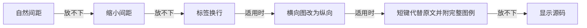

# 用法

[英文版](Usage)

本页介绍 mermaid-tty 的安装、适用界面、支持的图表、源码查看、回退原因、宽度计算和卸载方法。

## 安装

mermaid-tty 需要 Claude Code 2.1.287 或更高版本，目前在 2.1.308 上测试。查看版本：

```sh
claude --version
```

先添加插件市场，再安装插件：

```sh
claude plugin marketplace add D0n9X1n/mermaid-tty
claude plugin install mermaid-tty@mermaid-tty
```

启动新的 Claude Code 会话即可使用。插件没有运行时依赖，也不需要构建；会话开始时会注册 `/mermaid-tty` 命令。

更新时，运行 `claude plugin update mermaid-tty@mermaid-tty`，然后重启 Claude Code。

## 平台与终端

mermaid-tty 支持 Windows、macOS 和 Linux。`core/` 与 `hooks/` 中的运行时代码不依赖特定操作系统；CI 在三个系统上运行检查和真实 Claude Code 端到端测试。测试框架在 Windows 上使用 ConPTY，在 macOS 和 Linux 上使用 tmux；普通用户无需安装测试框架或其依赖。

插件只在 Claude Code 的终端界面中绘图。其他界面的回复不经修改，保留该界面自己的显示方式。

**终端。** mermaid-tty 不直接向终端写入内容，而是将带样式的文字交给 Claude Code 显示。因此，它适用于 Claude Code 支持的终端，包括 Windows Terminal、macOS Terminal、iTerm2、Ghostty 和 Linux 终端。

**颜色。** `default` 使用 Claude Code 主题颜色；精选配色使用固定的 24 位十六进制颜色。Claude Code 按终端支持的色深显示：

- 真彩色终端设置 `COLORTERM=truecolor` 时，显示精确颜色。
- 256 色终端使用 256 色代码。
- 在 tmux 中，Claude Code 默认限制为 256 色，除非设置 `CLAUDE_CODE_TMUX_TRUECOLOR=1`。

如果配色在终端中不合适，可以换一种，或使用不带颜色的 `mono`。详见[配置与主题](Configuration-and-Themes-zh-CN)。

**字体。** 使用覆盖制表符号区块（U+2500 至 U+257F）及 `►`、`◄`、`▲`、`▼`、`◇`、`●`、`◉` 的等宽字体。对于 CJK 标签，字体或回退字体需要将 CJK 字符显示为两列宽。

大多数制表符号，以及 `▲`、`▼`、`◇`、`●`，属于东亚宽度不明确的字符（Ambiguous）。mermaid-tty 将它们计为一列。如果终端启用了“将宽度不明确字符显示为宽字符”的设置，请关闭，否则连线可能无法对齐。

## 绘制图表

满足以下条件时，mermaid-tty 会绘制代码块：

- 开始围栏使用至少三个反引号或波浪号，缩进最多三个空格，信息字符串恰为 `mermaid`。
- 结束围栏使用相同字符，长度不短于开始围栏。
- 代码块不嵌套在更长的代码围栏中。

只绘制已闭合的代码块。尚未闭合的代码块保持普通文本；图表周围的正文仍由 Claude Code 正常显示。

图表类型由代码块中去掉 frontmatter 和 `%%` 注释行后的第一行决定。mermaid-tty v1 绘制以下 13 种类型：

| 图表 | 首行关键字 |
|---|---|
| 流程图 | `flowchart`、`graph`；可跟 `TD`、`TB`、`BT`、`LR` 或 `RL` |
| 时序图 | `sequenceDiagram` |
| 状态图 | `stateDiagram`、`stateDiagram-v2` |
| 类图 | `classDiagram`、`classDiagram-v2` |
| 实体关系图（ER） | `erDiagram` |
| 思维导图 | `mindmap` |
| 甘特图 | `gantt` |
| 饼图 | `pie`，可跟 `showData`，然后可跟 `title <text>` |
| Git 提交图 | `gitGraph`、`gitGraph:`、`gitGraph LR:`、`gitGraph TB:` 或 `gitGraph BT:` |
| 时间线 | `timeline`，可跟 `LR` 或 `TD` |
| 用户旅程图 | `journey` |
| XY 图 | `xychart`、`xychart-beta`；可跟 `vertical` 或 `horizontal` |
| 象限图 | `quadrantChart` |

关键字区分大小写。其他首行形式（包括 `flowchart-elk`）显示源码。

只有所有语句都属于该类型支持的子集时才绘图。任何一条语句不受支持，整个代码块都会显示源码：mermaid-tty 从不只绘制图表的一部分。

- 只有该类型解析器接受的样式、交互和无障碍语句才会被忽略。例如，流程图接受 `classDef`、`class`、`:::`、`style`、`linkStyle`、`click`、`accTitle` 和 `accDescr`；类图中的 `class` 则不会被忽略。颜色由插件主题决定。
- frontmatter 中受支持的 `title:` 会作为加粗标题显示在图表上方。

**已知限制。** frontmatter 扫描器只读取严格的 YAML 子集，不支持任意 YAML。配置支持嵌套映射和单行标量，不支持列表、流式集合、锚点或多行值。未加引号的小数配置值（如 `0.5`）会以 `config:<key>` 回退；数值仅接受安全范围内的十进制整数（[issue #7](https://github.com/D0n9X1n/mermaid-tty/issues/7)）。加引号会将值变成字符串，并不等价于原来的数值配置。配置也不是任意调整终端布局的接口。

Git 提交图使用竖直分支泳道：`LR` 和 `TB` 的时间向下，`BT` 的时间向上。自动生成的提交 id 不显示；显式 id、消息和标签会显示。cherry-pick 使用 `◎` 和标签（默认 `cherry-pick:<id>`），不会画一条回到来源提交的连线。如果分支或合并的泳道会让人误认提交间的连接，就会回退。

围栏扫描器仅将 LF、CRLF 和单独的 CR 视为换行，不识别 Unicode 行分隔符。结束围栏最多缩进三个空格，后面只能有空格或制表符。带块引用前缀或缩进四个空格的围栏不会被识别为图表围栏。

## 查看源码

`/mermaid-tty` 命令切换回复中图表的显示方式：

| 命令 | 效果 |
|---|---|
| `/mermaid-tty source` | 将所有图表显示为 Mermaid 源码，屏幕上已有的回复也会重绘。 |
| `/mermaid-tty diagram` | 恢复图表显示。 |
| `/mermaid-tty` | 报告当前模式：`mermaid-tty mode: diagram` 或 `mermaid-tty mode: source`。 |

参数只能是一个单词，不区分大小写。其他输入会返回 `usage: /mermaid-tty [source|diagram]`。源码模式下，所有回复原样交给 Claude Code 显示。

无论处于哪种模式，`/copy` 都复制 Mermaid 源码。mermaid-tty 只改变显示方式，存储的回复保留完整源码。

ctrl+o 不负责将图表切换成源码。要查看源码，请运行 `/mermaid-tty source`。

## 回退

无法准确绘制时，mermaid-tty 原样显示代码块，不会给出残缺或近似的图。以下情况会回退：

- 首行指定了不支持绘制的类型；
- 语句超出支持的子集，或无法解析；
- frontmatter 之后任意位置出现 `%%{`，即使在注释或引号内；但独占一行、设置项可写进 frontmatter config 的 `%%{init: …}%%`、`%%{initialize: …}%%` 或 `%%{wrap}%%` 指令除外；或双引号外出现行内 `%%`；
- frontmatter、标题或配置不在扫描器支持的子集内；
- 标签或标题包含不同终端可能显示为不同宽度的字符；
- 所有适配步骤都无法满足终端宽度，或所有绘制结果都未通过校验。

有些功能按设计始终回退，因为终端无法按 Mermaid 的方式显示：`fa:` 图标通过 SVG 或 Font Awesome CSS 显示，`$$…$$` 数学公式需要排版，`htmlLabels: false` 遵循不同的文本规则。图表词法分析器拒绝的空白字符，例如 pie 或 gitGraph 中不带引号的不换行空格，在 Mermaid 中同样会报错。

回退原因不会显示在界面上。要查看原因，请以调试模式启动 Claude Code：

```sh
claude --debug
```

每次未命中缓存的回退都会向调试日志写入 `mermaid-tty fallback: <reason>`。使用 `claude --debug-file <path>` 指定日志文件。结果按源码、宽度和主题缓存；条目被淘汰或启动新会话后，会再次记录原因。

原因码可能带源码行号后缀，如 `html:3`。行号从围栏正文第一行开始，包含 frontmatter。下表将相关原因归为一组。

| 原因码 | 含义 |
|---|---|
| `unknown-type`、`fallback:<keyword>`、`disabled:<type>` | 未知首行关键字、明确只显示源码的关键字，或不支持的图表类型。 |
| `header`、`syntax`、`syntax:<line>` | 首行形式无效，或语句超出支持的子集。 |
| `directive` | frontmatter 之后出现的 `%%{` 不是独占一行、设置为严格 JSON 的 `init`、`initialize` 或 `wrap` 指令（不得含 `null`、数组、空对象或 `config` 键；`htmlLabels` 只能为 `true`），或双引号外出现行内 `%%`。 |
| `frontmatter`、`title`、`repeat:<line>`、`repeat:header` | 不支持的 YAML 或标题形式，或标题、id、声明重复。 |
| `config:htmlLabels` | `htmlLabels` 或嵌套的 `*.htmlLabels` 不是布尔值 `true`；Mermaid 的非 HTML 标签采用不同的文本规则。 |
| `config:<key>` | 不支持的类似数值的配置标量，或无效的 gitGraph 主分支名称或顺序。 |
| `empty`、`root:<line>`、`blank:<line>`、`label-blank-line` | 缺少内容、出现第二个思维导图根节点，或该类型无法保留的空标签或空行。 |
| `entity` | Mermaid 会解码实体或内部实体标记，而不是原样显示。 |
| `html` | 无法在该字段中重现标记、净化、转义或换行效果。 |
| `markdown-string`、`markdown` | Mermaid 会显示粗体和斜体以外的 Markdown：反引号包裹的 `@{ label }`、转义、代码片段、同种样式的嵌套，或不绘制强调的位置（类名、注解或成员，ER 实体名，状态图复合状态标题）中的强调。 |
| `icon`、`math`、`newline` | Mermaid 会替换图标、渲染数学公式，或在 mermaid-tty 不画换行的位置（如子图标题）将字面的 `\n` 转为换行。流程图节点或连线标签中的字面 `\n` 会像 Mermaid 一样画成换行。 |
| `whitespace` | 图表词法分析器不接受的空白，例如饼图或 gitGraph 中引号外的不换行空格。 |
| `unsupported-char U+XXXX` | 该字符在终端中的宽度不可靠，详见“宽度与 CJK”。 |
| `generic` | ER 实体标签或属性列中的 `~...~` 被 Mermaid 显示为 `<...>` 后会拼出 `<br>`。其他 `~...~` 在 Mermaid 显示为 `<...>` 的位置画成 `<...>`，其余位置原样显示。 |
| `id-collision`、`id-clash` | id 与节点、边框或内部生成的所有者 id 冲突。 |
| `unclosed-subgraph`、`unclosed-frame`、`cluster-edge` | 块未闭合，或图布局无法放置指向簇的连线。 |
| `invisible-label` | 无法忠实显示不可见流程图连线上的标签。 |
| `scope:<line>`、`mark-label:<line>` | 状态跨越不兼容的作用域，或给特殊状态标记添加了描述。 |
| `semicolon`、`hash` | 状态图文本中的分号，或时序图 id、别名、标题、分组框标签中的井号，或 `#9829;` 这样的实体，会被解析为其他含义。时序图语句在 `;` 处拆分，消息、注释和条件文本在 `#` 处结束，与 Mermaid 一致。 |
| `keyword`、`id`、`create`、`destroy`、`destroyed`、`inactive`、`undeclared` | 时序图消息或注释使用了关键字，或后跟空格的数字（Mermaid 会拒绝）；或不支持的生命周期或激活用法；或只出现在 `activate`、`deactivate`、`destroy` 中的 id（Mermaid 会失败）。`participant end`、`participant 42` 这样的声明可以绘制。 |
| `box-color`、`box-split`、`empty-box`、`autonumber` | 不支持的时序图分组框声明或分组（包括以 `currentColor`、CSS 全局关键字或 `Canvas`、`Menu` 等系统颜色开头的标签，浏览器会将其读作颜色），或自动编号的起始值、步长或显示的编号不是安全整数。重新开始编号和 `autonumber off` 可以绘制。 |
| `box-frame` | 在含 `box` 的时序图中，Mermaid 可能以不同方式绘制的框（`rect`、`loop`、`alt` 等）：跨越分组框边框、覆盖其内容未涉及的生命线，或边缘取决于文字宽度（自消息、位于单条生命线上或旁边的注释、`create` 或 `destroy`、深层嵌套）。完全位于一个分组框内或与所有分组框分离的框可以绘制。 |
| `frame-extent` | 在不含 `box` 的时序图中，会覆盖 Mermaid 的框未覆盖的生命线的框（`rect`、`loop`、`alt` 等），或其靠近另一条生命线的边缘取决于文字宽度（自消息的左侧、位于生命线旁的注释、`create` 或 `destroy`）。 |
| `branch:<line>`、`checkout:<line>`、`merge:<line>`、`pick:<line>` | 无效的 gitGraph 分支操作、合并或 cherry-pick。 |
| `link-ambiguous` | gitGraph 分支或合并会看起来连接了错误的提交。 |
| `section-empty`、`section-repeat`、`empty-section`、`section:<line>` | 甘特图分区为空或重复，时间线分区为空，或时间线混用了有分区和无分区的时段。 |
| `ref:<line>`、`start:<line>`、`date:<line>`、`order:<line>`、`ref-order:<line>`、`cycle` | 甘特图的引用、开始时间、日期、顺序或循环时间依赖无法按 Mermaid 的方式解析。 |
| `format-token`、`format-ymd`、`axis-format` | 不支持的甘特图日期或坐标轴格式。 |
| `domain`、`domain:<line>`、`length`、`series` | 图表范围或数值无效、数据长度不匹配，或系列数量不受支持。 |
| `too-wide`、`row-too-wide`、`word-too-wide` | 图表或不可拆分的词无法放入当前宽度。 |
| `route-conflict`、`key-collision` | 找不到无歧义的路径，或象限图中的短键会冲突。 |
| `bad-columns`、`columns-mismatch`、`step`、`unregistered:<type>`、`internal-error` | 宽度无效或内部集成错误，并非普通的不支持语法。 |

**绘图会产生误导。** 以下校验失败意味着即使源码能够解析，也不能安全地显示绘图结果。校验关卡详见[架构](Architecture-zh-CN)。

| 原因码 | 含义 |
|---|---|
| `label-missing`、`label-dup`、`label-misplaced`、`label-unbound` | 文字缺失、重复、错位，或脱离了所属节点或行。 |
| `edge-disconnected`、`end-misplaced`、`head-extra`、`head-on-junction`、`line-dangling` | 连线、端点或箭头缺失、错位、多余或有歧义。 |
| `crossing-ambiguous`、`merge-ambiguous`、`line-glyph` | 交叉、合并路径或线条字形会暗示错误的连接或线型。 |
| `overwrite`、`frame-broken`、`edge-outside-frame`、`edge-crosses-frame` | 单元格冲突、边框未闭合、内部连线越出了所属边框，或连线穿过了与其两端都无关的边框（或多次穿过同一边框）。 |
| `label-not-adjacent`、`end-label`、`note-unbound`、`lifeline-unbound` | 连线标签、基数、注释或生命线没有绑定到正确对象。 |
| `bar`、`bar-misplaced`、`bar-stray` | 条形的长度、位置或所有者错误。 |
| `member`、`member-unlisted`、`member-outside`、`member-misplaced` | 类成员或 ER 属性缺失、未声明、越出节点框，或位于错误的行列。 |
| `key-missing`、`key-dup`、`key-mismatch`、`key-unbound`、`key-unplaced`、`key-adjacent`、`key-stray`、`key-class`、`key-partial` | 图例短键缺失、重复、错误、脱离对象、错位、视觉上粘连、多余或使用不一致。 |
| `order-broken`、`glyph-wrong`、`glyph-misplaced` | 事件顺序、具有语义的标记或其位置发生变化。 |

如果遇到 `internal-error`，请附上图表源码，到 [GitHub 仓库](https://github.com/D0n9X1n/mermaid-tty)报告。

**不同字段有不同的文本规则。** 规则以 Mermaid 12.2.0 的实际显示结果为准，而不只是以能否解析为准（见 `docs/specs/2026-10-29-mermaid-tty-v1-text-ground-truth.md`，X1–X4）：

- HTML 类字段拒绝 Mermaid 会解码、删除或改写的实体引用和标记。普通的 `Q&A`、`Q & A` 和 `a < b` 可以保持原样；HTML 标签中的 `a<b` 则不行。其他图表拒绝 Mermaid 的 `#name;`、`#123;` 实体及内部实体标记。流程图标签把十进制编码（如 `#35;`、`#9829;`）和 Mermaid 会显示的名称（如 `#quot;`）画成对应字符；未知名称、控制字符或空白编码，以及解码后成为标记的编码仍会回退。
- 流程图把 `A <-- text --> B`（以及 `<-. .->`、`<== ==>`）画成双箭头；`<--o` 之类的混合端标记只画 Mermaid 所画的箭头端；以一段引号开头的标签如 `["a" b]` 画成 `a b`；跨多行的 `@{ … }`（首行只有 `id@{`，每行一个 `key: value`，缩进一致）；Markdown 字符串 `` "`…`" `` 画出其文字。Markdown 粗体和斜体（`**b**`、`__b__`、`*i*`、`_i_`、`***both***`）以 SGR 粗体和斜体画在 Mermaid 强调的字符上：流程图的 Markdown 字符串和 `@{ label }`，状态图的描述、转换、注释以及作为标签显示的 id，类图的标签、关系标签和注释，ER 图的别名、关系标签、子图标题和属性注释，以及思维导图标签。粗体和斜体从不表示角色，所以 mono 主题仍靠字形和端帽区分角色。其他改变文字的 Markdown 仍会回退：转义、代码片段、同种样式的嵌套，以及类名、注解或成员、ER 实体名、状态图复合状态标题中的强调。流程图标签拒绝 `fa:fa-user` 之类的图标标记、`$$...$$` 数学公式以及字面的 `\n`。普通的 `snake_case`、`_private`、`a*b` 和 `C:\Users` 可以保持原样。除饼图和 gitGraph 外，空的 `accTitle:` 或 `accDescr:` 会回退：Mermaid 会把下一行读作其文字。类图注释中的字面 `\n` 原样显示。
- 支持多行的字段会在 `<br>`、`<BR>`、`<br/>` 和 `<br />` 处换行。别名、边框标题等单行字段即使在 Mermaid 中支持换行，也可能回退。时间线只按小写 `<br>` 换行；饼图切片及用户旅程的任务、分区保留换行标记原文；旅程中的参与者则拒绝这些标记。标题采用保守的净化检查，任何 `<` 都会回退。
- 关闭 HTML 标签会改变 Mermaid 的文本渲染。frontmatter 中的 `htmlLabels` 或嵌套 `*.htmlLabels` 只接受布尔值 `true`；其他值都会回退，包括加引号的 `"true"`。
- 不同语法中的空白并非都可互换：饼图和 gitGraph 拒绝双引号外的特殊空白；思维导图和象限图拒绝首行或空白行中的特殊空白。使用普通空格和制表符作为分隔符最稳妥。

某些 Mermaid 本可原样显示的文本也会被保守地回退。这是有意的：显示源码胜过给出可能误导的近似图。

## 宽度与 CJK

mermaid-tty 使用同一个宽度函数测量所有标签和行，数据来自 Unicode 16.0.0 的东亚宽度表：

| 文本 | 列数 |
|---|---|
| 东亚宽字符和全角字符（W/F），如 `中`、`ア`、`한` | 每个 2 列 |
| 组合标记（如 U+0301）及零宽字符 U+200B、U+200C、U+2060、U+FEFF | 0 列 |
| 其他字符，包括 ASCII、制表符号和 `─`、`┌`、`◇`、`►` 等箭头或标记 | 每个 1 列 |

只要终端将宽度不明确的字符显示为一列，CJK 标签就能与周围边框对齐，且每行都不会超出终端宽度。详见前面的“平台与终端”。

某些字符在不同终端中的宽度不同。标签或标题包含以下字符时，会以 `unsupported-char U+XXXX` 回退：零宽连接符（U+200D）、VS15 和 VS16 等变体选择符、构成旗帜的区域指示符、表情肤色修饰符、控制字符，以及 U+200E 等其他 Unicode 格式字符。

长标签在空格处换行。没有空格的 CJK 文本也可以在相邻的两个宽字符之间换行；拉丁字母组成的词不会被拆开。

**逐级适配。** 每种图表按顺序尝试自己的布局，显示第一个通过校验的结果：



这是共享图布局的适配顺序，其中部分步骤有适用条件。各类型的完整顺序如下：

| 类型 | 按顺序尝试的步骤 |
|---|---|
| 流程图 | `natural` → `tight` → `wrap` → 仅 `LR`/`RL` 使用 `lrToTd`；不使用短键 |
| 状态图、类图、ER 图 | `natural` → `tight` → `wrap` → `LR`/`RL` 使用 `lrToTd` → 有可替换项时使用 `keyed` |
| 时序图 | `natural` → `tight` → `wrap` |
| 思维导图 | `natural` → `compact` → `wrap` → `outline` |
| 甘特图 | `natural` → `keyed` → `keyedWrap` |
| 饼图 | `natural` → `wrap` |
| Git 提交图 | `natural` → `wrap` |
| 时间线，`LR` 或默认 | `natural` → `tight` → `wrap` → `lrToTd` |
| 时间线，`TD` | `natural` → `wrap` |
| 用户旅程图 | `natural` → `wrap` → `oneActor` |
| XY 图，纵向或默认 | `natural` → `horizontal` → `wrap` |
| XY 图，横向 | `natural` → `wrap` |
| 象限图 | `natural` → `keyed` |

共享图布局和时序图依次尝试按 24、20、16、12、8 列换行。思维导图也使用这些宽度，然后尝试大纲布局。共享图布局的 `lrToTd` 将 `LR` 转为 `TB`（从上到下），将 `RL` 转为 `BT`；`keyed` 也会将横向布局改为纵向。其他图表根据自身可用宽度计算，不统一使用这组换行宽度。

短键在原位替代符合条件的文本，并在图例中保留全文：状态图注释，类图注释和关系标签，ER 注释和关系标签，甘特图时间信息，以及象限图数据点标签。`keyedWrap` 还会让甘特图任务名换行。旅程图的 `oneActor` 将每个参与者单独放在一行；XY 图的 `horizontal` 将纵向图转为横向。所有适配步骤都未通过校验时，最终显示源码。

## 卸载

先移除插件，再移除插件市场：

```sh
claude plugin uninstall mermaid-tty@mermaid-tty
claude plugin marketplace remove mermaid-tty
```

如果只想停用而不卸载，运行 `claude plugin disable mermaid-tty@mermaid-tty`；用 `claude plugin enable mermaid-tty@mermaid-tty` 可重新启用。只是暂时查看源码时，使用 `/mermaid-tty source` 即可。
