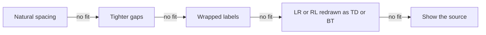

# Usage

[Chinese (Simplified)](Usage-zh-CN)

How to install mermaid-tty, where it draws, which diagrams it draws, how to see their source, why a diagram falls back, how width is measured, and how to remove it.

## Install

mermaid-tty needs Claude Code 2.1.287 or later, and is tested on 2.1.308. Check your version:

```sh
claude --version
```

Add the marketplace, then install the plugin:

```sh
claude plugin marketplace add D0n9X1n/mermaid-tty
claude plugin install mermaid-tty@mermaid-tty
```

Start a new Claude Code session, and you're done. The plugin has no runtime dependencies and no build step, and it registers the `/mermaid-tty` command when the session starts.

To update, run `claude plugin update mermaid-tty@mermaid-tty`, then restart Claude Code.

## Platforms and terminals

mermaid-tty works the same on Windows, macOS and Linux: it has no OS-specific code, and CI runs its tests on all three.

It draws only in Claude Code's terminal interface. On any other surface, a reply passes through untouched and keeps that surface's own drawing.

**Terminals.** mermaid-tty never writes to the terminal itself. It hands Claude Code styled text, and Claude Code draws it, so it works in any terminal Claude Code supports, including Windows Terminal, macOS Terminal, iTerm2, Ghostty and Linux terminals.

**Colors.** The `default` theme uses your Claude Code theme's colors; the curated palettes use fixed 24-bit hex colors. Claude Code draws them at your terminal's color depth:

- In a truecolor terminal, one that sets `COLORTERM=truecolor`, you get the exact colors.
- In a 256-color terminal, you get 256-color codes.
- Inside tmux, Claude Code limits colors to 256 unless `CLAUDE_CODE_TMUX_TRUECOLOR=1` is set.

If a palette looks wrong in your terminal, try another one, or `mono`, which draws without color. See [Configuration and Themes](Configuration-and-Themes).

**Fonts.** Use a monospaced font that covers the Box Drawing block (U+2500 to U+257F) and the glyphs `►`, `◄`, `▲`, `▼`, `◇`, `●` and `◉`. For CJK labels, the font or its fallback needs CJK glyphs two columns wide.

Most box-drawing glyphs, and `▲`, `▼`, `◇` and `●`, have East Asian Ambiguous width. mermaid-tty counts them as one column. If your terminal has a setting that draws ambiguous-width characters as wide, turn it off, or a diagram's lines won't meet.

## Drawing diagrams

mermaid-tty draws a code block when all of these hold:

- It opens with three or more backticks or tildes, indented at most three spaces, and its info string is exactly `mermaid`.
- It closes with a fence of the same character, at least as long as the opening one.
- It isn't nested inside a longer code block.

Only closed blocks are drawn. A block that hasn't closed stays plain text. Claude Code draws the prose around a diagram as usual.

The diagram type comes from the block's first line, after any frontmatter and `%%` comment lines. mermaid-tty v1 draws these 13 types:

| Diagram | Header keywords |
|---|---|
| Flowchart | `flowchart`, `graph` |
| Sequence | `sequenceDiagram` |
| State | `stateDiagram`, `stateDiagram-v2` |
| Class | `classDiagram`, `classDiagram-v2` |
| Entity relationship (ER) | `erDiagram` |
| Mindmap | `mindmap` |
| Gantt | `gantt` |
| Pie | `pie` |
| Git graph | `gitGraph` |
| Timeline | `timeline` |
| User journey | `journey` |
| XY chart | `xychart`, `xychart-beta` |
| Quadrant chart | `quadrantChart` |

Keywords are case-sensitive. Any other header, `flowchart-elk` included, shows its source.

A block is drawn only if every statement in it is in its type's supported subset. If one statement isn't, the whole block shows its source: mermaid-tty never draws part of a diagram.

- `classDef`, `class`, `:::`, `style`, `linkStyle`, `click`, `accTitle` and `accDescr` are read and ignored. The theme picks the colors.
- A `title:` in the frontmatter is drawn as a bold row above the diagram.

## Source view

The `/mermaid-tty` command switches how replies show their diagrams:

| Command | Effect |
|---|---|
| `/mermaid-tty source` | Shows every diagram as its Mermaid source. Replies already on screen are drawn again. |
| `/mermaid-tty diagram` | Draws the diagrams again. |
| `/mermaid-tty` | Reports the mode: `mermaid-tty mode: diagram` or `mermaid-tty mode: source`. |

The argument is one word, in any case. Anything else replies `usage: /mermaid-tty [source|diagram]`. In source mode, every reply goes to Claude Code's own drawing untouched.

`/copy` copies the Mermaid source in either mode. mermaid-tty changes only how a reply is drawn, and the stored reply keeps the exact source.

ctrl+o doesn't switch a diagram to its source. To read the source, run `/mermaid-tty source`.

## Fallback

When mermaid-tty can't draw a diagram exactly, it shows the original code block, unchanged. It never shows a partial or approximate drawing. A diagram falls back when:

- its header names a type mermaid-tty doesn't draw;
- a statement is outside the supported subset, or doesn't parse;
- it has a `%%{` directive, or a `%%` comment after other text on a line;
- its frontmatter has no closing `---`, or two titles;
- a label or title has a character that terminals draw at differing widths;
- no step of the fit ladder fits the terminal's width, or the validator rejects every drawing.

The reason never appears on screen. To see it, start Claude Code in debug mode:

```sh
claude --debug
```

Each fallback writes one line to the debug log: `mermaid-tty fallback: <reason>`. To write the debug log to a file, use `claude --debug-file <path>`. Results are cached by source, width and theme, so a diagram logs its reason once for each width and theme.

| Reason | Meaning |
|---|---|
| `unknown-type` | The header isn't a Mermaid keyword that mermaid-tty knows. |
| `fallback:<keyword>`, `disabled:<type>` | A Mermaid type that mermaid-tty doesn't draw. |
| `syntax:<line>` | The statement on that line of the block is outside the supported subset, or doesn't parse. |
| `directive` | A `%%{` directive, or a `%%` comment after text outside double quotes. |
| `frontmatter`, `title` | The frontmatter has no closing `---`, or has a second `title:`. |
| `empty` | The block has no header, or nothing after it. |
| `unsupported-char U+XXXX` | A label or title has that character. See Width and CJK below. |
| `too-wide`, `row-too-wide`, `word-too-wide` | No layout fits the terminal's width. `word-too-wide` means a word in a flowchart label is too wide to wrap. |
| `label-missing`, `label-dup`, `edge-disconnected`, `line-dangling`, `overwrite` | The validator rejected the drawing. See [Architecture](Architecture). |
| `internal-error` | A bug in mermaid-tty. |

Other reasons name the syntax or the layout step that failed, such as `unclosed-subgraph`, `markdown-string`, `entity` or `route-conflict`. If you see `internal-error`, please report it, with the diagram's source, on the [GitHub repository](https://github.com/D0n9X1n/mermaid-tty).

## Width and CJK

mermaid-tty measures every label and row with one width function, built from the East Asian Width table of Unicode 16.0.0:

| Text | Columns |
|---|---|
| East Asian Wide and Fullwidth characters, such as `中`, `ア` and `한` | 2 each |
| Combining marks, such as U+0301, and the zero-width characters U+200B, U+200C, U+2060 and U+FEFF | 0 |
| Everything else, including ASCII, box drawing and arrows such as `─`, `┌`, `◇` and `►` | 1 each |

So CJK labels line up with the boxes around them, and no row is wider than the terminal, as long as your terminal draws ambiguous-width characters one column wide (see Platforms and terminals above).

Terminals draw some characters at differing widths. A label or title that has one of them falls back with `unsupported-char U+XXXX`: the zero-width joiner (U+200D), variation selectors such as VS15 and VS16, the regional indicators that make flags, emoji skin-tone modifiers, control characters, and the other Unicode format characters, such as U+200E.

Long labels wrap at spaces. CJK text, which has no spaces, can also wrap between two wide characters. A Latin word is never split.

**The fit ladder.** Each diagram type tries its layouts in order, and draws the first one the validator accepts:



- **Natural spacing**, then **tighter gaps**: closer ranks and nodes in a flowchart, less padding around message labels in a sequence diagram.
- **Wrapped labels**: labels wrap at 24 columns, then 20, 16, 12 and 8.
- **LR or RL redrawn as TD or BT**: a left-to-right flowchart is redrawn top-down, and a right-to-left one bottom-up. Only LR and RL flowcharts take this step.
- **Show the source**: when no step fits, the block falls back.

Sequence diagrams take the first three steps. The other types have ladders of their own, and every ladder ends in the source, so a diagram is drawn whole at your width, or not at all.

## Uninstall

Remove the plugin, then the marketplace:

```sh
claude plugin uninstall mermaid-tty@mermaid-tty
claude plugin marketplace remove mermaid-tty
```

To keep it installed but stop it, run `claude plugin disable mermaid-tty@mermaid-tty`; `claude plugin enable mermaid-tty@mermaid-tty` turns it back on. To read sources for a while, `/mermaid-tty source` is enough.
