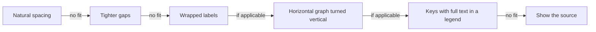

# Usage

[Chinese (Simplified)](Usage-zh-CN)

How to install mermaid-tty, where it draws, which diagrams it draws, how to see their source, why a diagram falls back, how width is measured, and how to remove it.

## Install

mermaid-tty needs Claude Code 2.1.287 or later, and is tested on 2.1.308. Check your version:

```sh
claude --version
```

Add the marketplace, then install the plugin:

```sh
claude plugin marketplace add D0n9X1n/mermaid-tty
claude plugin install mermaid-tty@mermaid-tty
```

Start a new Claude Code session, and you're done. The plugin has no runtime dependencies and no build step, and it registers the `/mermaid-tty` command when the session starts.

To update, run `claude plugin update mermaid-tty@mermaid-tty`, then restart Claude Code.

## Platforms and terminals

mermaid-tty runs on Windows, macOS and Linux. The runtime in `core/` and `hooks/` has no OS-specific code; CI runs the checks and real-Claude-Code end-to-end tests on all three. The test harness uses ConPTY on Windows and tmux on macOS and Linux; users need neither harness nor its dependencies.

It draws only in Claude Code's terminal interface. On any other surface, a reply passes through untouched and keeps that surface's own drawing.

**Terminals.** mermaid-tty never writes to the terminal itself. It hands Claude Code styled text, and Claude Code draws it, so it works in any terminal Claude Code supports, including Windows Terminal, macOS Terminal, iTerm2, Ghostty and Linux terminals.

**Colors.** The `default` theme uses your Claude Code theme's colors; the curated palettes use fixed 24-bit hex colors. Claude Code draws them at your terminal's color depth:

- In a truecolor terminal, one that sets `COLORTERM=truecolor`, you get the exact colors.
- In a 256-color terminal, you get 256-color codes.
- Inside tmux, Claude Code limits colors to 256 unless `CLAUDE_CODE_TMUX_TRUECOLOR=1` is set.

If a palette looks wrong in your terminal, try another one, or `mono`, which draws without color. See [Configuration and Themes](Configuration-and-Themes).

**Fonts.** Use a monospaced font that covers the Box Drawing block (U+2500 to U+257F) and the glyphs `►`, `◄`, `▲`, `▼`, `◇`, `●` and `◉`. For CJK labels, the font or its fallback needs CJK glyphs two columns wide.

Most box-drawing glyphs, and `▲`, `▼`, `◇` and `●`, have East Asian Ambiguous width. mermaid-tty counts them as one column. If your terminal has a setting that draws ambiguous-width characters as wide, turn it off, or a diagram's lines won't meet.

## Drawing diagrams

mermaid-tty draws a code block when all of these hold:

- It opens with three or more backticks or tildes, indented at most three spaces, and its info string is exactly `mermaid`.
- It closes with a fence of the same character, at least as long as the opening one.
- It isn't nested inside a longer code block.

Only closed blocks are drawn. A block that hasn't closed stays plain text. Claude Code draws the prose around a diagram as usual.

The diagram type comes from the block's first line, after any frontmatter and `%%` comment lines. mermaid-tty v1 draws these 13 types:

| Diagram | Header keywords |
|---|---|
| Flowchart | `flowchart`, `graph`; optionally followed by `TD`, `TB`, `BT`, `LR` or `RL` |
| Sequence | `sequenceDiagram` |
| State | `stateDiagram`, `stateDiagram-v2` |
| Class | `classDiagram`, `classDiagram-v2` |
| Entity relationship (ER) | `erDiagram` |
| Mindmap | `mindmap` |
| Gantt | `gantt` |
| Pie | `pie`, optionally `showData`, then optionally `title <text>` |
| Git graph | `gitGraph`, `gitGraph:`, `gitGraph LR:`, `gitGraph TB:` or `gitGraph BT:` |
| Timeline | `timeline`, optionally `LR` or `TD` |
| User journey | `journey` |
| XY chart | `xychart`, `xychart-beta`; optionally `vertical` or `horizontal` |
| Quadrant chart | `quadrantChart` |

Keywords are case-sensitive. Any other header, `flowchart-elk` included, shows its source.

A block is drawn only if every statement in it is in its type's supported subset. If one statement isn't, the whole block shows its source: mermaid-tty never draws part of a diagram.

- Styling, interaction and accessibility statements are ignored only where that type's parser accepts them. For example, flowchart accepts `classDef`, `class`, `:::`, `style`, `linkStyle`, `click`, `accTitle` and `accDescr`; `class` is not ignored in a class diagram. The plugin theme picks the colors.
- A supported `title:` in the frontmatter is drawn as a bold row above the diagram.

**Known limits.** The frontmatter scanner reads a strict YAML subset, not arbitrary YAML. Its config supports nested mappings with one-line scalar values, not lists, flow collections, anchors or multiline values. Unquoted decimal config values, such as `0.5`, fall back with `config:<key>`; only safe decimal integers are accepted as numbers ([issue #7](https://github.com/D0n9X1n/mermaid-tty/issues/7)). Quoting a value makes it a string, not an equivalent numeric setting. Config is not a general way to customize the terminal layout.

A gitGraph is drawn as vertical branch lanes: time runs down for `LR` and `TB`, and up for `BT`. Auto-generated commit ids are hidden; explicit ids, messages and tags are shown. A cherry-pick is a `◎` with its tag (by default `cherry-pick:<id>`), not a line back to the source commit. A fork or merge whose lane would connect the wrong commits falls back.

The fence scanner recognizes LF, CRLF and lone CR as line endings, not Unicode line separators. A closing fence is indented at most three spaces and has only spaces or tabs after it. Block-quote prefixes and four-space-indented fences are not recognized as diagram fences.

## Source view

The `/mermaid-tty` command switches how replies show their diagrams:

| Command | Effect |
|---|---|
| `/mermaid-tty source` | Shows every diagram as its Mermaid source. Replies already on screen are drawn again. |
| `/mermaid-tty diagram` | Draws the diagrams again. |
| `/mermaid-tty` | Reports the mode: `mermaid-tty mode: diagram` or `mermaid-tty mode: source`. |

The argument is one word, in any case. Anything else replies `usage: /mermaid-tty [source|diagram]`. In source mode, every reply goes to Claude Code's own drawing untouched.

`/copy` copies the Mermaid source in either mode. mermaid-tty changes only how a reply is drawn, and the stored reply keeps the exact source.

ctrl+o doesn't switch a diagram to its source. To read the source, run `/mermaid-tty source`.

## Fallback

When mermaid-tty can't draw a diagram exactly, it shows the original code block, unchanged. It never shows a partial or approximate drawing. A diagram falls back when:

- its header names a type mermaid-tty doesn't draw;
- a statement is outside the supported subset, or doesn't parse;
- it has `%%{` anywhere after the frontmatter, even inside a comment or quoted label, or an inline `%%` outside double quotes;
- its frontmatter, title or config is outside the scanner's subset;
- a label or title has a character that terminals draw at differing widths;
- no step of the fit ladder fits the terminal's width, or the validator rejects every drawing.

The reason never appears on screen. To see it, start Claude Code in debug mode:

```sh
claude --debug
```

Each uncached fallback writes `mermaid-tty fallback: <reason>` to the debug log. Use `claude --debug-file <path>` to choose the log file. Results are cached by source, width and theme; a reason logs again after eviction or a new session.

Reason codes can carry a source line suffix, such as `html:3`; line numbers count from the fence body's first line, including frontmatter. The table groups related codes.

| Reason | Meaning |
|---|---|
| `unknown-type`, `fallback:<keyword>`, `disabled:<type>` | Unknown header, explicitly source-only keyword, or unsupported diagram type. |
| `header`, `syntax`, `syntax:<line>` | Invalid header form, or a statement outside the supported subset. |
| `directive` | `%%{` anywhere after frontmatter, or inline `%%` outside double quotes. |
| `frontmatter`, `title`, `repeat:<line>`, `repeat:header` | Unsupported YAML or title form, duplicate title, id or declaration. |
| `config:htmlLabels` | An `htmlLabels` or nested `*.htmlLabels` setting is not boolean `true`; Mermaid's non-HTML labels follow different text rules. |
| `config:<key>` | Unsupported numeric-looking config scalar, or invalid gitGraph main-branch name or order. |
| `empty`, `root:<line>`, `blank:<line>`, `label-blank-line` | Missing content, a second mindmap root, or a blank label/line the type cannot preserve. |
| `entity` | Mermaid would decode an entity or its internal entity markers rather than show the text as written. |
| `html` | Markup, sanitization, escaping or a line break cannot be reproduced in that field. |
| `markdown-string`, `markdown` | Mermaid's Markdown label form, emphasis or escapes would change the text. |
| `icon`, `math`, `newline` | Mermaid would substitute an icon, render math, or turn a literal `\n` into a line break. |
| `whitespace` | Whitespace the diagram's lexer rejects, such as an unquoted no-break space in pie or gitGraph. |
| `unsupported-char U+XXXX` | A character whose terminal width is not reliable. See Width and CJK. |
| `generic` | ER text contains multiple `~` characters; Mermaid turns a `~...~` pair into `<...>` rather than showing it literally. |
| `id-collision`, `id-clash` | An id collides with a node, frame or internally generated owner id. |
| `unclosed-subgraph`, `unclosed-frame`, `cluster-edge` | An unclosed block, or an edge to a cluster the graph layout cannot place. |
| `invisible-label` | A label on an invisible flowchart edge cannot be shown faithfully. |
| `scope:<line>`, `mark-label:<line>` | A state crosses incompatible scopes, or a special state mark is given a description. |
| `semicolon`, `hash` | A semicolon in state/sequence text or a hash in sequence text would be parsed differently. |
| `keyword`, `id`, `create`, `destroy`, `destroyed`, `inactive` | Unsupported sequence participant id, lifecycle or activation use. |
| `box-color`, `box-split`, `empty-box`, `autonumber` | Unsupported sequence box declaration/grouping or automatic numbering. |
| `branch:<line>`, `checkout:<line>`, `merge:<line>`, `pick:<line>` | Invalid gitGraph branch operation, merge or cherry-pick. |
| `link-ambiguous` | A gitGraph fork or merge would appear to connect the wrong commits. |
| `section-empty`, `section-repeat`, `empty-section`, `section:<line>` | Empty or repeated gantt sections, an empty timeline section, or mixed sectioned/unsectioned timeline periods. |
| `ref:<line>`, `start:<line>`, `date:<line>`, `order:<line>`, `ref-order:<line>`, `cycle` | Gantt reference, start/date, ordering or cyclic timing that cannot be resolved like Mermaid. |
| `format-token`, `format-ymd`, `axis-format` | Unsupported gantt date or axis format. |
| `domain`, `domain:<line>`, `length`, `series` | Invalid chart range/value, mismatched data length, or unsupported series count. |
| `too-wide`, `row-too-wide`, `word-too-wide` | The drawing or an indivisible word cannot fit. |
| `route-conflict`, `key-collision` | No unambiguous route, or quadrant keys would collide. |
| `bad-columns`, `columns-mismatch`, `step`, `unregistered:<type>`, `internal-error` | Invalid width or an internal integration failure; not ordinary unsupported Mermaid syntax. |

**The drawing would mislead.** The following validator failures mean the drawing cannot safely be shown, even if the source parsed. See [Architecture](Architecture) for the gate.

| Reason | Meaning |
|---|---|
| `label-missing`, `label-dup`, `label-misplaced`, `label-unbound` | Text is missing, repeated, misplaced or no longer attached to its node/row. |
| `edge-disconnected`, `end-misplaced`, `head-extra`, `head-on-junction`, `line-dangling` | An edge, endpoint or arrowhead is missing, misplaced, extra or ambiguous. |
| `crossing-ambiguous`, `merge-ambiguous`, `line-glyph` | A crossing, merged route or line glyph would imply the wrong connections or line style. |
| `overwrite`, `frame-broken`, `edge-outside-frame` | Cells conflict, a frame is open, or an internal edge leaves its frame. |
| `label-not-adjacent`, `end-label`, `note-unbound`, `lifeline-unbound` | An edge label, cardinality, note or lifeline is not bound to its intended item. |
| `bar`, `bar-misplaced`, `bar-stray` | A bar has the wrong length, position or owner. |
| `member`, `member-unlisted`, `member-outside`, `member-misplaced` | A class member or ER attribute is missing, unlisted, outside its pill or in the wrong row/column. |
| `key-missing`, `key-dup`, `key-mismatch`, `key-unbound`, `key-unplaced`, `key-adjacent`, `key-stray`, `key-class`, `key-partial` | A legend key is absent, repeated, wrong, detached, misplaced, visually joined, unexpected or inconsistently applied. |
| `order-broken`, `glyph-wrong`, `glyph-misplaced` | Event order, a semantic mark or its position changed. |

If you see `internal-error`, report it with the diagram's source on the [GitHub repository](https://github.com/D0n9X1n/mermaid-tty).

**Text is field-specific.** The rules follow what Mermaid 12.2.0 actually displays, not just what its parser accepts (`docs/specs/2026-10-29-mermaid-tty-v1-text-ground-truth.md`, X1–X4):

- HTML-style fields reject entity references and markup that Mermaid decodes, removes or rewrites. Ordinary `Q&A`, `Q & A` and `a < b` can stay literal; `a<b` cannot in an HTML label. All text modes reject Mermaid's `#name;`/`#123;` entities and internal entity markers.
- Flowchart labels reject Markdown strings, icon tokens such as `fa:fa-user`, `$$...$$` math and a literal `\n`. State, class, ER and mindmap labels also reject Markdown emphasis and punctuation escapes that change the text. Ordinary `snake_case`, `_private`, `a*b` and `C:\Users` can remain literal. A literal `\n` in a class note stays as written.
- Supported multiline fields split `<br>`, `<BR>`, `<br/>` and `<br />`. One-line fields, such as aliases and frame titles, may reject them even when Mermaid supports them. Timeline splits only lowercase `<br>`; pie slices and journey tasks/sections keep breaks literal; journey actors reject them. Titles are conservatively checked for sanitization, so any `<` falls back.
- Turning HTML labels off changes Mermaid's text rendering. Any frontmatter `htmlLabels` or nested `*.htmlLabels` value other than boolean `true` falls back, even a quoted `"true"`.
- Whitespace is not interchangeable in every grammar: pie and gitGraph reject unusual whitespace outside double quotes; mindmap and quadrant reject it in headers and blank lines. Ordinary spaces and tabs are the safest separators.

These rules sometimes fall back conservatively on text Mermaid could show unchanged. That is intentional: source is better than a misleading approximation.

## Width and CJK

mermaid-tty measures every label and row with one width function, built from the East Asian Width table of Unicode 16.0.0:

| Text | Columns |
|---|---|
| East Asian Wide and Fullwidth characters, such as `中`, `ア` and `한` | 2 each |
| Combining marks, such as U+0301, and the zero-width characters U+200B, U+200C, U+2060 and U+FEFF | 0 |
| Everything else, including ASCII, box drawing and arrows such as `─`, `┌`, `◇` and `►` | 1 each |

So CJK labels line up with the boxes around them, and no row is wider than the terminal, as long as your terminal draws ambiguous-width characters one column wide (see Platforms and terminals above).

Terminals draw some characters at differing widths. A label or title that has one of them falls back with `unsupported-char U+XXXX`: the zero-width joiner (U+200D), variation selectors such as VS15 and VS16, the regional indicators that make flags, emoji skin-tone modifiers, control characters, and the other Unicode format characters, such as U+200E.

Long labels wrap at spaces. CJK text, which has no spaces, can also wrap between two wide characters. A Latin word is never split.

**The fit ladder.** Each diagram type tries its layouts in order, and draws the first one the validator accepts:



This is the shared graph ladder, with conditional steps. The exact ladders are:

| Type | Steps, in order |
|---|---|
| Flowchart | `natural` → `tight` → `wrap` → `lrToTd` only for `LR`/`RL`; no keys |
| State, class, ER | `natural` → `tight` → `wrap` → `lrToTd` for `LR`/`RL` → `keyed` for supported keyable items |
| Sequence | `natural` → `tight` → `wrap` |
| Mindmap | `natural` → `compact` → `wrap` → `outline` |
| Gantt | `natural` → `keyed` → `keyedWrap` |
| Pie | `natural` → `wrap` |
| Git graph | `natural` → `wrap` |
| Timeline, `LR` or default | `natural` → `tight` → `wrap` → `lrToTd` |
| Timeline, `TD` | `natural` → `wrap` |
| Journey | `natural` → `wrap` → `oneActor` |
| XY chart, vertical or default | `natural` → `horizontal` → `wrap` |
| XY chart, horizontal | `natural` → `wrap` |
| Quadrant | `natural` → `keyed` |

Graphs and sequence diagrams try wrapping at 24, 20, 16, 12 and 8 columns. Mindmap uses those widths too, then tries an outline. Graph `lrToTd` turns `LR` into `TB` (top-down) and `RL` into `BT`; graph `keyed` also turns horizontal layouts vertical. Other charts use their own available-width calculations, not that universal wrap-width list.

Keys replace eligible text in place and keep the full text in a legend: state notes; class notes and relation labels; ER comments and relation labels; gantt timings; quadrant point labels. `keyedWrap` also wraps gantt task names. Journey's `oneActor` gives each actor a separate row, and XY's `horizontal` turns a vertical plot sideways. Every ladder ends in the source when no drawing passes validation.

## Uninstall

Remove the plugin, then the marketplace:

```sh
claude plugin uninstall mermaid-tty@mermaid-tty
claude plugin marketplace remove mermaid-tty
```

To keep it installed but stop it, run `claude plugin disable mermaid-tty@mermaid-tty`; `claude plugin enable mermaid-tty@mermaid-tty` turns it back on. To read sources for a while, `/mermaid-tty source` is enough.
